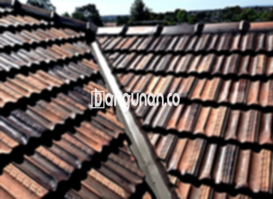

**Jual Genteng Kermaik & Beton di Cikoko Jakarta** – Genteng merupakan material konstruksi vital bagi setiap hunian yang seharusnya dimiliki oleh setiap pemilik properti. Komponen ini berfungsi melindungi bangunan dari berbagai elemen cuaca seperti hujan deras, sengatan matahari terik, dan kondisi ekstrem lainnya. Dengan genteng yang berkualitas, Anda dapat menciptakan lingkungan tempat tinggal yang lebih aman, nyaman, dan terlindungi. Mitra Bangunan di Cikoko Jakarta siap melayani kebutuhan atap Anda dengan produk-produk terbaik.

Memilih jenis genteng yang ideal memerlukan pertimbangan matang. Ada banyak ragam genteng di pasaran, masing-masing memiliki karakteristik khas, kelebihan, dan kekurangannya sendiri. Selain itu, harga juga menjadi faktor penting yang perlu dipertimbangkan. Sebagai konsumen cerdas, Anda perlu menimbang semua aspek ini agar mendapatkan genteng yang sesuai dengan kebutuhan dan anggaran Anda.



## Update Harga Genteng dari Toko Jual Genteng Kermaik & Beton di Cikoko Jakarta

Beragam pilihan genteng tersedia untuk Anda gunakan dalam membangun atau merenovasi atap rumah. Setiap jenis genteng menawarkan keunggulan tertentu. Berikut ini adalah referensi harga genteng yang bisa Anda jadikan acuan saat berkunjung ke toko kami di Cikoko Jakarta:

### - Harga Genteng Metal di Toko Genteng Kermaik & Beton di Cikoko Jakarta

Genteng metal menjadi salah satu pilihan populer di kalangan masyarakat karena desainnya yang modern dan ringan. Sering digunakan pada rumah-rumah bergaya minimalis, tampilan elegan yang ditawarkannya menjadi daya tarik tersendiri. Untuk mengetahui harga genteng metal terbaru, Anda dapat melihatnya pada tabel harga di bawah ini atau langsung menghubungi tim kami.

### - Harga Genteng Aspal di Toko Genteng Kermaik & Beton di Cikoko Jakarta

Genteng aspal juga banyak digunakan karena terbuat dari serat kayu dan aspal berkualitas tinggi. Kombinasi material ini menjadikan genteng aspal tahan lama dan fleksibel. Selain itu, genteng aspal juga memiliki ketahanan terhadap api yang cukup baik. Informasi harga genteng aspal terkini dapat Anda temukan pada daftar harga yang tersedia.

### - Harga Genteng Kermaik & Beton di Cikoko Jakarta

Genteng keramik dan beton merupakan pilihan klasik yang banyak digunakan karena keawetan dan desainnya yang bervariasi. Dengan berbagai pilihan warna dan model, Anda dapat menemukan genteng keramik dan beton yang sesuai dengan gaya arsitektur rumah Anda. Harga genteng keramik dan beton di Cikoko Jakarta bisa Anda lihat pada tabel harga atau dengan menghubungi kami.

### - Harga Genteng Kaca di Toko Genteng Kermaik & Beton di Cikoko Jakarta

Genteng kaca sering digunakan sebagai elemen dekoratif untuk memberikan efek pencahayaan alami pada ruangan. Namun, perlu diingat bahwa penggunaan genteng kaca secara berlebihan dapat menyebabkan ruangan menjadi terlalu panas. Anda dapat menemukan informasi harga genteng kaca terbaru pada tabel harga yang tersedia.

### - Harga Genteng Seng di Toko Genteng Kermaik & Beton di Cikoko Jakarta

Genteng seng adalah pilihan ekonomis yang sering digunakan pada bangunan-bangunan tradisional. Ukurannya yang relatif panjang membuatnya lebih efisien dalam penggunaan material. Untuk pemasangan yang optimal, pastikan menggunakan paku berkualitas tinggi. Informasi harga genteng seng saat ini dapat Anda temukan pada tabel harga yang disediakan.

### - Harga Genteng Beton di Toko Genteng Kermaik & Beton di Cikoko Jakarta

Genteng beton terkenal karena kekuatannya dan terbuat dari campuran semen, pasir, dan air berkualitas tinggi. Banyak orang memilih genteng beton karena daya tahannya yang teruji dan kemampuannya menahan cuaca ekstrem. Harga genteng beton terkini dapat Anda lihat pada tabel harga.



## Ragam Jenis Genteng dari Toko Jual Genteng Kermaik & Beton di Cikoko Jakarta

Ada berbagai macam jenis genteng yang dapat Anda pilih untuk membangun atau merenovasi atap rumah Anda. Masing-masing jenis memiliki karakteristik unik yang perlu Anda pertimbangkan. Berikut adalah beberapa pilihan yang bisa Anda pelajari lebih lanjut:

### Genteng Keramik dari Toko Jual Genteng Kermaik & Beton di Cikoko Jakarta

Bagi Anda yang mencari genteng dengan tampilan klasik dan elegan, genteng keramik adalah pilihan yang tepat. Genteng ini tidak hanya memberikan keindahan pada rumah Anda, tetapi juga memberikan perlindungan optimal terhadap cuaca panas.

### Genteng Seng dan Genteng Kermaik & Beton di Cikoko Jakarta

Genteng seng, dengan bentuknya yang panjang, menawarkan solusi ekonomis untuk atap rumah Anda. Dengan pemasangan yang benar menggunakan paku yang kuat, genteng seng dapat memberikan perlindungan yang memadai.

### Genteng Asbes dan Genteng Kermaik & Beton di Cikoko Jakarta

Meskipun pernah populer di masa lalu, genteng asbes kini kurang direkomendasikan karena rentan terhadap kerusakan dan potensi risiko kesehatan. Ada baiknya Anda mempertimbangkan alternatif lain yang lebih tahan lama dan aman.

### Genteng Kanopi Baja Ringan dan Genteng Kermaik & Beton di Cikoko Jakarta

Genteng kanopi baja ringan menawarkan kombinasi antara kekuatan dan kelenturan. Dengan desain yang unik, genteng ini cocok untuk berbagai jenis atap dan memberikan tampilan modern.

### Genteng Sirap Kayu Ulin dan Genteng Kermaik & Beton di Cikoko Jakarta

Genteng sirap kayu ulin memberikan kesan alami dan tradisional pada rumah Anda. Terbuat dari kayu ulin berkualitas tinggi, genteng ini tahan lama dan memberikan perlindungan yang baik terhadap cuaca.

Anda dapat menemukan berbagai macam Genteng Kermaik & Beton di Cikoko Jakarta yang sesuai dengan kebutuhan dan preferensi Anda. Tentukan jumlah, material, dan jenis genteng yang Anda butuhkan, lalu konsultasikan dengan tim kami untuk mendapatkan rekomendasi terbaik. Mitra Bangunan yang sedang mencari solusi atap berkualitas di Cikoko Jakarta, jangan ragu untuk menghubungi kami melalui tombol WhatsApp atau Telepon yang tersedia di halaman ini. Kami siap membantu dan memberikan penawaran harga terbaik untuk Anda.

**Ref by:**  [Genteng Kermaik & Beton  Cikoko Jakarta](https://id.wikipedia.org/wiki/Genteng)