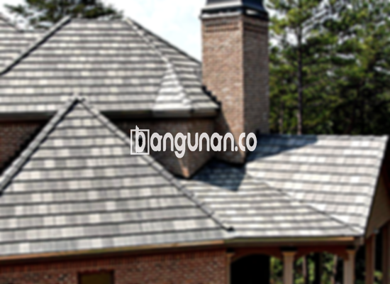

**Jual Genteng Kermaik & Beton di Cilamaya Karawang** – Membangun atau merenovasi atap rumah impian di Cilamaya Karawang? Mitra Bangunan menyediakan berbagai pilihan genteng berkualitas tinggi untuk melindungi hunian Anda dari segala cuaca. Genteng merupakan elemen krusial dalam konstruksi rumah, memastikan kenyamanan dan keamanan keluarga Anda dalam jangka waktu panjang.

Memilih material atap yang tepat adalah keputusan penting. Ada beragam jenis genteng yang tersedia, masing-masing memiliki karakteristik unik yang sesuai dengan kebutuhan dan preferensi Anda. Mempertimbangkan kualitas, daya tahan, dan estetika genteng akan memastikan investasi Anda memberikan manfaat optimal.



## Informasi Harga Genteng dari Toko Jual Genteng Kermaik & Beton di Cilamaya Karawang

Tentukan anggaran dan material apa yang paling sesuai dengan kebutuhan proyek bangunan Anda. Kami di sini untuk memberikan informasi harga yang jelas dan transparan mengenai berbagai jenis genteng yang tersedia. Perbandingan harga akan membantu Anda membuat keputusan terbaik.

### - Harga Genteng Metal di Toko Genteng Kermaik & Beton di Cilamaya Karawang

Genteng metal menjadi solusi modern dan populer bagi banyak pemilik rumah karena ringan, kuat, dan tahan terhadap korosi. Dengan desain yang minimalis dan elegan, genteng metal sangat cocok untuk rumah dengan gaya arsitektur modern. Untuk mengetahui informasi harga lebih lengkap, silakan merujuk ke tabel harga atau hubungi tim kami.

### - Harga Genteng Aspal di Toko Genteng Kermaik & Beton di Cilamaya Karawang

Genteng aspal menawarkan tampilan yang klasik dan mewah, memberikan sentuhan estetis pada rumah Anda. Terbuat dari serat kayu dan aspal berkualitas, genteng ini tahan terhadap cuaca ekstrem dan memberikan insulasi termal yang baik. Dapatkan detail harga genteng aspal terbaru melalui tabel harga atau dengan menghubungi kami.

### - Harga Genteng Keramik & Beton di Cilamaya Karawang

Genteng keramik dan beton adalah pilihan klasik yang telah lama digunakan di Indonesia. Keduanya menawarkan daya tahan yang tinggi, tahan terhadap api, dan tersedia dalam berbagai warna dan desain yang menarik. Anda dapat menelusuri pilihan warna dan tekstur untuk menemukan yang paling sesuai dengan gaya rumah Anda. Harga detail dapat Anda temukan dalam tabel harga yang tersedia.

### - Harga Genteng Kaca di Toko Genteng Kermaik & Beton di Cilamaya Karawang

Genteng kaca memberikan sentuhan unik dan modern, memungkinkan cahaya alami masuk ke dalam ruangan. Namun, perlu diingat bahwa genteng kaca dapat meningkatkan suhu ruangan, sehingga penggunaannya sebaiknya disesuaikan dengan iklim dan kebutuhan Anda. Informasi harga lengkap dapat dilihat pada tabel harga.

### - Harga Genteng Seng di Toko Genteng Kermaik & Beton di Cilamaya Karawang

Genteng seng merupakan pilihan ekonomis yang sering digunakan untuk bangunan dengan anggaran terbatas. Meskipun ringan dan terjangkau, pemasangan genteng seng memerlukan kehati-hatian untuk memastikan kekuatannya. Untuk harga terbaru, silakan lihat tabel harga kami.

### - Harga Genteng Beton di Toko Genteng Kermaik & Beton di Cilamaya Karawang

Genteng beton dikenal karena kekuatannya dan daya tahannya terhadap cuaca ekstrem. Terbuat dari campuran semen, pasir, dan air berkualitas tinggi, genteng beton adalah investasi jangka panjang yang cerdas. Jangan ragu untuk melihat tabel harga guna mendapatkan informasi detail.



## Ragam Pilihan Genteng dari Toko Jual Genteng Kermaik & Beton di Cilamaya Karawang

Kami menyediakan beragam pilihan genteng untuk memenuhi kebutuhan konstruksi bangunan Anda di Cilamaya Karawang. Anda dapat memilih dari berbagai jenis genteng, sesuai dengan gaya arsitektur dan anggaran proyek Anda.

### Genteng Keramik dari Toko Jual Genteng Kermaik & Beton di Cilamaya Karawang

Genteng keramik adalah pilihan ideal jika Anda menginginkan tampilan klasik dan indah. Dengan berbagai pilihan warna dan desain, Anda dapat menciptakan atap yang unik dan menawan. Keunggulan lain dari genteng keramik adalah kemampuannya dalam memberikan insulasi termal yang baik, menjaga rumah Anda tetap sejuk dan nyaman.

### Genteng Seng dan Genteng Kermaik & Beton di Cilamaya Karawang

Genteng seng adalah pilihan ekonomis yang populer untuk bangunan sederhana. Meskipun ringan dan terjangkau, pemasangan genteng seng yang tepat sangat penting untuk memastikan kekuatannya dan mencegah kebocoran. Pastikan Anda menggunakan paku berkualitas tinggi untuk pemasangan yang aman dan tahan lama.

### Genteng Asbes dan Genteng Kermaik & Beton di Cilamaya Karawang

Genteng asbes merupakan pilihan yang lebih tua dan kurang direkomendasikan saat ini karena pertimbangan kesehatan dan lingkungan. Material ini dapat mengeluarkan serat asbes yang berbahaya jika rusak atau terganggu.

### Genteng Kanopi Baja Ringan dan Genteng Kermaik & Beton di Cilamaya Karawang

Genteng kanopi baja ringan menawarkan kombinasi antara kekuatan, ringan, dan desain yang menarik. Material ini tahan terhadap karat dan memiliki umur pakai yang panjang. Anda dapat menemukan berbagai pilihan desain yang sesuai dengan gaya rumah Anda.

### Genteng Sirap Kayu Ulin dan Genteng Kermaik & Beton di Cilamaya Karawang

Genteng sirap kayu ulin memberikan tampilan alami dan elegan pada rumah Anda. Terbuat dari kayu ulin yang kuat dan tahan lama, genteng ini memberikan insulasi termal yang baik dan menciptakan suasana yang nyaman dan hangat.

Anda, sebagai Mitra Bangunan yang sedang merencanakan proyek di Cilamaya Karawang, dapat menemukan berbagai jenis genteng Kermaik & Beton yang sesuai dengan kebutuhan dan anggaran Anda. Hubungi kami sekarang juga untuk mendapatkan penawaran harga terbaik dan layanan konsultasi gratis.

**Ref by:**  [Genteng Kermaik & Beton  Cilamaya Karawang](https://id.wikipedia.org/wiki/Genteng)