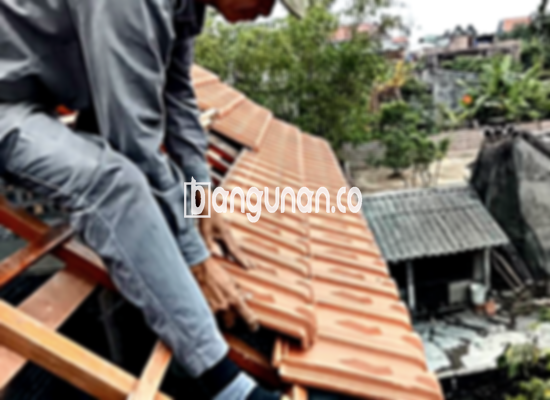

**Jual Genteng Kermaik & Beton di Cilendek Bogor** – Genteng merupakan salah satu material hunian yang sangat penting untuk dimiliki oleh setiap pemilik rumah. Perlindungan dari berbagai kondisi cuaca seperti hujan deras dan sengatan matahari yang terik menjadi fungsi utamanya. Mitra Bangunan di Cilendek Bogor hadir untuk menyediakan solusi atap yang kokoh dan tahan lama bagi Anda. Dengan genteng yang tepat, hunian Anda akan terlindungi dan nyaman.

Memilih jenis genteng yang sesuai adalah keputusan penting. Ada beragam pilihan yang tersedia, masing-masing menawarkan keunggulan dan estetika yang berbeda. Mempertimbangkan gaya arsitektur rumah, iklim di Cilendek Bogor, serta anggaran yang Anda miliki akan membantu Anda membuat keputusan yang tepat. Investasi pada genteng berkualitas adalah langkah bijak untuk jangka panjang.



## Harga Genteng dari Toko Jual Genteng Kermaik & Beton di Cilendek Bogor

Mencari tahu harga genteng adalah langkah awal yang penting sebelum Anda memutuskan untuk membeli. Kami di toko jual genteng keramik dan beton di Cilendek Bogor menyediakan berbagai pilihan dengan harga yang kompetitif. Berikut adalah gambaran umum mengenai harga beberapa jenis genteng yang tersedia. Untuk detail lebih lanjut dan penawaran khusus, silakan merujuk ke tabel harga yang disediakan atau langsung menghubungi tim kami.

### Harga Genteng Metal di Cilendek Bogor

Genteng metal sangat populer karena sifatnya yang ringan, kuat, dan tahan lama. Pilihan ini ideal untuk rumah dengan desain minimalis modern, memberikan tampilan yang bersih dan rapi. Berbagai pilihan warna dan profil tersedia untuk menyelaraskan dengan gaya rumah Anda.

### Harga Genteng Aspal di Cilendek Bogor

Genteng aspal menawarkan kombinasi estetika yang indah dan ketahanan terhadap cuaca. Terbuat dari serat kayu dan aspal, material ini memberikan isolasi termal yang baik dan tersedia dalam berbagai warna serta tekstur.

### Harga Genteng Keramik & Beton di Cilendek Bogor

Genteng keramik dan beton adalah pilihan yang telah teruji waktu, menawarkan daya tahan dan keindahan yang klasik. Tersedia dalam berbagai warna dan desain, kedua jenis genteng ini cocok untuk berbagai gaya arsitektur rumah Anda. Kekuatannya dalam menghadapi cuaca ekstrem menjadikannya pilihan yang tepat untuk iklim di Cilendek Bogor.

### Harga Genteng Kaca di Cilendek Bogor

Genteng kaca biasanya digunakan sebagai aksen dekoratif untuk memberikan pencahayaan alami yang unik ke dalam rumah Anda. Meskipun tidak digunakan sebagai material atap utama, genteng kaca dapat menjadi sentuhan yang menarik pada desain atap Anda.

### Harga Genteng Seng di Cilendek Bogor

Genteng seng adalah pilihan yang ekonomis dan sering digunakan untuk bangunan sederhana atau rumah dengan anggaran terbatas. Ringan dan mudah dipasang, jenis genteng ini memerlukan perawatan rutin untuk mencegah timbulnya karat.

### Harga Genteng Beton di Cilendek Bogor

Genteng beton menawarkan kekuatan dan ketahanan yang unggul, terbuat dari campuran semen, pasir, dan air berkualitas tinggi. Genteng ini sangat ideal untuk iklim Cilendek Bogor karena tahan terhadap hujan deras dan sengatan matahari yang intens. Berbagai pilihan warna dan bentuk tersedia untuk memenuhi preferensi Anda.



## Jenis-jenis Genteng dari Toko Jual Genteng Kermaik & Beton di Cilendek Bogor

Memahami berbagai jenis genteng yang tersedia akan membantu Anda membuat keputusan yang paling tepat untuk kebutuhan hunian Anda. Berikut adalah beberapa pilihan yang bisa Anda pertimbangkan:

### Genteng Keramik dari Toko Jual Genteng Kermaik & Beton di Cilendek Bogor

Genteng keramik merupakan pilihan yang populer karena tampilan elegan dan daya tahannya. Material ini sangat sesuai dengan gaya rumah tradisional atau klasik, dan akan memberikan sentuhan estetika yang menawan pada hunian Anda.

### Genteng Seng dan Genteng Kermaik & Beton di Cilendek Bogor

Genteng seng, meski sering diasosiasikan dengan bangunan lama, tetap menjadi pilihan yang ekonomis. Pastikan pemasangan dilakukan dengan benar dengan menggunakan paku yang berkualitas untuk memaksimalkan kekuatannya. 

### Genteng Asbes dan Genteng Kermaik & Beton di Cilendek Bogor

Meskipun dahulu banyak digunakan, genteng asbes kini kurang direkomendasikan karena potensi risiko kesehatan dan lingkungan. Kami sarankan untuk mempertimbangkan alternatif yang lebih aman dan berkelanjutan.

### Genteng Kanopi Baja Ringan dan Genteng Kermaik & Beton di Cilendek Bogor

Genteng kanopi baja ringan menawarkan kombinasi antara kekuatan, ringan, dan tampilan modern. Material ini sangat cocok untuk berbagai jenis atap dan tahan terhadap korosi serta cuaca ekstrem.

### Genteng Sirap Kayu Ulin dan Genteng Kermaik & Beton di Cilendek Bogor

Genteng sirap kayu ulin memberikan tampilan alami dan unik pada rumah Anda. Dengan daya tahan yang tinggi terhadap cuaca dan serangan hama, material ini merupakan pilihan yang ramah lingkungan dan estetis.

Anda dapat menemukan berbagai opsi genteng keramik dan beton di Cilendek Bogor yang sesuai dengan selera dan anggaran Anda. Jangan ragu untuk berkonsultasi dengan tim kami untuk mendapatkan rekomendasi terbaik. Mitra Bangunan siap membantu Anda mewujudkan atap impian untuk hunian Anda. Hubungi kami segera untuk mendapatkan penawaran harga terbaik.

**Ref by:**  [Genteng Kermaik & Beton  Cilendek Bogor](https://id.wikipedia.org/wiki/Genteng)