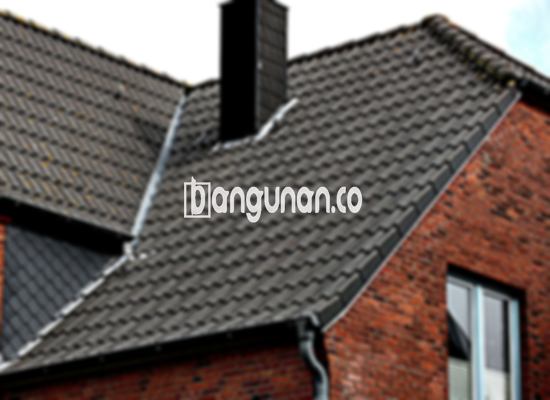

**Jual Genteng Kermaik & Beton di Cileunyi** – Genteng merupakan material hunian yang sangat penting yang wajib dimiliki setiap pemilik tempat tinggal. Bagi Mitra Bangunan di Cileunyi yang sedang mencari solusi atap terbaik, kami hadir untuk menyediakan berbagai pilihan genteng berkualitas tinggi. Genteng akan melindungi rumah Anda dari berbagai kondisi cuaca seperti hujan, panas terik matahari, dan masih banyak lagi. Kualitas genteng yang baik akan memberikan rasa aman dan nyaman bagi penghuni rumah.

Memilih genteng yang tepat adalah investasi jangka panjang bagi rumah Anda. Terdapat beragam jenis genteng yang tersedia di pasaran, masing-masing dengan kelebihan dan kekurangannya sendiri. Mempertimbangkan kebutuhan dan preferensi pribadi adalah kunci untuk menemukan genteng yang paling sesuai. Bagi banyak orang di Cileunyi, genteng berkualitas adalah prioritas utama karena daya tahan dan nilai estetika yang ditawarkannya.



## Harga Genteng Dari Toko Jual Genteng Kermaik & Beton di Cileunyi

Ada banyak sekali pilihan genteng yang dapat Anda pertimbangkan untuk proyek pembangunan atau renovasi rumah Anda. Setiap jenis genteng memiliki karakteristik dan rentang harga yang berbeda-beda. Berikut ini adalah tinjauan harga beberapa jenis genteng yang tersedia di toko kami di Cileunyi:

### - Harga Genteng Metal di Toko Genteng Kermaik & Beton di Cileunyi

Genteng metal merupakan pilihan yang sangat populer di kalangan banyak orang. Kekuatan, tampilan modern, dan harga yang relatif terjangkau menjadi keunggulan utama genteng metal. Jenis genteng ini sangat cocok untuk rumah dengan desain minimalis atau modern.

### - Harga Genteng Aspal di Toko Genteng Kermaik & Beton di Cileunyi

Genteng aspal dibuat dari kombinasi serat kayu dan aspal, menjadikannya material yang fleksibel dan tahan lama. Genteng aspal menawarkan perlindungan yang baik terhadap api dan cuaca ekstrem.

### - Harga Genteng Kermaik & Beton di Cileunyi

Genteng keramik dan beton adalah pilihan klasik yang menawarkan daya tahan dan estetika yang tinggi. Keduanya tersedia dalam berbagai warna, bentuk, dan ukuran untuk menyesuaikan dengan gaya arsitektur rumah Anda.

### - Harga Genteng Kaca di Toko Genteng Kermaik & Beton di Cileunyi

Genteng kaca seringkali digunakan sebagai aksen dekoratif untuk memberikan sentuhan unik pada atap rumah Anda. Penggunaannya biasanya terbatas pada area tertentu karena sifatnya yang dapat menghantarkan panas.

### - Harga Genteng Seng di Toko Genteng Kermaik & Beton di Cileunyi

Genteng seng merupakan pilihan yang ekonomis, sering digunakan pada bangunan tradisional atau sebagai solusi sementara. Ukurannya yang panjang membuatnya efisien dan mengurangi jumlah sambungan.

### - Harga Genteng Beton di Toko Genteng Kermaik & Beton di Cileunyi

Genteng beton dibuat dari campuran semen, pasir, dan air, menjadikannya material yang kuat, tahan lama, dan tahan terhadap cuaca ekstrem. Genteng beton adalah pilihan yang populer untuk berbagai jenis bangunan di Cileunyi.



## Beberapa Macam Genteng Dari Toko Jual Genteng Kermaik & Beton di Cileunyi

Berikut ini adalah daftar beberapa jenis genteng yang dapat Anda pilih untuk proyek pembangunan rumah Anda di Cileunyi:

### Genteng Keramik Dari Toko Jual Genteng Kermaik & Beton di Cileunyi

Genteng keramik adalah pilihan yang sangat populer di kalangan pemilik rumah. Anda akan menemukan bahwa genteng keramik memberikan tampilan yang indah dan perlindungan yang andal terhadap cuaca. Keindahan dan daya tahannya menjadikan genteng keramik sebagai investasi yang cerdas.

### Genteng Seng dan Genteng Kermaik & Beton di Cileunyi

Genteng seng merupakan pilihan ekonomis yang sering digunakan pada bangunan tradisional. Ukurannya yang panjang membuatnya hemat biaya, namun perlu dipasang dengan paku yang kuat untuk memastikan keawetannya.

### Genteng Asbes dan Genteng Kermaik & Beton di Cileunyi

Genteng asbes merupakan pilihan yang kurang direkomendasikan karena materialnya yang rentan terhadap kerusakan dan potensi risiko kesehatan. Pertimbangkan alternatif yang lebih tahan lama dan aman.

### Genteng Kanopi Baja Ringan dan Genteng Kermaik & Beton di Cileunyi

Genteng kanopi baja ringan menawarkan kombinasi antara kekuatan, ringan, dan fleksibilitas. Genteng ini mudah dipasang dan tersedia dalam berbagai desain yang menarik.

### Genteng Sirap Kayu Ulin dan Genteng Kermaik & Beton di Cileunyi

Genteng sirap kayu ulin adalah pilihan yang unik dan alami, terbuat dari kayu ulin berkualitas tinggi. Genteng ini memberikan tampilan yang hangat dan tradisional pada rumah Anda.

Sebagai Mitra Bangunan yang bijak, Anda dapat memilih jenis Genteng Kermaik & Beton di Cileunyi yang paling sesuai dengan anggaran dan preferensi Anda. Jangan ragu untuk menghubungi kami untuk konsultasi dan penawaran harga terbaik. Hubungi kami melalui tombol WhatsApp atau Telepon di halaman ini untuk informasi lebih lanjut.

**Ref by:**  [Genteng Kermaik & Beton  Cileunyi](https://id.wikipedia.org/wiki/Genteng)