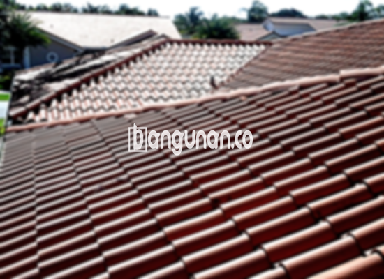

**Jual Genteng Kermaik & Beton di Cimahi** – Membangun atau merenovasi rumah di Cimahi membutuhkan material berkualitas, dan genteng adalah salah satu yang paling krusial. Genteng melindungi hunian Anda dari cuaca ekstrem seperti hujan dan panas matahari, serta meningkatkan keamanan dan kenyamanan tempat tinggal. Bagi Mitra Bangunan yang mencari solusi atap yang tepat di Cimahi, kami hadir sebagai penyedia genteng terpercaya dengan pilihan lengkap dan harga kompetitif.

Memilih genteng yang tepat membutuhkan pertimbangan matang. Terdapat beragam jenis genteng dengan karakteristik dan harga yang berbeda. Kami memahami bahwa setiap pemilik rumah di Cimahi memiliki preferensi dan kebutuhan yang unik. Oleh karena itu, kami menyediakan berbagai pilihan genteng berkualitas untuk memenuhi semua kebutuhan Anda.



## Harga Genteng dari Toko Jual Genteng Kermaik & Beton di Cimahi

Ada banyak sekali pilihan jenis genteng yang bisa Anda pertimbangkan untuk hunian Anda. Setiap jenis memiliki keunggulan dan kekurangan masing-masing. Berikut adalah gambaran harga beberapa jenis genteng sebagai acuan:

### - Harga Genteng Metal di Toko Genteng Kermaik & Beton di Cimahi

Genteng metal sangat populer karena tampilannya yang modern dan elegan. Sering digunakan untuk rumah minimalis, material ini menawarkan daya tahan yang baik dan kemudahan pemasangan. Untuk mengetahui detail harga genteng metal, silakan lihat tabel harga di bawah ini.

### - Harga Genteng Aspal di Toko Genteng Kermaik & Beton di Cimahi

Genteng aspal menawarkan tampilan yang menarik dan nuansa klasik. Terbuat dari serat kayu dan aspal, material ini dikenal dengan ketahanannya terhadap api dan cuaca ekstrem. Anda dapat menemukan informasi lebih lanjut mengenai harga genteng aspal pada daftar harga kami.

### - Harga Genteng Kermaik & Beton di Cimahi

Genteng keramik dan beton merupakan pilihan klasik yang tetap populer hingga saat ini. Keunggulannya terletak pada keindahan estetika dan ketahanannya terhadap berbagai kondisi cuaca. Agar Anda dapat menemukan varian yang sesuai, kami menyediakan beragam warna dan desain genteng keramik dan beton. Dapatkan informasi harga terbaru melalui tabel harga atau hubungi tim kami.

### - Harga Genteng Kaca di Toko Genteng Kermaik & Beton di Cimahi

Genteng kaca sering digunakan sebagai aksen untuk memberikan pencahayaan alami pada ruangan. Material ini ideal untuk area tertentu yang membutuhkan cahaya tambahan, namun perlu diingat bahwa penggunaannya secara berlebihan dapat meningkatkan suhu ruangan. Untuk informasi harga genteng kaca, silakan merujuk pada daftar harga atau hubungi kami langsung.

### - Harga Genteng Seng di Toko Genteng Kermaik & Beton di Cimahi

Genteng seng merupakan pilihan ekonomis yang sering ditemukan pada bangunan-bangunan yang lebih tua. Ukurannya yang panjang membuat pemasangan lebih efisien. Untuk Anda yang mencari solusi atap yang terjangkau di Cimahi, genteng seng bisa menjadi pilihan yang baik. Detail harga dapat dilihat pada tabel harga kami.

### - Harga Genteng Beton di Toko Genteng Kermaik & Beton di Cimahi

Genteng beton dikenal karena kekuatannya dan ketahanannya terhadap cuaca. Terbuat dari campuran semen, pasir, dan air, material ini ideal untuk bangunan yang membutuhkan perlindungan maksimal. Dapatkan penawaran harga terbaik untuk genteng beton berkualitas di Cimahi dengan menghubungi tim kami.



## Beberapa Variasi Genteng dari Toko Jual Genteng Kermaik & Beton di Cimahi

Berikut adalah beberapa variasi genteng yang dapat Anda gunakan untuk bangunan Anda:

### Genteng Keramik dari Toko Jual Genteng Kermaik & Beton di Cimahi

Genteng keramik adalah pilihan yang tepat bagi Anda yang menginginkan atap yang indah dan tahan lama. Selain memberikan estetika yang menarik, genteng keramik juga melindungi rumah Anda dari panas matahari dan hujan. Anda akan mendapatkan hunian yang nyaman dan terlindungi dengan material ini.

### Genteng Seng dan Genteng Kermaik & Beton di Cimahi

Genteng seng, meskipun sering digunakan pada bangunan lama, tetap menjadi pilihan populer karena harganya yang terjangkau. Dengan ukuran yang panjang, pemasangan genteng seng cukup efisien. Pastikan untuk menggunakan paku yang kuat agar genteng terpasang dengan aman.

### Genteng Asbes dan Genteng Kermaik & Beton di Cimahi

Genteng asbes merupakan salah satu jenis genteng yang umum digunakan di masa lalu. Namun, karena material ini cenderung rapuh dan kurang tahan lama, kami menyarankan untuk mempertimbangkan opsi lain yang lebih awet dan berkualitas.

### Genteng Kanopi Baja Ringan dan Genteng Kermaik & Beton di Cimahi

Genteng kanopi baja ringan menawarkan kombinasi antara kekuatan, fleksibilitas, dan estetika yang menarik. Material ini sangat cocok untuk berbagai jenis atap dan memberikan tampilan yang modern dan stylish. Anda bisa mendapatkan detail tentang genteng ini di daftar harga kami.

### Genteng Sirap Kayu Ulin dan Genteng Kermaik & Beton di Cimahi

Genteng sirap kayu ulin memberikan kesan alami dan tradisional pada rumah Anda. Terbuat dari kayu ulin berkualitas, material ini dikenal karena ketahanannya terhadap cuaca dan serangan hama. Jika Anda mencari tampilan yang unik dan menarik, genteng sirap kayu ulin bisa menjadi pilihan yang tepat.

Anda dapat memilih jenis genteng yang sesuai dengan kebutuhan dan anggaran Anda. Kami siap membantu Anda dalam memilih genteng yang tepat untuk menciptakan atap yang kuat, indah, dan tahan lama untuk rumah Anda di Cimahi. Untuk penawaran harga terbaik dan informasi lebih lanjut, jangan ragu untuk menghubungi kami.

**Ref by:**  [Genteng Kermaik & Beton  Cimahi](https://id.wikipedia.org/wiki/Genteng)

Mitra Bangunan yang sedang mencari genteng berkualitas di Cimahi, hubungi kami lewat tombol WhatsApp atau Telepon di halaman ini. Kami siap memberikan pelayanan terbaik dan memastikan kepuasan Anda.