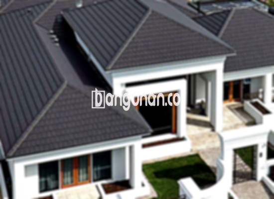

**Jual Genteng Kermaik & Beton di Cimanggis Depok** – Genteng merupakan komponen penting dalam setiap pembangunan hunian. Melindungi rumah Anda dari cuaca ekstrem, seperti hujan deras dan sengatan matahari, genteng juga memberikan kontribusi signifikan terhadap keamanan dan kenyamanan tempat tinggal Anda. Bagi Mitra Bangunan di Cimanggis Depok yang sedang merencanakan pembangunan atau renovasi, kami menyediakan beragam pilihan genteng berkualitas dengan harga terjangkau.

Memilih genteng yang tepat untuk proyek Anda memerlukan pertimbangan yang matang. Berbagai jenis genteng tersedia di pasaran, masing-masing dengan keunggulan dan kekurangan tersendiri. Tentu saja, preferensi estetika pribadi juga memegang peranan penting dalam pengambilan keputusan. Karena rumah adalah investasi jangka panjang, pemilihan genteng berkualitas adalah hal yang sangat penting.



## Informasi Harga Genteng dari Toko Jual Genteng Kermaik & Beton di Cimanggis Depok

Ada banyak sekali opsi jenis genteng yang bisa Anda gunakan untuk proyek Anda. Setiap jenis tentu saja memiliki karakteristik dan kelebihan masing-masing. Berikut ini adalah beberapa rentang harga genteng yang dapat Anda jadikan sebagai referensi saat memilih bahan atap:

### \- Harga Genteng Metal di Toko Genteng Kermaik & Beton di Cimanggis Depok

Genteng metal adalah salah satu jenis genteng yang sangat populer di kalangan pemilik rumah modern. Tampilan yang ringkas dan kekinian menjadikan genteng metal pilihan yang banyak diminati untuk hunian bergaya minimalis. Genteng ini dikenal dengan ketahanannya dan kemudahan pemasangannya.

### \- Harga Genteng Aspal di Toko Genteng Kermaik & Beton di Cimanggis Depok

Genteng aspal, yang terbuat dari serat kayu dan material aspal berkualitas tinggi, menawarkan fleksibilitas dan daya tahan yang baik. Material ini juga memiliki sifat tahan api, menjadikan genteng aspal sebagai pilihan yang aman untuk atap rumah Anda.

### \- Harga Genteng Kermaik & Beton di Cimanggis Depok

Genteng keramik adalah pilihan klasik dan populer yang selalu digemari oleh banyak orang. Keunggulannya terletak pada variasi warna dan desain yang tak terbatas, memungkinkan Anda menciptakan tampilan atap yang unik dan sesuai dengan selera Anda.

### \- Harga Genteng Kaca di Toko Genteng Kermaik & Beton di Cimanggis Depok

Genteng kaca biasanya digunakan sebagai elemen dekoratif atau untuk memberikan pencahayaan alami pada ruangan. Meskipun tidak disarankan untuk digunakan sebagai material atap utama karena dapat menyebabkan ruangan menjadi panas, genteng kaca dapat mempercantik tampilan rumah Anda secara keseluruhan.

### \- Harga Genteng Seng di Toko Genteng Kermaik & Beton di Cimanggis Depok

Genteng seng adalah pilihan ekonomis yang sering digunakan pada bangunan-bangunan lama. Ukurannya yang panjang menjadikannya solusi hemat biaya, namun memerlukan pemasangan yang tepat dengan paku agar tetap kokoh.

### \- Harga Genteng Beton di Toko Genteng Kermaik & Beton di Cimanggis Depok

Genteng beton, yang terbuat dari campuran semen, pasir, dan air, terkenal dengan kekuatan dan ketahanannya. Material ini sangat cocok untuk Anda yang menginginkan atap yang kokoh dan tahan lama.



## Berbagai Pilihan Jenis Genteng dari Toko Jual Genteng Kermaik & Beton di Cimanggis Depok

Berikut adalah beberapa jenis genteng yang dapat Anda pilih untuk membangun atau merenovasi atap rumah Anda:

### Genteng Keramik dari Toko Jual Genteng Kermaik & Beton di Cimanggis Depok

Genteng keramik adalah opsi yang sangat ideal bagi Anda yang menginginkan tampilan atap yang elegan dan tahan lama. Dengan warnanya yang menarik dan kemampuannya menjaga rumah tetap sejuk, genteng keramik adalah pilihan tepat untuk iklim tropis seperti di Indonesia.

### Genteng Seng dan Genteng Kermaik & Beton di Cimanggis Depok

Genteng seng, yang sering ditemukan pada bangunan-bangunan tradisional, menawarkan solusi hemat biaya tanpa mengorbankan fungsi utamanya sebagai pelindung atap. Pastikan Anda menggunakan paku yang berkualitas untuk memastikan kekokohan pemasangan genteng seng.

### Genteng Asbes dan Genteng Kermaik & Beton di Cimanggis Depok

Meskipun pernah populer di masa lalu, genteng asbes kini kurang direkomendasikan karena bahannya yang mudah rusak dan kurang ramah lingkungan. Pertimbangkan alternatif lain yang lebih berkualitas dan berkelanjutan.

### Genteng Kanopi Baja Ringan dan Genteng Kermaik & Beton di Cimanggis Depok

Genteng kanopi baja ringan menawarkan kombinasi unik antara kekuatan, fleksibilitas, dan desain modern. Material ini ringan dan mudah dipasang, menjadikannya pilihan ideal untuk berbagai jenis bangunan.

### Genteng Sirap Kayu Ulin dan Genteng Kermaik & Beton di Cimanggis Depok

Genteng sirap kayu ulin, terbuat dari kayu ulin yang tahan lama dan kokoh, dapat memberikan tampilan alami dan tradisional pada rumah Anda. Material ini juga memiliki sifat insulasi yang baik, membantu menjaga suhu ruangan tetap nyaman.

Anda dapat menemukan berbagai jenis Genteng Kermaik & Beton di Cimanggis Depok yang sesuai dengan kebutuhan dan anggaran Anda. Jangan ragu untuk berkonsultasi dengan tim ahli kami untuk mendapatkan rekomendasi terbaik. Mitra Bangunan yang sedang mencari solusi atap berkualitas di Cimanggis Depok, hubungi kami sekarang juga melalui tombol WhatsApp atau Telepon yang tersedia di halaman ini untuk mendapatkan penawaran harga terbaik dan pelayanan yang memuaskan.

**Ref by:**  [Genteng Kermaik & Beton  Cimanggis Depok](https://id.wikipedia.org/wiki/Genteng)