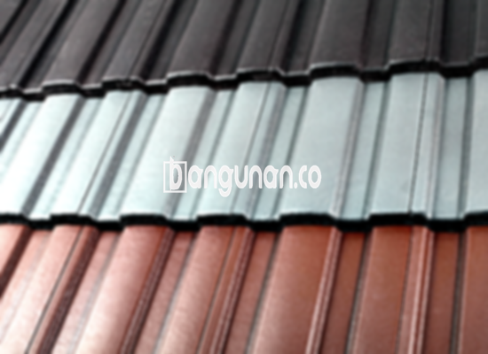

**Jual Genteng Kermaik & Beton di Cimpaeun Depok** – Genteng merupakan bagian material tempat tinggal yang sangat penting wajib dimiliki setiap pengguna hunian. Melindungi rumah dari hujan, panas terik matahari, dan berbagai kondisi cuaca ekstrem, genteng juga berperan vital dalam menciptakan kenyamanan dan keamanan. Bagi Mitra Bangunan di Cimpaeun Depok, kami hadir sebagai solusi terlengkap untuk kebutuhan atap rumah Anda.

Memilih genteng yang tepat adalah investasi jangka panjang untuk hunian Anda. Ada begitu banyak jenis genteng yang tersedia di pasaran, masing-masing dengan kelebihan dan kekurangannya sendiri. Setiap orang memiliki preferensi masing-masing terkait jenis genteng yang akan digunakan. Pertimbangkan dengan matang jenis genteng yang paling sesuai dengan gaya arsitektur rumah Anda dan anggaran yang tersedia.



## Informasi Harga Genteng dari Toko Jual Genteng Kermaik & Beton di Cimpaeun Depok

Berbagai variasi genteng tersedia di toko kami, memungkinkan Anda menemukan opsi yang paling sesuai dengan kebutuhan Anda. Setiap jenis genteng menawarkan nilai unik, dan memahami perbedaan harga akan membantu Anda membuat keputusan yang tepat. Berikut adalah gambaran harga beberapa jenis genteng yang kami sediakan sebagai acuan:

### - Harga Genteng Metal di Toko Genteng Kermaik & Beton di Cimpaeun Depok

Genteng metal adalah pilihan populer karena kekuatannya dan tampilan modern yang ditawarkannya. Banyak orang memilih genteng metal untuk rumah bergaya minimalis karena kesan elegan dan tahan lama yang diberikannya. Anda dapat menemukan berbagai pilihan genteng metal berkualitas tinggi di toko kami. Harga genteng metal saat ini adalah Rp. 26.000 per buah.

### - Harga Genteng Aspal di Toko Genteng Kermaik & Beton di Cimpaeun Depok

Genteng aspal menawarkan kombinasi daya tahan dan estetika yang menarik. Terbuat dari serat kayu dan aspal, genteng ini memberikan perlindungan yang andal terhadap cuaca ekstrem. Sifatnya yang fleksibel dan tahan api menjadikannya pilihan yang aman dan nyaman. Harga genteng aspal terbaru adalah Rp.125.000 per m.

### - Harga Genteng Kermaik & Beton di Cimpaeun Depok

Genteng keramik adalah pilihan klasik yang memberikan sentuhan tradisional pada rumah Anda. Dengan berbagai pilihan warna dan desain, Anda dapat menciptakan tampilan atap yang unik dan menarik. Genteng keramik kami menawarkan kualitas terbaik dan keindahan yang tahan lama. Harga genteng keramik saat ini adalah Rp. 9.800 per buah.

### - Harga Genteng Kaca di Toko Genteng Kermaik & Beton di Cimpaeun Depok

Genteng kaca adalah pilihan unik yang sering digunakan sebagai aksen pada area tertentu dari atap rumah. Penggunaannya terbatas karena dapat meningkatkan suhu ruangan. Namun, genteng kaca dapat memberikan pencahayaan alami yang indah ke dalam ruangan. Harga genteng kaca terbaru adalah Rp. 8.800 per pcs.

### - Harga Genteng Seng di Toko Genteng Kermaik & Beton di Cimpaeun Depok

Genteng seng adalah pilihan ekonomis yang sering digunakan pada bangunan-bangunan lama. Ukurannya yang panjang memungkinkan pemasangan yang lebih efisien dan hemat biaya. Pastikan untuk menggunakan paku yang kuat agar pemasangan genteng seng lebih stabil dan tahan lama. Harga genteng seng saat ini adalah Rp. 39.000 per buah.

### - Harga Genteng Beton di Toko Genteng Kermaik & Beton di Cimpaeun Depok

Genteng beton terbuat dari campuran semen, pasir, dan air, menjadikannya pilihan yang kokoh dan tahan lama. Material berkualitas tinggi yang digunakan dalam pembuatan genteng beton memastikan kekuatan dan keawetannya. Banyak orang memilih genteng beton karena ketahanannya terhadap cuaca ekstrim. Harga genteng beton sekarang adalah Rp. 5.800 per buah.



## Beberapa Varian Genteng dari Toko Jual Genteng Kermaik & Beton di Cimpaeun Depok

Berikut ini adalah beberapa variasi genteng yang dapat Anda pilih untuk proyek pembangunan rumah Anda di Cimpaeun Depok:

### Genteng Keramik dari Toko Jual Genteng Kermaik & Beton di Cimpaeun Depok

Apabila Anda sedang mencari genteng dengan tampilan yang elegan dan tahan lama, genteng keramik menjadi pilihan yang tepat untuk Anda. Genteng keramik akan meningkatkan kenyamanan dan keindahan hunian Anda. Selain melindungi dari panas matahari, genteng keramik juga memberikan estetika yang menarik pada rumah Anda.

### Genteng Seng dan Genteng Kermaik & Beton di Cimpaeun Depok

Genteng seng merupakan pilihan ekonomis yang ideal bagi Anda yang memiliki anggaran terbatas. Ukurannya yang panjang membantu menghemat biaya pemasangan. Pastikan Anda menggunakan paku yang kuat untuk memasang genteng seng agar lebih aman dan tahan lama.

### Genteng Asbes dan Genteng Kermaik & Beton di Cimpaeun Depok

Salah satu jenis genteng yang banyak digunakan adalah genteng asbes. Namun, perlu diingat bahwa bahan genteng asbes relatif mudah rusak, jadi Anda perlu berhati-hati dalam pemeliharaannya.

### Genteng Kanopi Baja Ringan dan Genteng Kermaik & Beton di Cimpaeun Depok

Genteng kanopi baja ringan menawarkan kombinasi kekuatan, fleksibilitas, dan desain modern. Dengan berbagai pilihan desain yang tersedia, Anda dapat menemukan genteng kanopi baja ringan yang sempurna untuk melengkapi gaya rumah Anda.

### Genteng Sirap Kayu Ulin dan Genteng Kermaik & Beton di Cimpaeun Depok

Genteng sirap kayu ulin adalah pilihan alami dan ramah lingkungan yang terbuat dari kayu ulin berkualitas tinggi. Harganya relatif terjangkau dan memberikan kenyamanan alami pada rumah Anda.

Anda dapat membeli berbagai macam jenis Genteng Kermaik & Beton di Cimpaeun Depok yang sesuai dengan kebutuhan dan preferensi Anda. Tentukan jumlah yang diperlukan, material yang diinginkan, dan jenis genteng yang Anda pilih. Mitra Bangunan siap membantu Anda mendapatkan penawaran harga terbaik dan pengiriman cepat. Hubungi kami sekarang juga untuk konsultasi lebih lanjut.

**Ref by:**  [Genteng Kermaik & Beton  Cimpaeun Depok](https://id.wikipedia.org/wiki/Genteng)