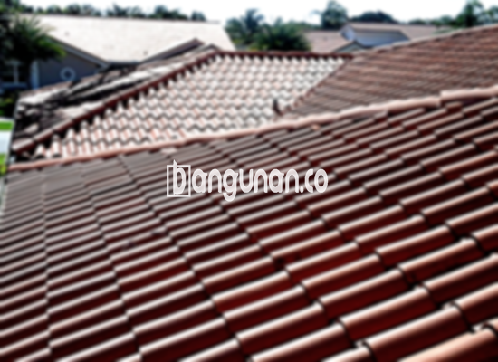

**Jual Genteng Kermaik & Beton di Cinere Depok** – Genteng merupakan material hunian yang sangat penting untuk dimiliki setiap pemilik rumah. Material ini berperan penting dalam melindungi tempat tinggal Anda dari berbagai kondisi cuaca, seperti hujan deras, panas terik matahari, dan faktor eksternal lainnya. Dengan memilih genteng yang tepat, Anda dapat menciptakan lingkungan hunian yang lebih aman dan nyaman. Bagi Mitra Bangunan di Cinere Depok yang sedang mencari solusi atap berkualitas, kami hadir sebagai mitra terpercaya untuk menyediakan berbagai pilihan genteng yang sesuai dengan kebutuhan Anda.

Mempertimbangkan jenis genteng yang akan digunakan adalah langkah krusial dalam membangun atau merenovasi atap rumah. Terdapat beragam ragam genteng yang tersedia di pasaran, masing-masing dengan karakteristik dan keunggulannya tersendiri. Proses seleksi ini membutuhkan pemahaman tentang perbedaan antara masing-masing jenis, sehingga Anda dapat memilih yang paling sesuai dengan preferensi dan kebutuhan hunian Anda di Cinere Depok.



## Harga Genteng dari Toko Jual Genteng Kermaik & Beton di Cinere Depok

Memahami kisaran harga genteng yang tersedia di pasaran adalah hal penting sebelum Anda memutuskan untuk membeli. Setiap jenis genteng memiliki harga yang berbeda-beda, tergantung pada bahan dasar, kualitas, dan desainnya. Berikut adalah gambaran umum tentang harga beberapa jenis genteng yang dapat Anda pertimbangkan:

### - Harga Genteng Metal di Toko Genteng Kermaik & Beton di Cinere Depok

Genteng metal dikenal karena daya tahannya dan sering digunakan pada desain rumah modern minimalis. Estetika yang bersih dan ramping menjadi daya tarik utama bagi banyak orang. Material ini juga relatif ringan, sehingga memudahkan proses pemasangan. Untuk mendapatkan informasi harga yang lebih terperinci, Anda dapat merujuk pada tabel harga yang tersedia atau menghubungi tim kami.

### - Harga Genteng Aspal di Toko Genteng Kermaik & Beton di Cinere Depok

Genteng aspal merupakan pilihan populer karena terbuat dari serat kayu dan aspal berkualitas tinggi. Kombinasi material ini menghasilkan genteng yang kuat, fleksibel, dan tahan terhadap api. Banyak pemilik rumah memilih genteng aspal untuk memberikan sentuhan unik dan menarik pada atap hunian mereka. Informasi harga yang lebih lengkap dapat Anda temukan pada tabel harga atau melalui konsultasi dengan tim kami.

### - Harga Genteng Kermaik & Beton di Cinere Depok

Genteng keramik dan beton merupakan pilihan klasik yang banyak digunakan selama bertahun-tahun. Kedua jenis genteng ini menawarkan daya tahan yang baik dan tersedia dalam berbagai pilihan warna dan desain. Fleksibilitas dalam desain memungkinkan Anda untuk menciptakan tampilan atap yang sesuai dengan gaya arsitektur rumah Anda. Informasi harga terkini dapat Anda peroleh melalui tabel harga yang tersedia atau dengan menghubungi tim kami.

### - Harga Genteng Kaca di Toko Genteng Kermaik & Beton di Cinere Depok

Genteng kaca seringkali digunakan sebagai elemen dekoratif untuk memberikan sentuhan unik dan menarik pada atap rumah. Umumnya, genteng kaca tidak digunakan secara keseluruhan, melainkan sebagai aksen untuk menciptakan efek visual yang menarik. Untuk informasi harga yang lebih akurat, silakan merujuk pada tabel harga atau menghubungi tim kami.

### - Harga Genteng Seng di Toko Genteng Kermaik & Beton di Cinere Depok

Genteng seng sering ditemukan pada bangunan-bangunan lama karena harganya yang terjangkau dan kemudahan pemasangannya. Material ini memiliki ukuran yang relatif panjang, sehingga dapat menghemat biaya material secara keseluruhan. Untuk memastikan pemasangan yang kuat dan tahan lama, disarankan untuk menggunakan paku berkualitas tinggi. Informasi harga yang lebih detail dapat Anda temukan pada tabel harga atau dengan menghubungi tim kami.

### - Harga Genteng Beton di Toko Genteng Kermaik & Beton di Cinere Depok

Genteng beton terbuat dari campuran semen, pasir, dan air berkualitas tinggi, menjadikannya material yang sangat kuat dan tahan lama. Karena ketahanannya, genteng beton sering menjadi pilihan utama bagi banyak pemilik rumah. Anda dapat menemukan informasi harga terbaru pada tabel harga atau dengan menghubungi tim kami.



## Jenis-Jenis Genteng dari Toko Jual Genteng Kermaik & Beton di Cinere Depok

Ada berbagai jenis genteng yang tersedia, masing-masing menawarkan karakteristik unik untuk memenuhi kebutuhan hunian Anda seperti berikut ini:

### Genteng Keramik dari Toko Jual Genteng Kermaik & Beton di Cinere Depok

Bagi Anda yang mencari genteng dengan estetika klasik dan ketahanan yang baik, genteng keramik adalah pilihan yang sangat tepat. Material ini memberikan perlindungan optimal terhadap cuaca ekstrem dan dapat meningkatkan nilai estetika rumah Anda. Berbagai pilihan warna dan desain memungkinkan Anda untuk menemukan genteng yang sesuai dengan gaya arsitektur rumah Anda di Cinere Depok.

### Genteng Seng dan Genteng Kermaik & Beton di Cinere Depok

Genteng seng adalah pilihan ekonomis yang cocok bagi Anda yang mencari solusi terjangkau. Ukurannya yang panjang dapat membantu menghemat biaya material. Memastikan pemasangan yang kuat dengan menggunakan paku berkualitas tinggi akan meningkatkan daya tahannya.

### Genteng Asbes dan Genteng Kermaik & Beton di Cinere Depok

Genteng asbes merupakan pilihan yang kurang direkomendasikan karena kurang tahan lama dibandingkan jenis genteng lainnya. Material ini rentan terhadap kerusakan dan memerlukan penggantian secara berkala.

### Genteng Kanopi Baja Ringan dan Genteng Kermaik & Beton di Cinere Depok

Genteng kanopi baja ringan adalah pilihan modern yang menawarkan kekuatan, fleksibilitas, dan estetika yang menarik. Material ini tahan terhadap berbagai kondisi cuaca dan tersedia dalam berbagai desain yang sesuai dengan gaya rumah Anda.

### Genteng Sirap Kayu Ulin dan Genteng Kermaik & Beton di Cinere Depok

Genteng sirap kayu ulin terbuat dari kayu ulin berkualitas tinggi, memberikan tampilan alami dan estetis pada atap rumah Anda. Material ini relatif terjangkau dan dapat menciptakan suasana yang nyaman dan alami.

Anda dapat menemukan berbagai jenis Genteng Kermaik & Beton di Cinere Depok yang sesuai dengan preferensi Anda. Dengan memilih material yang tepat dan berkonsultasi dengan tim kami, Anda akan mendapatkan atap yang indah, kuat, dan tahan lama. Mitra Bangunan yang sedang mencari solusi atap terbaik di Cinere Depok, jangan ragu untuk menghubungi kami melalui tombol WhatsApp atau Telepon di halaman ini. Kami siap membantu Anda menemukan genteng yang sempurna untuk hunian Anda.

**Ref by:**  [Genteng Kermaik & Beton  Cinere Depok](https://id.wikipedia.org/wiki/Genteng)