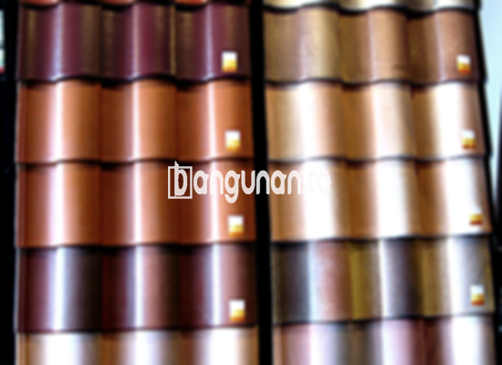

**Jual Genteng Kermaik & Beton di Ciomas** – Bagi Mitra Bangunan yang sedang merencanakan pembangunan atau renovasi atap rumah di Ciomas, pemilihan genteng yang tepat adalah investasi penting. Genteng tidak hanya berfungsi melindungi hunian dari segala cuaca, tetapi juga berperan dalam estetika bangunan. Kami menyediakan berbagai pilihan genteng berkualitas tinggi untuk memenuhi kebutuhan proyek Anda.

Memilih genteng yang ideal memerlukan pertimbangan matang. Ada beragam jenis genteng yang tersedia di pasaran, masing-masing dengan karakteristik, keunggulan, dan kekurangan tersendiri. Penyesuaian dengan gaya arsitektur rumah dan anggaran yang tersedia menjadi kunci utama. Hunian yang dilengkapi dengan genteng berkualitas tentu akan terasa lebih nyaman dan aman.



## Informasi Harga Genteng dari Toko Jual Genteng Kermaik & Beton di Ciomas

Kami menyediakan beragam variasi genteng dengan harga yang kompetitif. Berikut adalah perkiraan harga berbagai jenis genteng yang bisa Anda pertimbangkan:

### \- Harga Genteng Metal di Toko Genteng Kermaik & Beton di Ciomas

Genteng metal adalah pilihan populer karena ringan, kuat, dan mudah dipasang. Jenis ini sering digunakan pada bangunan dengan gaya minimalis, memberikan tampilan yang elegan dan modern. Untuk informasi harga yang lebih akurat, silakan lihat tabel harga di bawah ini atau hubungi tim kami.

### \- Harga Genteng Aspal di Toko Genteng Kermaik & Beton di Ciomas

Genteng aspal menawarkan tampilan yang menarik dan tahan lama. Terbuat dari serat kayu dan aspal, material ini memiliki ketahanan terhadap api dan cuaca ekstrem. Dapatkan informasi lengkap mengenai harga genteng aspal terkini melalui tabel harga atau dengan menghubungi kami.

### \- Harga Genteng Kermaik & Beton di Ciomas

Genteng keramik dan beton merupakan pilihan klasik yang tetap diminati hingga kini. Genteng keramik dikenal dengan variasi warna dan desain yang kaya, sementara genteng beton menawarkan kekuatan dan daya tahan yang superior. Anda dapat menemukan detail harga genteng keramik dan beton di area Ciomas pada tabel harga yang tersedia.

### \- Harga Genteng Kaca di Toko Genteng Kermaik & Beton di Ciomas

Genteng kaca sering digunakan sebagai aksen untuk memberikan pencahayaan alami pada ruangan. Karena tidak cocok untuk digunakan sebagai penutup atap secara menyeluruh, genteng ini biasanya dipasang dalam jumlah terbatas. Informasi harga genteng kaca bisa Anda temukan pada tabel harga di bawah.

### \- Harga Genteng Seng di Toko Genteng Kermaik & Beton di Ciomas

Genteng seng merupakan pilihan ekonomis yang sering digunakan pada bangunan tradisional atau sebagai solusi sementara. Meskipun ringan dan terjangkau, genteng seng memerlukan pemasangan yang tepat untuk memastikan kekuatan dan ketahanannya. Silakan cek detail harga genteng seng di tabel harga yang kami sediakan.

### \- Harga Genteng Beton di Toko Genteng Kermaik & Beton di Ciomas

Genteng beton menawarkan kombinasi ideal antara kekuatan, daya tahan, dan harga yang terjangkau. Terbuat dari campuran semen, pasir, dan air berkualitas tinggi, genteng beton mampu menahan beban dan kondisi cuaca ekstrem. Anda dapat menemukan harga terkini genteng beton di tabel harga atau dengan menghubungi tim kami.



## Beragam Pilihan Genteng dari Toko Jual Genteng Kermaik & Beton di Ciomas

Berikut adalah beberapa jenis genteng yang dapat Anda pilih untuk proyek pembangunan di Ciomas:

### Genteng Keramik dari Toko Jual Genteng Kermaik & Beton di Ciomas

Genteng keramik adalah pilihan yang sangat baik untuk Anda yang menginginkan tampilan rumah yang klasik dan elegan. Dengan berbagai pilihan warna dan desain, genteng ini dapat meningkatkan nilai estetika bangunan Anda secara signifikan. Selain itu, genteng keramik juga memberikan perlindungan optimal terhadap panas dan hujan.

### Genteng Seng dan Genteng Kermaik & Beton di Ciomas

Genteng seng, meskipun tergolong tradisional, masih menjadi pilihan populer karena harganya yang terjangkau. Ukurannya yang panjang memungkinkan pemasangan yang efisien dan hemat biaya. Pastikan untuk menggunakan paku berkualitas tinggi untuk memastikan ketahanan dan keamanan pemasangan.

### Genteng Asbes dan Genteng Kermaik & Beton di Ciomas

Genteng asbes merupakan pilihan yang ekonomis, namun memiliki beberapa kekurangan dalam hal kekuatan dan daya tahan. Karena rentan terhadap kerusakan, penggantian genteng asbes mungkin diperlukan lebih sering. 

### Genteng Kanopi Baja Ringan dan Genteng Kermaik & Beton di Ciomas

Genteng kanopi baja ringan menawarkan kombinasi antara kekuatan, ringan, dan ketahanan terhadap korosi. Dengan desain yang modern dan beragam pilihan warna, genteng ini cocok untuk berbagai gaya arsitektur.

### Genteng Sirap Kayu Ulin dan Genteng Kermaik & Beton di Ciomas

Genteng sirap kayu ulin memberikan tampilan alami dan unik pada bangunan Anda. Terbuat dari kayu ulin berkualitas tinggi, genteng ini tahan terhadap cuaca ekstrem dan memberikan insulasi yang baik. Pilihan yang menarik bagi Anda yang menginginkan desain rumah yang berbeda dan ramah lingkungan.

Anda dapat membeli berbagai jenis Genteng Kermaik & Beton di Ciomas yang sesuai dengan preferensi Anda. Tentukan jumlah, material, dan jenis genteng yang dibutuhkan, kemudian hubungi kami untuk mendapatkan penawaran harga terbaik. Tergantung pada kebutuhan Anda, kami akan membantu Anda menemukan solusi atap yang sempurna. Mitra Bangunan yang ingin mendapatkan informasi lebih lanjut, silakan hubungi kami melalui tombol WhatsApp atau Telepon yang tertera di halaman ini.

**Ref by:**  [Genteng Kermaik & Beton  Ciomas](https://id.wikipedia.org/wiki/Genteng)