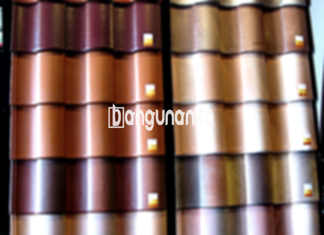

**Jual Genteng Kermaik & Beton di Ciparigi Bogor** – Bagi Mitra Bangunan di Ciparigi Bogor yang sedang mempertimbangkan pembangunan atau renovasi hunian, pemilihan material atap yang tepat menjadi investasi penting. Genteng merupakan elemen krusial dalam melindungi bangunan dari berbagai kondisi cuaca, sekaligus memberikan sentuhan estetika yang mempercantik tampilan rumah. Dengan memilih genteng berkualitas, Anda memastikan kenyamanan dan keamanan hunian dalam jangka waktu yang lama.

Investasi dalam material bangunan yang tepat membutuhkan perencanaan yang cermat. Ada begitu banyak opsi genteng yang tersedia, dengan kelebihan dan kekurangannya masing-masing. Pertimbangkan gaya arsitektur rumah, anggaran yang Anda miliki, serta fungsi yang Anda inginkan sebelum memutuskan jenis genteng yang akan digunakan.



## Informasi Harga Genteng dari Toko Jual Genteng Kermaik & Beton di Ciparigi Bogor

Terdapat beragam pilihan jenis genteng yang dapat Anda pilih untuk memenuhi kebutuhan konstruksi Anda. Masing-masing jenis memiliki karakteristik dan harga yang berbeda. Berikut adalah informasi mengenai harga beberapa jenis genteng yang populer dan sering dicari di Ciparigi Bogor:

### – Harga Genteng Metal di Toko Genteng Kermaik & Beton di Ciparigi Bogor

Genteng metal menjadi pilihan yang semakin populer karena sifatnya yang ringan, kuat, dan tahan lama. Material ini seringkali diaplikasikan pada bangunan dengan gaya minimalis dan modern, memberikan kesan elegan pada tampilan rumah. Untuk mendapatkan informasi lebih detail mengenai harga genteng metal, silakan hubungi tim penjualan kami.

### – Harga Genteng Aspal di Toko Genteng Kermaik & Beton di Ciparigi Bogor

Genteng aspal menawarkan tampilan yang unik dan menarik, terbuat dari kombinasi serat kayu dan aspal berkualitas tinggi. Selain estetika yang memukau, genteng aspal juga memiliki sifat fleksibel dan tahan terhadap api, menjadikannya pilihan yang aman dan terpercaya. Dapatkan informasi harga genteng aspal terkini dengan menghubungi kami.

### – Harga Genteng Kermaik & Beton di Ciparigi Bogor

Genteng keramik merupakan pilihan klasik yang selalu digemari karena keindahan dan ketahanannya. Dengan berbagai pilihan warna dan desain, Anda dapat menciptakan tampilan rumah yang sesuai dengan selera pribadi. Informasi harga genteng keramik terbaru tersedia di tabel harga kami.

### – Harga Genteng Kaca di Toko Genteng Kermaik & Beton di Ciparigi Bogor

Genteng kaca seringkali digunakan sebagai elemen dekoratif untuk memberikan pencahayaan alami pada ruangan. Pemasangan genteng kaca umumnya tidak mencakup seluruh area atap, karena dapat menyebabkan ruangan menjadi lebih panas. Untuk mengetahui harga genteng kaca, silakan menghubungi tim kami.

### – Harga Genteng Seng di Toko Genteng Kermaik & Beton di Ciparigi Bogor

Genteng seng adalah pilihan yang ekonomis, seringkali digunakan pada bangunan-bangunan lama atau proyek dengan anggaran terbatas. Meskipun terjangkau, genteng seng memerlukan perawatan rutin untuk mencegah korosi. Hubungi kami untuk mendapatkan informasi harga genteng seng terkini.

### – Harga Genteng Beton di Toko Genteng Kermaik & Beton di Ciparigi Bogor

Genteng beton terbuat dari campuran semen, pasir, dan air, menghasilkan material yang kuat dan tahan lama. Genteng beton merupakan pilihan ideal bagi Anda yang menginginkan atap yang kokoh dan mampu menahan berbagai kondisi cuaca ekstrem. Kami menyediakan daftar harga genteng beton yang lengkap dan terperinci.



## Beberapa Pilihan Macam Genteng dari Toko Jual Genteng Kermaik & Beton di Ciparigi Bogor

Di toko kami, Anda dapat menemukan berbagai macam genteng untuk memenuhi kebutuhan pembangunan rumah Anda di Ciparigi Bogor. Berikut adalah beberapa pilihan yang tersedia:

### Genteng Keramik dari Toko Jual Genteng Kermaik & Beton di Ciparigi Bogor

Genteng keramik menawarkan kombinasi keindahan dan daya tahan. Tersedia dalam berbagai bentuk, ukuran, dan warna, genteng keramik memungkinkan Anda menciptakan tampilan yang unik dan sesuai dengan gaya rumah Anda. Pilihan ini sangat tepat bagi Anda yang menginginkan hunian dengan karakter yang kuat.

### Genteng Seng dan Genteng Kermaik & Beton di Ciparigi Bogor

Genteng seng merupakan pilihan ekonomis yang sering digunakan pada bangunan dengan anggaran terbatas. Dengan bentuknya yang panjang, genteng seng dapat menghemat biaya pemasangan. Pastikan untuk menggunakan paku yang berkualitas tinggi untuk memastikan pemasangan yang kokoh dan tahan lama.

### Genteng Asbes dan Genteng Kermaik & Beton di Ciparigi Bogor

Genteng asbes adalah pilihan yang terjangkau, namun kurang tahan lama dibandingkan dengan jenis genteng lainnya. Material ini rentan terhadap kerusakan dan perlu diganti secara berkala. Anda perlu mempertimbangkan kelebihan dan kekurangan genteng asbes sebelum memutuskan untuk menggunakannya.

### Genteng Kanopi Baja Ringan dan Genteng Kermaik & Beton di Ciparigi Bogor

Genteng kanopi baja ringan menawarkan kombinasi antara kekuatan, ringan, dan tampilan yang modern. Material ini cocok untuk berbagai jenis atap dan memberikan perlindungan yang optimal terhadap cuaca ekstrem.

### Genteng Sirap Kayu Ulin dan Genteng Kermaik & Beton di Ciparigi Bogor

Genteng sirap kayu ulin memberikan tampilan alami dan unik pada rumah Anda. Terbuat dari kayu ulin yang berkualitas tinggi, genteng ini tahan terhadap cuaca dan hama. Pilihan ini sangat cocok bagi Anda yang menginginkan hunian dengan nuansa tradisional dan alami.

Mitra Bangunan yang sedang mencari genteng berkualitas di Ciparigi Bogor, jangan ragu untuk menghubungi kami melalui tombol WhatsApp atau Telepon di halaman ini. Kami siap memberikan konsultasi, penawaran harga terbaik, dan pelayanan yang memuaskan. Percayakan kebutuhan material bangunan Anda kepada kami, dan kami akan membantu Anda mewujudkan rumah impian Anda.

**Ref by:**  [Genteng Kermaik & Beton  Ciparigi Bogor](https://id.wikipedia.org/wiki/Genteng)