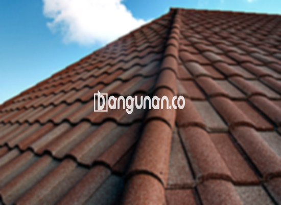

**Jual Genteng Kermaik & Beton di Cipete Jakarta** – Membangun atau merenovasi rumah di Cipete Jakarta membutuhkan material berkualitas, dan genteng adalah salah satu yang terpenting. Sebagai Mitra Bangunan, Anda membutuhkan perlindungan optimal dari cuaca, serta estetika yang sesuai dengan desain rumah Anda. Kami menyediakan berbagai pilihan genteng berkualitas untuk memenuhi kebutuhan proyek Anda.

Memilih genteng yang tepat sangat penting untuk kenyamanan dan keamanan hunian Anda. Ada banyak jenis genteng yang tersedia, masing-masing dengan keunggulan dan kekurangannya sendiri. Pertimbangkan kebutuhan spesifik rumah Anda dan preferensi pribadi Anda saat memilih jenis genteng yang paling sesuai. Banyak yang memilih genteng berkualitas karena investasi jangka panjang yang diberikannya.



## Informasi Harga Genteng dari Toko Jual Genteng Kermaik & Beton di Cipete Jakarta

Kami menyediakan beragam jenis genteng dengan harga yang kompetitif. Berikut adalah gambaran umum tentang kisaran harga beberapa jenis genteng yang tersedia di toko kami di Cipete Jakarta:

### Harga Genteng Metal di Toko Genteng Kermaik & Beton di Cipete Jakarta

Genteng metal adalah pilihan populer karena ketahanannya dan tampilannya yang modern. Jenis ini sering digunakan pada rumah bergaya minimalis. Tampilannya dapat meningkatkan estetika rumah Anda secara signifikan. Untuk informasi harga terbaru, silakan lihat tabel harga di bawah atau hubungi kami.

### Harga Genteng Aspal di Toko Genteng Kermaik & Beton di Cipete Jakarta

Genteng aspal terbuat dari serat kayu dan aspal, menawarkan kombinasi kekuatan dan fleksibilitas. Material ini cukup tahan api dan memberikan perlindungan yang baik terhadap cuaca ekstrem. Anda dapat menemukan detail harga genteng aspal di tabel harga kami.

### Harga Genteng Kermaik & Beton di Cipete Jakarta

Genteng keramik dikenal karena keindahan dan variasi warnanya. Pilihan warna yang unik dapat menambah karakter pada rumah Anda. Untuk mengetahui harga genteng keramik terbaru, silakan merujuk pada tabel harga yang tersedia.

### Harga Genteng Kaca di Toko Genteng Kermaik & Beton di Cipete Jakarta

Genteng kaca biasanya digunakan sebagai aksen untuk memberikan pencahayaan alami. Namun, karena sifatnya yang menghantarkan panas, genteng kaca tidak disarankan untuk digunakan sebagai penutup atap utama. Informasi harga genteng kaca dapat ditemukan di tabel harga.

### Harga Genteng Seng di Toko Genteng Kermaik & Beton di Cipete Jakarta

Genteng seng adalah pilihan ekonomis yang sering ditemukan pada rumah-rumah tradisional. Ukurannya yang lebih panjang dapat membantu menghemat biaya. Untuk memastikan pemasangan yang kuat, disarankan untuk menggunakan paku. Anda dapat melihat harga genteng seng terkini pada tabel harga.

### Harga Genteng Beton di Toko Genteng Kermaik & Beton di Cipete Jakarta

Genteng beton terbuat dari campuran semen, pasir, dan air, menjadikannya material yang kuat dan tahan lama. Banyak orang memilih genteng beton karena kualitas dan umur pakainya yang terjamin. Silakan lihat tabel harga untuk informasi lebih lanjut.



## Berbagai Jenis Genteng Tersedia di Toko Jual Genteng Kermaik & Beton di Cipete Jakarta

Berikut adalah beberapa jenis genteng yang dapat Anda pilih untuk bangunan Anda di Cipete Jakarta:

### Genteng Keramik dari Toko Jual Genteng Kermaik & Beton di Cipete Jakarta

Genteng keramik adalah pilihan yang sangat baik untuk rumah Anda. Anda akan merasakan manfaatnya dengan perlindungan dari panas matahari dan peningkatan estetika rumah.

### Genteng Seng dan Genteng Kermaik & Beton di Cipete Jakarta

Genteng seng, populer di masa lalu, memiliki ukuran yang lebih panjang dan ekonomis. Penggunaan paku penting untuk memastikan pemasangan yang kuat dan tahan lama.

### Genteng Asbes dan Genteng Kermaik & Beton di Cipete Jakarta

Meskipun dulunya banyak digunakan, genteng asbes kurang direkomendasikan karena rentan terhadap kerusakan. Bahan ini cenderung mudah rusak dan membutuhkan penggantian yang sering.

### Genteng Kanopi Baja Ringan dan Genteng Kermaik & Beton di Cipete Jakarta

Genteng kanopi baja ringan menawarkan kombinasi kekuatan, kelenturan, dan desain yang unik. Material ini cocok untuk berbagai jenis atap dan memberikan daya tahan yang baik.

### Genteng Sirap Kayu Ulin dan Genteng Kermaik & Beton di Cipete Jakarta

Genteng sirap kayu ulin terbuat dari kayu ulin yang kuat dan tahan lama. Harganya terjangkau dan dapat menciptakan suasana nyaman di rumah Anda.

Anda dapat memilih variasi Genteng Kermaik & Beton di Cipete Jakarta yang paling sesuai dengan kebutuhan Anda. Tentukan jumlah, material, dan tipe genteng yang Anda inginkan. Hubungi kami sekarang untuk mendapatkan penawaran harga terbaik. Sebagai Mitra Bangunan, kami berkomitmen untuk membantu Anda menemukan solusi atap yang sempurna.

**Ref by:**  [Genteng Kermaik & Beton  Cipete Jakarta](https://id.wikipedia.org/wiki/Genteng)