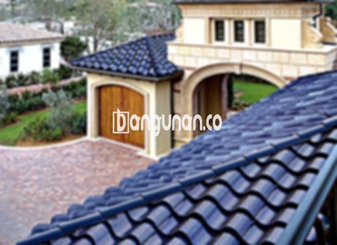

**Jual Genteng Kermaik & Beton di Cipeundeuy** – Genteng merupakan material vital bagi pembangunan sebuah rumah yang seharusnya dimiliki oleh setiap pemilik hunian. Memberikan perlindungan optimal terhadap kondisi cuaca seperti hujan lebat, sengatan matahari yang terik, serta berbagai faktor lingkungan lainnya, menjadi fungsi utama genteng. Dengan genteng berkualitas, hunian Anda akan terlindungi secara maksimal, Mitra Bangunan. Investasi pada genteng yang kokoh adalah kunci untuk kenyamanan dan keamanan jangka panjang.

Untuk membangun atap rumah yang ideal, pemilihan material genteng yang tepat menjadi pertimbangan penting. Banyak sekali tipe genteng yang bisa Anda pilih, masing-masing dengan karakteristik dan kegunaan yang berbeda. Memahami kelebihan dan kekurangan setiap jenis akan membantu Anda membuat keputusan yang paling sesuai dengan kebutuhan bangunan Anda.

## Harga Genteng dari Toko Jual Genteng Kermaik & Beton di Cipeundeuy

Toko kami di Cipeundeuy menyediakan beragam jenis genteng dengan harga yang kompetitif, cocok untuk berbagai anggaran proyek Anda. Mengetahui perkiraan biaya akan membantu Anda merencanakan anggaran pembangunan dengan lebih efektif. Berikut adalah gambaran harga beberapa jenis genteng yang tersedia, sebagai referensi awal.

### - Harga Genteng Metal di Toko Genteng Kermaik & Beton di Cipeundeuy

Genteng metal adalah opsi yang banyak dicari karena desainnya yang modern dan perawatannya yang relatif mudah. Banyak orang memilih genteng metal untuk proyek hunian minimalis mereka. Untuk informasi harga terperinci dan terkini mengenai genteng metal, silakan merujuk pada tabel harga produk kami atau hubungi tim layanan pelanggan.

### - Harga Genteng Aspal di Toko Genteng Kermaik & Beton di Cipeundeuy

Genteng aspal, dengan komposisi serat kayu dan material aspal, menawarkan kombinasi unik antara kekuatan dan fleksibilitas. Material ini juga dikenal akan ketahanannya terhadap api, menjadi nilai tambah dalam keamanan bangunan Anda. Informasi lebih lanjut mengenai harga genteng aspal terbaru dapat Anda temukan di .

### - Harga Genteng Kermaik & Beton di Cipeundeuy

Genteng keramik menawarkan pilihan warna dan desain yang kaya, memungkinkan Anda menciptakan atap rumah yang estetik dan sesuai dengan gaya arsitektur yang Anda inginkan. Selain keindahan visualnya, genteng keramik juga dikenal tahan lama dan memberikan kenyamanan termal. Silakan hubungi kami untuk mengetahui detail harga.

### - Harga Genteng Kaca di Toko Genteng Kermaik & Beton di Cipeundeuy

Genteng kaca seringkali diaplikasikan sebagai elemen dekoratif yang memberikan sentuhan unik dan pencahayaan alami pada bangunan Anda. Penting untuk mempertimbangkan bahwa penggunaan genteng kaca perlu disesuaikan dengan iklim dan kebutuhan pencahayaan. Untuk informasi harga, mohon hubungi kami.

### - Harga Genteng Seng di Toko Genteng Kermaik & Beton di Cipeundeuy

Genteng seng merupakan pilihan ekonomis yang populer untuk bangunan dengan anggaran terbatas. Ukurannya yang umumnya lebih panjang dapat membantu menghemat biaya pemasangan. Cek detail harga genteng seng terbaru di Cipeundeuy melalui kami.

### - Harga Genteng Beton di Toko Genteng Kermaik & Beton di Cipeundeuy

Genteng beton, terbuat dari campuran semen, pasir, dan air berkualitas tinggi, menawarkan kekuatan dan daya tahan yang luar biasa. Material ini merupakan investasi jangka panjang yang ideal untuk melindungi hunian Anda dari berbagai kondisi cuaca. Informasi lengkap mengenai harga genteng beton terbaru dapat Anda peroleh dengan menghubungi tim kami. 



## Beragam Pilihan Genteng dari Toko Jual Genteng Kermaik & Beton di Cipeundeuy

Kami menyediakan sejumlah pilihan genteng yang dapat Anda sesuaikan dengan gaya dan kebutuhan bangunan Anda. Berikut adalah beberapa variasi genteng yang tersedia di toko kami di Cipeundeuy.

### Genteng Keramik dari Toko Jual Genteng Kermaik & Beton di Cipeundeuy

Jika Anda mencari genteng yang memberikan kesan klasik dan elegan, genteng keramik adalah pilihan yang tepat. Tersedia dalam berbagai warna dan desain, genteng keramik dapat meningkatkan estetika hunian Anda. Selain itu, genteng keramik juga memberikan perlindungan yang baik terhadap panas dan hujan.

### Genteng Seng dan Genteng Kermaik & Beton di Cipeundeuy

Genteng seng bisa menjadi solusi ekonomis untuk proyek pembangunan Anda. Dengan ukuran yang lebih panjang, genteng seng dapat mengurangi biaya pemasangan secara keseluruhan. Anda dapat mengkalkulasi lebih lanjut potensi penghematan yang dapat Anda peroleh di Cipeundeuy.

### Genteng Asbes dan Genteng Kermaik & Beton di Cipeundeuy

Meskipun dulunya banyak digunakan, genteng asbes memiliki kekurangan dalam hal daya tahan dan dampak lingkungannya. Pertimbangkan alternatif yang lebih ramah lingkungan dan berkelanjutan untuk atap rumah Anda.

### Genteng Kanopi Baja Ringan dan Genteng Kermaik & Beton di Cipeundeuy

Genteng kanopi baja ringan adalah pilihan yang populer karena ringan, kuat, dan mudah dipasang. Material ini cocok untuk berbagai jenis bangunan dan memberikan tampilan modern.

### Genteng Sirap Kayu Ulin dan Genteng Kermaik & Beton di Cipeundeuy

Genteng sirap kayu ulin memberikan tampilan alami dan unik pada bangunan Anda. Terbuat dari kayu ulin berkualitas tinggi, genteng ini tahan terhadap cuaca ekstrem dan memberikan insulasi termal yang baik.

Anda dapat memperoleh berbagai jenis Genteng Kermaik & Beton di Cipeundeuy sesuai dengan preferensi dan anggaran Anda. Tentukan jumlah, bahan, dan model genteng yang Anda butuhkan, dan tim kami akan dengan senang hati membantu Anda mendapatkan penawaran terbaik. Mitra Bangunan selalu siap membantu Anda mewujudkan atap impian Anda. Hubungi kami sekarang juga melalui tombol WhatsApp atau Telepon yang tersedia di halaman ini.

**Ref by:**  [Genteng Kermaik & Beton  Cipeundeuy](https://id.wikipedia.org/wiki/Genteng)