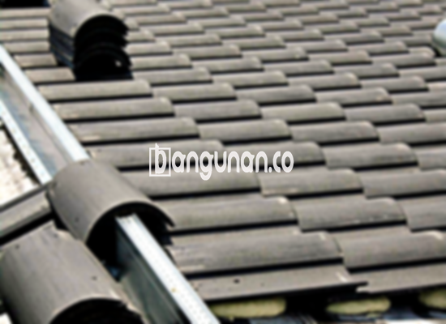

**Jual Genteng Kermaik & Beton di Cipinang Jakarta** – Genteng merupakan material bangunan yang sangat penting bagi setiap pemilik hunian di Cipinang Jakarta. Sebagai perlindungan utama dari berbagai kondisi cuaca seperti hujan deras dan sengatan matahari, genteng adalah investasi yang krusial untuk kenyamanan dan keamanan rumah Anda. Mitra Bangunan hadir sebagai solusi terpercaya dalam menyediakan beragam pilihan genteng berkualitas tinggi yang sesuai dengan kebutuhan dan anggaran Anda.

Memilih genteng yang tepat membutuhkan pertimbangan matang. Terdapat berbagai jenis genteng yang tersedia di pasaran, masing-masing dengan karakteristik dan kelebihan tersendiri. Penting bagi Anda untuk memahami perbedaan antara jenis-jenis genteng ini agar dapat membuat keputusan yang paling tepat untuk proyek bangunan Anda. Dengan memilih genteng yang berkualitas, Anda akan memastikan atap rumah Anda tahan lama dan memberikan perlindungan optimal.



## Informasi Harga Genteng dari Toko Jual Genteng Kermaik & Beton di Cipinang Jakarta

Kami menyediakan beragam pilihan genteng dengan berbagai rentang harga yang dapat Anda sesuaikan dengan anggaran proyek Anda. Memahami kisaran harga setiap jenis genteng akan membantu Anda dalam perencanaan anggaran dan memastikan Anda mendapatkan nilai terbaik untuk investasi Anda.  Berikut adalah informasi mengenai beberapa jenis genteng yang tersedia di toko kami:

### Harga Genteng Metal di Toko Genteng Kermaik & Beton di Cipinang Jakarta

Genteng metal merupakan salah satu pilihan populer karena kemudahan pemasangannya dan tampilan modern yang ditawarkannya.  Genteng ini sangat cocok untuk desain rumah minimalis dan memberikan kesan yang bersih serta rapi pada eksterior rumah Anda. Untuk detail harga, silakan merujuk ke tabel harga yang tersedia atau hubungi tim kami untuk mendapatkan penawaran khusus.

### Harga Genteng Aspal di Toko Genteng Kermaik & Beton di Cipinang Jakarta

Genteng aspal terbuat dari serat kayu dan aspal berkualitas tinggi, menawarkan ketahanan yang baik terhadap cuaca dan api. Material ini menjadi pilihan yang menarik bagi Anda yang menginginkan atap yang kuat dan tahan lama. Untuk mengetahui harga terbaru genteng aspal, silakan cek tabel harga atau hubungi kami langsung.

### Harga Genteng Kermaik & Beton di Cipinang Jakarta

Genteng keramik dan beton merupakan pilihan klasik yang tetap diminati karena keindahan dan ketahanannya.  Dengan berbagai pilihan warna dan tekstur, Anda dapat menciptakan tampilan atap yang unik dan sesuai dengan gaya arsitektur rumah Anda.  Informasi harga lebih lanjut dapat Anda temukan pada tabel harga yang kami sediakan.

### Harga Genteng Kaca di Toko Genteng Kermaik & Beton di Cipinang Jakarta

Genteng kaca, meskipun tidak digunakan sebagai penutup atap utama secara keseluruhan, dapat memberikan sentuhan estetika yang menarik dengan membiarkan cahaya alami masuk ke dalam ruangan. Namun, perlu diingat bahwa penggunaan genteng kaca secara berlebihan dapat meningkatkan suhu ruangan. Untuk detail harga, silakan periksa tabel harga.

### Harga Genteng Seng di Toko Genteng Kermaik & Beton di Cipinang Jakarta

Genteng seng adalah solusi ekonomis yang sering digunakan untuk bangunan-bangunan dengan anggaran terbatas. Ukurannya yang panjang memungkinkan pemasangan yang efisien dan hemat biaya. Pastikan untuk memasang genteng seng dengan paku yang kuat untuk ketahanan yang optimal. Dapatkan informasi harga terkini di tabel harga kami.

### Harga Genteng Beton di Toko Genteng Kermaik & Beton di Cipinang Jakarta

Genteng beton, terbuat dari campuran semen, pasir, dan air berkualitas tinggi, menawarkan kekuatan dan ketahanan yang luar biasa.  Pilihan ini sangat ideal bagi Anda yang mengutamakan keawetan dan kekuatan atap rumah Anda. Detail harga genteng beton tersedia di tabel harga kami.



## Beragam Jenis Genteng dari Toko Jual Genteng Kermaik & Beton di Cipinang Jakarta

Kami menyediakan berbagai pilihan jenis genteng untuk memenuhi kebutuhan dan preferensi Anda.  Setiap jenis genteng memiliki karakteristik dan kegunaan yang berbeda, sehingga Anda dapat memilih yang paling sesuai dengan desain dan anggaran proyek Anda. Berikut adalah beberapa jenis genteng yang kami tawarkan:

### Genteng Keramik dari Toko Jual Genteng Kermaik & Beton di Cipinang Jakarta

Genteng keramik merupakan pilihan populer karena keindahan dan ketahanannya.  Dengan beragam pilihan warna dan desain, Anda dapat menciptakan tampilan atap yang elegan dan sesuai dengan gaya rumah Anda. Genteng keramik juga memberikan isolasi yang baik, membantu menjaga suhu ruangan tetap nyaman.

### Genteng Seng dan Genteng Kermaik & Beton di Cipinang Jakarta

Genteng seng adalah pilihan ekonomis yang sering digunakan pada bangunan-bangunan tradisional. Ukurannya yang panjang memudahkan pemasangan dan menghemat biaya. Pastikan untuk memasang genteng seng dengan paku yang kuat untuk mencegah kerusakan akibat angin kencang.

### Genteng Asbes dan Genteng Kermaik & Beton di Cipinang Jakarta

Meskipun dulunya banyak digunakan, genteng asbes kini kurang direkomendasikan karena masalah kesehatan dan lingkungan.  Pilihlah jenis genteng lain yang lebih aman dan ramah lingkungan untuk melindungi kesehatan keluarga Anda.

### Genteng Kanopi Baja Ringan dan Genteng Kermaik & Beton di Cipinang Jakarta

Genteng kanopi baja ringan menawarkan kombinasi antara kekuatan, ringan, dan desain yang modern. Bahan ini tahan terhadap korosi dan memberikan perlindungan jangka panjang terhadap cuaca ekstrem.

### Genteng Sirap Kayu Ulin dan Genteng Kermaik & Beton di Cipinang Jakarta

Genteng sirap kayu ulin memberikan tampilan yang unik dan alami pada bangunan Anda. Terbuat dari kayu ulin yang kuat dan tahan lama, pilihan ini cocok untuk Anda yang menghargai desain tradisional dan estetika alami.

Anda, sebagai Mitra Bangunan, dapat memilih jenis Genteng Kermaik & Beton di Cipinang Jakarta yang paling sesuai dengan kebutuhan dan preferensi Anda.  Hubungi kami sekarang untuk mendapatkan penawaran harga terbaik dan konsultasi gratis dari tim ahli kami. Kami siap membantu Anda mewujudkan atap rumah impian Anda.

**Ref by:**  [Genteng Kermaik & Beton  Cipinang Jakarta](https://id.wikipedia.org/wiki/Genteng)