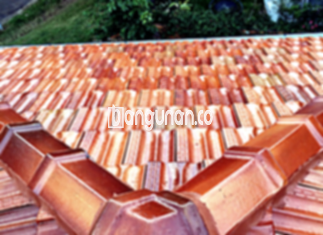

**Jual Genteng Keramik & Beton di Cirebon** – Bagi Mitra Bangunan yang sedang mencari material atap berkualitas, genteng adalah pilihan yang tepat. Genteng merupakan komponen krusial dalam konstruksi bangunan, menjadi perlindungan utama dari berbagai elemen cuaca seperti hujan deras, terik matahari, dan angin kencang. Dengan memilih genteng yang tepat, Anda tidak hanya melindungi rumah, tetapi juga meningkatkan kenyamanan dan keindahan hunian Anda di Cirebon.

Investasi pada genteng berkualitas adalah langkah cerdas untuk masa depan rumah Anda. Terdapat berbagai jenis genteng yang tersedia, masing-masing dengan karakteristik unik yang sesuai dengan kebutuhan dan anggaran yang berbeda. Memahami kelebihan dan kekurangan setiap jenis genteng akan membantu Anda membuat keputusan yang paling tepat untuk proyek pembangunan atau renovasi rumah Anda.



## Harga Genteng dari Toko Jual Genteng Keramik & Beton di Cirebon

Kami menyediakan beragam pilihan genteng dengan berbagai harga, memungkinkan Anda menemukan yang paling sesuai dengan anggaran proyek Anda. Berikut adalah perkiraan harga beberapa jenis genteng populer yang tersedia di toko kami:

### - Harga Genteng Metal di Toko Genteng Keramik & Beton di Cirebon

Genteng metal adalah pilihan modern yang ringan dan tahan lama, ideal untuk rumah dengan desain minimalis. Bahan ini menawarkan tampilan yang bersih dan elegan, serta mudah dipasang. Untuk mengetahui harga genteng metal terkini, Anda dapat merujuk pada tabel harga yang tersedia atau menghubungi tim penjualan kami.

### - Harga Genteng Aspal di Toko Genteng Keramik & Beton di Cirebon

Genteng aspal menawarkan keunggulan dalam hal estetika dan daya tahan. Terbuat dari serat kayu dan aspal, material ini memberikan tampilan yang menarik dan mampu menahan cuaca ekstrem. Silakan periksa tabel harga untuk mengetahui detail harga genteng aspal terbaru.

### - Harga Genteng Keramik & Beton di Cirebon

Genteng keramik dan beton adalah pilihan klasik yang populer karena keindahan dan ketahanannya. Tersedia dalam berbagai warna dan tekstur, genteng ini dapat menciptakan tampilan yang unik dan personal untuk rumah Anda. Informasi harga terkini dapat Anda temukan pada tabel harga yang disediakan.

### - Harga Genteng Kaca di Toko Genteng Kermaik & Beton di Cirebon

Genteng kaca dapat digunakan sebagai aksen menarik untuk memberikan pencahayaan alami pada rumah Anda. Meskipun sering digunakan sebagai pelengkap, genteng kaca dapat memberikan sentuhan artistik yang unik. Detail harga genteng kaca saat ini dapat dilihat pada tabel harga.

### - Harga Genteng Seng di Toko Genteng Kermaik & Beton di Cirebon

Genteng seng adalah pilihan ekonomis yang sering digunakan pada bangunan tradisional. Dengan ukurannya yang panjang, genteng seng dapat menutupi area atap dengan efisien. Informasi harga genteng seng termutakhir tersedia pada tabel harga.

### - Harga Genteng Beton Di Toko Genteng Kermaik & Beton di Cirebon

Genteng beton adalah pilihan yang kuat dan tahan lama, terbuat dari campuran semen, pasir, dan air. Material ini ideal untuk rumah yang membutuhkan perlindungan maksimal dari cuaca ekstrem. Untuk informasi harga genteng beton, silakan lihat tabel harga yang terdapat di halaman ini.



## Beberapa Variasi Genteng dari Toko Jual Genteng Kermaik & Beton di Cirebon

Toko kami menawarkan berbagai macam variasi genteng yang dapat Anda sesuaikan dengan desain dan anggaran bangunan Anda. Berikut adalah beberapa pilihan populer yang tersedia:

### Genteng Keramik dari Toko Jual Genteng Keramik & Beton di Cirebon

Genteng keramik adalah pilihan yang populer karena keindahan alami dan ketahanannya terhadap cuaca. Jenis genteng ini memberikan sentuhan klasik dan elegan pada rumah Anda. Anda akan merasakan manfaat perlindungan optimal dari panas matahari dan hujan.

### Genteng Seng dan Genteng Kermaik & Beton di Cirebon

Genteng seng, yang sering digunakan pada bangunan tradisional, menawarkan solusi ekonomis untuk perlindungan atap. Ukurannya yang panjang membuat pemasangan lebih efisien dan hemat biaya. Pastikan pemasangan dilakukan dengan paku yang kuat untuk memastikan ketahanan.

### Genteng Asbes dan Genteng Kermaik & Beton di Cirebon

Meskipun dahulu populer, genteng asbes memiliki kelemahan dalam hal daya tahan dan potensi kerusakan. Material ini seringkali memerlukan perawatan dan penggantian yang lebih sering dibandingkan jenis genteng lainnya.

### Genteng Kanopi Baja Ringan dan Genteng Kermaik & Beton di Cirebon

Genteng kanopi baja ringan adalah pilihan yang kuat, ringan, dan mudah dipasang. Material ini menawarkan fleksibilitas desain dan ketahanan terhadap berbagai kondisi cuaca.

### Genteng Sirap Kayu Ulin dan Genteng Kermaik & Beton di Cirebon

Genteng sirap kayu ulin memberikan tampilan alami dan elegan pada rumah Anda. Terbuat dari kayu ulin yang berkualitas, genteng ini tahan terhadap cuaca dan memberikan kesan yang unik.

Anda dapat memilih jenis Genteng Keramik & Beton di Cirebon yang paling sesuai dengan kebutuhan proyek Anda. Tentukan jumlah, material, dan jenis genteng yang Anda butuhkan, dan kami akan melayani dengan senang hati. Jangan ragu untuk menghubungi tim kami melalui tombol WhatsApp atau Telepon untuk mendapatkan penawaran harga terbaik dan konsultasi gratis. Kami siap membantu Mitra Bangunan mewujudkan atap impian untuk rumah Anda di Cirebon.

**Ref by:**  [Genteng Kermaik & Beton  Cirebon](https://id.wikipedia.org/wiki/Genteng)