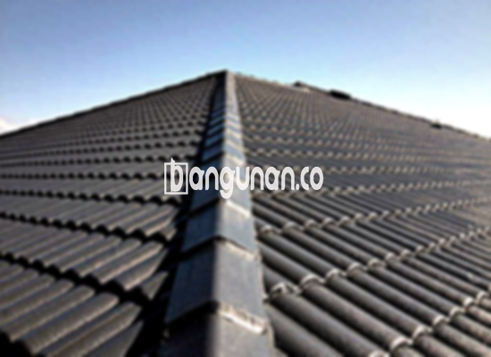

**Jual Genteng Kermaik & Beton di Cisalak Depok** – Genteng adalah material penting untuk setiap hunian. Melindungi rumah Anda dari cuaca ekstrem seperti hujan dan panas terik, genteng juga berperan vital dalam menciptakan kenyamanan tinggal. Sebagai Mitra Bangunan, Anda tentu menginginkan atap yang awet dan terlindungi. Kami hadir sebagai solusi tepat untuk kebutuhan genteng Anda di Cisalak Depok.

Memilih genteng yang tepat sangatlah penting. Ada berbagai jenis genteng yang tersedia, masing-masing dengan kelebihan dan kekurangannya. Setiap orang memiliki preferensi berbeda, dan penting untuk mempertimbangkan kualitas agar hunian Anda terlindungi dalam jangka panjang.



## Harga Genteng dari Toko Jual Genteng Kermaik & Beton di Cisalak Depok

Kami menyediakan beragam pilihan genteng untuk memenuhi kebutuhan bangunan Anda. Berikut adalah gambaran mengenai berbagai jenis genteng yang tersedia:

### Harga Genteng Metal di Toko Genteng Kermaik & Beton di Cisalak Depok

Genteng metal adalah pilihan populer karena tampilannya yang modern dan elegan. Sering digunakan pada desain rumah minimalis, genteng metal memberikan kesan yang bersih dan rapi. Untuk informasi harga terbaru, silakan lihat tabel harga atau hubungi tim kami.

### Harga Genteng Aspal di Toko Genteng Kermaik & Beton di Cisalak Depok

Genteng aspal terbuat dari serat kayu dan aspal, menawarkan kombinasi antara kekuatan dan fleksibilitas. Material ini juga dikenal tahan api, memberikan keamanan ekstra pada hunian Anda. Detail harga dapat Anda temukan pada tabel harga yang tersedia.

### Harga Genteng Kermaik & Beton di Cisalak Depok

Genteng keramik dan beton menawarkan daya tahan tinggi dan estetika yang menarik. Dengan pilihan warna dan desain yang beragam, Anda dapat menemukan genteng yang sesuai dengan gaya arsitektur rumah Anda. Informasi harga terperinci tersedia di tabel harga kami.

### Harga Genteng Kaca di Toko Genteng Kermaik & Beton di Cisalak Depok

Genteng kaca umumnya digunakan sebagai aksen untuk memberikan pencahayaan alami pada ruangan. Penggunaannya tidak disarankan untuk seluruh atap karena dapat meningkatkan panas di dalam ruangan. Harga genteng kaca dapat dilihat pada tabel harga.

### Harga Genteng Seng di Toko Genteng Kermaik & Beton di Cisalak Depok

Genteng seng merupakan pilihan ekonomis yang sering digunakan pada bangunan tradisional. Meskipun ringan, genteng seng membutuhkan pemasangan yang cermat agar kokoh dan tahan lama. Harga genteng seng dapat Anda periksa di tabel harga.

### Harga Genteng Beton di Toko Genteng Kermaik & Beton di Cisalak Depok

Genteng beton terbuat dari campuran semen, pasir, dan air, menjadikannya pilihan yang kuat dan tahan lama. Material ini ideal untuk berbagai jenis bangunan dan cuaca. Detail harga dan spesifikasi dapat Anda temukan di tabel harga.



## Jenis-Jenis Genteng dari Toko Jual Genteng Kermaik & Beton di Cisalak Depok

Berikut adalah beberapa jenis genteng yang tersedia di toko kami, yang mungkin cocok untuk proyek Anda di Cisalak Depok:

### Genteng Keramik dari Toko Jual Genteng Kermaik & Beton di Cisalak Depok

Genteng keramik adalah pilihan klasik yang memberikan tampilan rumah yang elegan dan nyaman. Material ini juga efektif dalam melindungi rumah dari panas matahari. Anda akan merasakan perbedaan kualitas dan kenyamanan dengan memilih genteng keramik untuk hunian Anda.

### Genteng Seng dan Genteng Kermaik & Beton di Cisalak Depok

Genteng seng menawarkan solusi ekonomis untuk aplikasi atap. Dengan bentuknya yang panjang, genteng seng dapat menutupi area yang luas secara efisien. Pastikan pemasangan dilakukan dengan benar untuk memastikan kekokohan dan ketahanannya.

### Genteng Asbes dan Genteng Kermaik & Beton di Cisalak Depok

Genteng asbes dahulu populer karena harganya yang terjangkau, namun kini penggunaannya semakin terbatas karena pertimbangan kesehatan dan lingkungan. Sebagai alternatif, kami menyarankan Anda untuk mempertimbangkan jenis genteng lain yang lebih aman dan berkelanjutan.

### Genteng Kanopi Baja Ringan dan Genteng Kermaik & Beton di Cisalak Depok

Genteng kanopi baja ringan merupakan pilihan modern yang ringan, kuat, dan tahan lama. Material ini ideal untuk berbagai desain atap dan memberikan tampilan yang menarik.

### Genteng Sirap Kayu Ulin dan Genteng Kermaik & Beton di Cisalak Depok

Genteng sirap kayu ulin menawarkan sentuhan tradisional dengan keindahan alami kayu ulin. Material ini memberikan isolasi termal yang baik dan menciptakan suasana yang hangat dan nyaman.

Anda dapat memilih jenis Genteng Kermaik & Beton di Cisalak Depok yang paling sesuai dengan kebutuhan dan anggaran Anda. Tentukan jumlah, bahan, dan jenis genteng yang diperlukan, dan hubungi kami untuk mendapatkan penawaran terbaik. Sebagai Mitra Bangunan, kami siap membantu Anda menemukan solusi atap yang ideal. Kami siap melayani Anda dan memberikan informasi terkini mengenai harga. **Ref by:**  [Genteng Kermaik & Beton  Cisalak Depok](https://id.wikipedia.org/wiki/Genteng)