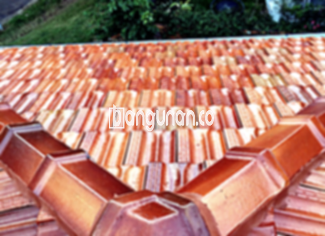

**Jual Genteng Kermaik & Beton di Ciseeng** – Genteng adalah material hunian yang sangat penting dan sepatutnya dimiliki oleh setiap pemilik rumah. Genteng memberikan perlindungan optimal bagi hunian Anda dari berbagai kondisi cuaca, seperti hujan lebat, sengatan matahari, dan faktor lingkungan lainnya. Dengan memilih genteng yang tepat, Anda memastikan ketahanan dan kenyamanan rumah Anda. Mitra Bangunan di Ciseeng hadir sebagai solusi terpercaya untuk kebutuhan atap Anda.

Memilih genteng yang sesuai bisa menjadi tantangan tersendiri. Beragam jenis genteng menawarkan karakteristik unik dan harga yang bervariasi. Investasi yang tepat pada genteng akan memberikan manfaat jangka panjang bagi kenyamanan dan keamanan hunian Anda di Ciseeng. Pertimbangan matang akan memastikan rumah Anda terlindungi dengan optimal.



## Informasi Harga Genteng dari Toko Jual Genteng Kermaik & Beton di Ciseeng

Kami menyediakan beragam pilihan genteng untuk memenuhi gaya dan kebutuhan bangunan Anda. Masing-masing jenis genteng memiliki keunggulan tersendiri, dan harga bervariasi sesuai kualitas dan materialnya. Berikut adalah informasi harga yang dapat Anda jadikan acuan.

### - Harga Genteng Metal di Toko Genteng Kermaik & Beton di Ciseeng

Genteng metal sering dipilih karena desainnya yang modern dan minimalis. Tampilan ramping dan kekuatannya menjadikannya solusi atap yang populer dikalangan pemilik rumah yang menginginkan kesan modern.

### - Harga Genteng Aspal di Toko Genteng Kermaik & Beton di Ciseeng

Genteng aspal menawarkan kombinasi daya tahan dan estetika. Terbuat dari serat kayu dan aspal berkualitas tinggi, material ini tidak hanya tahan terhadap cuaca ekstrem, tetapi juga memberikan isolasi suara yang baik.

### - Harga Genteng Kermaik & Beton di Ciseeng

Genteng keramik merupakan pilihan klasik yang selalu digemari. Variasi warna dan teksturnya yang unik memberikan sentuhan elegan pada setiap bangunan. Ketahanannya terhadap cuaca menjadikan genteng keramik investasi yang cerdas.

### - Harga Genteng Kaca di Toko Genteng Kermaik & Beton di Ciseeng

Genteng kaca sering digunakan sebagai elemen dekoratif untuk menciptakan efek visual yang menarik. Biasanya dipasang sebagai aksen untuk memberikan pencahayaan alami di area tertentu pada bangunan Anda.

### - Harga Genteng Seng di Toko Genteng Kermaik & Beton di Ciseeng

Genteng seng merupakan pilihan ekonomis yang tepat untuk konstruksi yang hemat biaya. Karena ringan dan mudah dipasang, genteng seng juga menjadi solusi praktis untuk berbagai jenis bangunan. Penting untuk memastikan pemasangan yang rapi agar tahan lama.

### - Harga Genteng Beton di Toko Genteng Kermaik & Beton di Ciseeng

Genteng beton dikenal karena kekuatannya dan ketahanannya terhadap cuaca buruk. Terbuat dari campuran semen, pasir, dan air berkualitas tinggi, genteng beton memberikan perlindungan optimal bagi bangunan Anda.



## Jenis-jenis Genteng dari Toko Jual Genteng Kermaik & Beton di Ciseeng

Tersedia berbagai jenis genteng yang dapat Anda pilih untuk bangunan Anda. Setiap jenis memiliki karakteristik dan keunggulannya masing-masing. Berikut adalah beberapa pilihan yang paling populer:

### Genteng Keramik dari Toko Jual Genteng Kermaik & Beton di Ciseeng

Genteng keramik memberikan tampilan yang elegan dan tahan lama. Anda akan menemukan berbagai pilihan warna dan desain untuk menyesuaikan dengan gaya arsitektur bangunan Anda. Material ini juga memberikan isolasi termal yang baik.

### Genteng Seng dan Genteng Kermaik & Beton di Ciseeng

Genteng seng adalah pilihan yang ekonomis dan praktis. Ukurannya yang panjang mengurangi jumlah sambungan, sehingga memudahkan pemasangan dan meminimalkan risiko kebocoran.

### Genteng Asbes dan Genteng Kermaik & Beton di Ciseeng

Genteng asbes merupakan pilihan yang terjangkau, namun perlu dipertimbangkan kekurangannya dalam hal kekuatan dan daya tahan dibandingkan dengan jenis genteng lainnya. 

### Genteng Kanopi Baja Ringan dan Genteng Kermaik & Beton di Ciseeng

Genteng kanopi baja ringan menawarkan kombinasi kekuatan dan ringan, sehingga cocok untuk berbagai jenis konstruksi atap. Material ini tahan terhadap karat dan mudah dipasang.

### Genteng Sirap Kayu Ulin dan Genteng Kermaik & Beton di Ciseeng

Genteng sirap kayu ulin memberikan tampilan alami dan unik. Terbuat dari kayu ulin yang berkualitas tinggi, genteng ini tahan terhadap cuaca dan memberikan kesan tradisional yang elegan.

Anda dapat menemukan berbagai jenis Genteng Kermaik & Beton di Ciseeng yang sesuai dengan kebutuhan dan preferensi Anda. Untuk mendapatkan hasil terbaik, pertimbangkan dengan cermat jenis bahan, ukuran, dan desain yang paling cocok untuk bangunan Anda. Hubungi tim kami untuk mendapatkan rekomendasi dan penawaran harga yang kompetitif. Mitra Bangunan siap menjadi mitra terpercaya Anda dalam membangun dan melindungi hunian impian Anda.

**Ref by:**  [Genteng Kermaik & Beton  Ciseeng](https://id.wikipedia.org/wiki/Genteng)