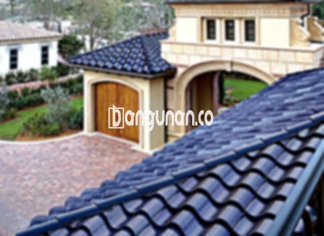

**Jual Genteng Kermaik & Beton di Citeureup** – Genteng adalah material vital bagi setiap hunian, yang sepatutnya dimiliki setiap pemilik rumah. Genteng melindungi tempat tinggal Anda dari berbagai kondisi cuaca seperti hujan dan panas terik. Saatnya memastikan kenyamanan dan keamanan rumah Anda dengan memilih genteng berkualitas, Mitra Bangunan.

Memilih genteng yang tepat untuk hunian Anda adalah investasi penting. Ada beragam jenis genteng yang tersedia, masing-masing dengan kelebihan dan kekurangannya. Pertimbangkan gaya arsitektur rumah Anda dan iklim setempat untuk membuat keputusan yang paling tepat. Mengingat rumah adalah tempat Anda beristirahat dan berkumpul, memilih genteng bermutu adalah keputusan bijak.



## Harga Genteng dari Toko Jual Genteng Kermaik & Beton di Citeureup

Beragam pilihan genteng tersedia untuk memenuhi kebutuhan dan anggaran Anda. Setiap jenis genteng menawarkan keunggulan unik. Berikut adalah gambaran harga sebagai acuan:

### \- Harga Genteng Metal di Toko Genteng Kermaik & Beton di Citeureup

Genteng metal populer digunakan, terutama untuk rumah minimalis. Tampilannya modern dan ramping, memberikan kesan estetis yang menarik. Untuk informasi harga genteng metal terkini, silakan lihat tabel harga atau hubungi tim kami.

### \- Harga Genteng Aspal di Toko Genteng Kermaik & Beton di Citeureup

Genteng aspal terbuat dari serat kayu dan aspal, menawarkan kombinasi kekuatan dan fleksibilitas. Material ini tahan api dan tahan lama, menjadikannya pilihan yang aman dan handal. Anda dapat menemukan detail harga genteng aspal terbaru pada tabel harga kami.

### \- Harga Genteng Kermaik & Beton di Citeureup

Genteng keramik merupakan pilihan klasik yang banyak diminati. Tersedia dalam berbagai warna dan desain, genteng keramik dapat memberikan tampilan yang unik dan menarik pada rumah Anda. Untuk mengetahui harga genteng keramik terbaru, lihat tabel harga yang tersedia.

### \- Harga Genteng Kaca di Toko Genteng Kermaik & Beton di Citeureup

Genteng kaca sering digunakan sebagai aksen untuk memberikan pencahayaan alami pada ruangan. Karena kemampuannya menghantarkan panas, penggunaan genteng kaca sebaiknya terbatas pada area tertentu. Anda dapat menemukan informasi harga genteng kaca pada tabel harga kami.

### \- Harga Genteng Seng di Toko Genteng Kermaik & Beton di Citeureup

Genteng seng merupakan pilihan ekonomis yang sering digunakan untuk bangunan tradisional. Ukurannya yang panjang membantu menghemat biaya pemasangan. Untuk harga genteng seng terkini, silakan merujuk pada tabel harga yang tersedia.

### \- Harga Genteng Beton di Toko Genteng Kermaik & Beton di Citeureup

Genteng beton dikenal karena kekuatannya dan ketahanannya. Terbuat dari campuran semen, pasir, dan air berkualitas tinggi, genteng beton adalah pilihan yang tahan lama untuk melindungi rumah Anda. Informasi harga genteng beton terbaru dapat ditemukan pada tabel harga.



## Jenis-jenis Genteng dari Toko Jual Genteng Kermaik & Beton di Citeureup

Berikut adalah beberapa jenis genteng yang dapat Anda pertimbangkan untuk bangunan Anda:

### Genteng Keramik dari Toko Jual Genteng Kermaik & Beton di Citeureup

Jika Anda mencari genteng dengan estetika yang menawan, genteng keramik adalah pilihan yang tepat. Dengan beragam warna dan tekstur, genteng keramik dapat meningkatkan tampilan rumah Anda secara signifikan. Selain itu, genteng keramik juga memberikan perlindungan optimal terhadap sinar matahari dan panas.

### Genteng Seng dan Genteng Kermaik & Beton di Citeureup

Genteng seng merupakan pilihan populer untuk bangunan tradisional. Ukurannya yang panjang membuat pemasangan lebih efisien. Pastikan untuk menggunakan paku yang kuat untuk memastikan ketahanan genteng seng terhadap cuaca ekstrem.

### Genteng Asbes dan Genteng Kermaik & Beton di Citeureup

Genteng asbes adalah salah satu jenis genteng yang cukup banyak digunakan di masa lalu. Namun, karena bahan yang mudah rusak, genteng asbes kurang direkomendasikan untuk penggunaan jangka panjang.

### Genteng Kanopi Baja Ringan dan Genteng Kermaik & Beton di Citeureup

Genteng kanopi baja ringan adalah pilihan populer karena sifatnya yang ringan, kuat, dan tahan lama. Dengan berbagai desain yang tersedia, Anda dapat menemukan genteng yang sesuai dengan gaya arsitektur rumah Anda.

### Genteng Sirap Kayu Ulin dan Genteng Kermaik & Beton di Citeureup

Genteng sirap kayu ulin terbuat dari kayu ulin berkualitas tinggi. Harganya relatif terjangkau dan memberikan kesan alami pada rumah Anda. Selain itu, kayu ulin memiliki ketahanan yang baik terhadap cuaca ekstrem.

Anda bisa mendapatkan variasi Genteng Kermaik & Beton di Citeureup yang sesuai dengan kebutuhan Anda. Tentukan jumlah, material, dan jenis genteng yang diinginkan. Jangan ragu untuk menghubungi kami untuk mendapatkan penawaran harga terbaik!

**Ref by:**  [Genteng Kermaik & Beton  Citeureup](https://id.wikipedia.org/wiki/Genteng)

Mitra Bangunan siap membantu Anda menemukan genteng berkualitas terbaik untuk rumah Anda di Citeureup. Hubungi kami melalui tombol WhatsApp atau Telepon di halaman ini, dan kami akan dengan senang hati melayani Anda.