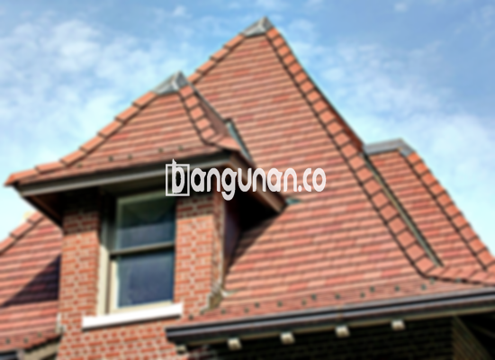

**Jual Genteng Kermaik & Beton di Curug Tangerang** – Genteng adalah material hunian yang sangat penting dan seharusnya dimiliki oleh setiap pemilik rumah. Perlindungan yang diberikan genteng terhadap berbagai kondisi cuaca sangat krusial untuk kenyamanan tempat tinggal Anda. Mitra Bangunan hadir di Curug Tangerang untuk menyediakan solusi genteng berkualitas yang akan menjadikan hunian Anda lebih aman dan nyaman. Memilih genteng yang tepat merupakan investasi penting untuk masa depan rumah Anda.

Untuk memastikan rumah Anda terlindungi dengan baik, membeli genteng yang sesuai adalah hal yang mendesak. Banyak sekali jenis genteng yang tersedia di pasaran, masing-masing menawarkan keunggulan dan kekurangan yang berbeda. Setiap orang tentu memiliki preferensi masing-masing ketika memilih jenis genteng yang akan digunakan untuk hunian mereka. Mempertimbangkan bahwa rumah adalah tempat tinggal jangka panjang, memilih genteng berkualitas adalah keputusan yang cerdas. 



## Harga Genteng Dari Toko Jual Genteng Kermaik & Beton di Curug Tangerang

Bagi Anda yang sedang mencari genteng untuk proyek bangunan di Curug Tangerang, kami menawarkan berbagai pilihan yang dapat disesuaikan dengan anggaran dan kebutuhan Anda. Setiap jenis genteng memiliki karakteristik tersendiri dan rentang harga yang bervariasi. Berikut adalah gambaran umum harga berbagai jenis genteng yang tersedia di toko kami:

### \- Harga Genteng Metal Di Toko Genteng Kermaik & Beton di Curug Tangerang

Genteng metal menjadi salah satu pilihan yang paling diminati karena ringan, kuat, dan mudah dipasang. Jenis ini sangat populer untuk rumah-rumah bergaya modern dan minimalis, memberikan tampilan yang bersih dan elegan. Fleksibilitas dalam desain dan ketersediaan warna yang beragam juga menjadi daya tarik utama. Harga genteng metal terbaru adalah Rp. 26.000 per buah.

### \- Harga Genteng Aspal Di Toko Genteng Kermaik & Beton di Curug Tangerang

Genteng aspal menawarkan estetika yang mewah dan tahan lama. Terbuat dari serat kayu dan material aspal berkualitas tinggi, jenis ini mampu menahan kondisi cuaca ekstrem dan memiliki ketahanan terhadap api yang baik. Genteng aspal juga dikenal fleksibel, sehingga dapat beradaptasi dengan berbagai bentuk atap. Harga genteng aspal hari ini adalah Rp.125.000 per meter.

### \- Harga Genteng Kermaik & Beton di Curug Tangerang

Genteng keramik dan beton adalah pilihan klasik yang tetap populer hingga saat ini. Kedua jenis genteng ini menawarkan kekuatan, daya tahan, dan tampilan yang menarik. Tersedia dalam berbagai warna dan tekstur, Anda dapat memilih genteng yang paling sesuai dengan gaya arsitektur rumah Anda. Harga genteng keramik saat ini yaitu Rp. 9.800 per pcs.

### \- Harga Genteng Kaca Di Toko Genteng Kermaik & Beton di Curug Tangerang

Genteng kaca seringkali digunakan sebagai elemen dekoratif untuk memberikan sentuhan unik pada atap rumah. Meskipun tidak digunakan secara keseluruhan, genteng kaca dapat menciptakan efek visual yang menarik dan mempercantik tampilan rumah Anda. Perlu diingat bahwa genteng kaca dapat meningkatkan panas di dalam ruangan. Harga genteng kaca terbaru yakni Rp. 8.800 per biji.

### \- Harga Genteng Seng Di Toko Genteng Kermaik & Beton di Curug Tangerang

Genteng seng merupakan pilihan ekonomis yang sering digunakan pada bangunan-bangunan tradisional. Ukurannya yang panjang dan ringan membuatnya mudah dipasang. Jika Anda mencari solusi atap yang hemat biaya, genteng seng bisa menjadi pilihan yang tepat. Harga genteng seng sekarang yakni Rp. 39.000 per buah.

### \- Harga Genteng Beton Di Toko Genteng Kermaik & Beton di Curug Tangerang

Genteng beton menawarkan kombinasi ideal antara kekuatan, daya tahan, dan harga yang terjangkau. Terbuat dari campuran semen, pasir, dan air berkualitas tinggi, jenis ini mampu menahan beban berat dan kondisi cuaca ekstrem. Banyak orang memilih genteng beton karena keandalannya dalam jangka panjang. Harga genteng beton hari ini adalah Rp. 5.800 per pcs.



## Beberapa Macam Genteng Dari Toko Jual Genteng Kermaik & Beton di Curug Tangerang

Ada berbagai macam genteng yang dapat Anda pilih untuk membangun atau merenovasi atap rumah Anda di Curug Tangerang. Berikut adalah beberapa jenis genteng yang populer dan cocok untuk berbagai gaya bangunan:

### Genteng Keramik Dari Toko Jual Genteng Kermaik & Beton di Curug Tangerang

Bagi Anda yang mencari genteng dengan tampilan klasik dan elegan, genteng keramik adalah pilihan terbaik. Genteng ini tidak hanya memberikan estetika yang menawan, tetapi juga memiliki kemampuan meredam panas yang baik, menjaga rumah Anda tetap sejuk dan nyaman. Selain itu, genteng keramik juga tahan lama dan mudah perawatannya.

### Genteng Seng dan Genteng Kermaik & Beton di Curug Tangerang

Genteng seng adalah pilihan yang ekonomis dan praktis. Dengan ukurannya yang panjang, genteng seng dapat menutupi area atap yang luas dengan cepat. Jenis genteng ini cocok untuk Anda yang mencari solusi atap yang terjangkau dan mudah dipasang. Pastikan untuk menggunakan paku yang kuat untuk memastikan pemasangan yang aman dan tahan lama.

### Genteng Asbes dan Genteng Kermaik & Beton di Curug Tangerang

Meskipun dulunya populer, genteng asbes kini mulai ditinggalkan karena beberapa pertimbangan penting. Bahan yang mudah rusak dan potensi masalah kesehatan menjadi alasan utama mengapa orang beralih ke jenis genteng lain. Anda mungkin ingin mempertimbangkan alternatif yang lebih aman dan tahan lama untuk melindungi rumah Anda.

### Genteng Kanopi Baja Ringan dan Genteng Kermaik & Beton di Curug Tangerang

Genteng kanopi baja ringan menawarkan kombinasi antara kekuatan, ringan, dan estetika yang modern. Dengan berbagai desain yang tersedia, Anda dapat menciptakan tampilan atap yang unik dan menarik. Jenis genteng ini juga tahan terhadap korosi dan memiliki umur pakai yang panjang.

### Genteng Sirap Kayu Ulin dan Genteng Kermaik & Beton di Curug Tangerang

Genteng sirap kayu ulin memberikan sentuhan alami dan tradisional pada rumah Anda. Terbuat dari kayu ulin berkualitas tinggi, jenis genteng ini tahan terhadap cuaca ekstrem dan memiliki tampilan yang unik. Harganya relatif terjangkau, sehingga menjadi pilihan yang menarik bagi banyak pemilik rumah di Curug Tangerang.

Anda dapat menemukan berbagai jenis Genteng Kermaik & Beton di Curug Tangerang yang sesuai dengan kebutuhan Anda. Tentukan jumlah yang Anda butuhkan, material yang diinginkan, dan jenis genteng yang paling sesuai dengan gaya bangunan Anda. 
<table class="table">
  <caption>Jenis Genteng Populer</caption>
  <thead>
    <tr><th>Jenis Genteng</th><th>Keunggulan</th><th>Cocok untuk</th></tr>
  </thead>
  <tbody>
    <tr><td>Genteng Metal</td><td>Ringan, kuat, tahan lama, tampilan modern</td><td>Rumah minimalis, modern</td></tr>
    <tr><td>Genteng Aspal</td><td>Mewah, tahan cuaca, tahan api</td><td>Rumah bergaya Eropa, klasik</td></tr>
    <tr><td>Genteng Keramik</td><td>Tahan lama, meredam panas, banyak pilihan warna</td><td>Rumah tradisional, modern</td></tr>
    <tr><td>Genteng Beton</td><td>Kuat, tahan lama, harga terjangkau</td><td>Berbagai jenis rumah</td></tr>
  </tbody>
</table>

**Ref by:**  [Genteng Kermaik & Beton  Curug Tangerang](https://id.wikipedia.org/wiki/Genteng)

Mitra Bangunan siap membantu Anda menemukan genteng yang sempurna untuk rumah Anda di Curug Tangerang. Jangan ragu untuk menghubungi kami melalui tombol WhatsApp atau Telepon di halaman ini untuk mendapatkan penawaran harga terbaik dan konsultasi gratis. Kami berkomitmen untuk memberikan layanan terbaik dan produk berkualitas tinggi kepada Anda.