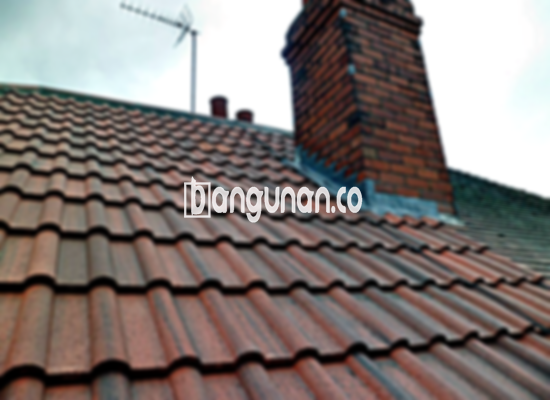

**Jual Genteng Kermaik & Beton di Demak** – Membangun atau merenovasi rumah di Demak membutuhkan material berkualitas, dan genteng adalah salah satu yang terpenting. Mitra Bangunan hadir sebagai solusi kebutuhan atap Anda, menyediakan berbagai jenis genteng yang kuat, tahan lama, dan sesuai dengan anggaran Anda. Kami memahami bahwa genteng bukan hanya pelindung rumah, tetapi juga penentu estetika.

Memilih genteng yang tepat memerlukan pertimbangan matang. Ada beragam jenis genteng yang tersedia di pasaran, masing-masing dengan kelebihan dan kekurangannya. Setiap orang memiliki preferensi berbeda, tergantung gaya arsitektur rumah, iklim, dan budget yang tersedia. Karena itulah, kami menyediakan berbagai opsi genteng berkualitas untuk memenuhi kebutuhan Anda di Demak. 



## Harga Genteng dari Toko Jual Genteng Kermaik & Beton di Demak

Ada banyak sekali pilihan genteng yang bisa Anda pertimbangkan untuk bangunan Anda. Setiap jenis genteng memiliki keunggulan tersendiri. Berikut adalah gambaran umum harga genteng yang dapat Anda gunakan sebagai referensi:

### – Harga Genteng Metal di Toko Genteng Kermaik & Beton di Demak

Genteng metal merupakan pilihan populer yang banyak digunakan saat ini. Jenis ini sangat umum, terutama untuk desain rumah minimalis. Tampilannya yang elegan dan modern menjadi daya tarik utama. Untuk informasi harga genteng metal terbaru, silakan lihat tabel harga berikut atau hubungi tim kami.

### – Harga Genteng Aspal di Toko Genteng Kermaik & Beton di Demak

Genteng aspal terbuat dari serat kayu dan aspal, menawarkan fleksibilitas dan kekuatan yang baik. Material ini juga dikenal tahan terhadap api, memberikan lapisan perlindungan tambahan. Untuk mengetahui harga genteng aspal terkini, Anda dapat merujuk pada tabel harga atau menghubungi kami untuk konsultasi.

### – Harga Genteng Kermaik & Beton di Demak

Genteng keramik adalah pilihan klasik yang banyak disukai. Variasi warna yang unik dan keindahan estetikanya membuat jenis ini menjadi favorit banyak orang. Untuk informasi harga genteng keramik terbaru, silakan cek tabel harga yang tersedia atau hubungi kami.

### – Harga Genteng Kaca di Toko Genteng Kermaik & Beton di Demak

Genteng kaca biasanya digunakan sebagai aksen atau pelengkap pada atap. Penggunaannya tidak meliputi seluruh area atap karena dapat meningkatkan panas di dalam ruangan. Genteng kaca cocok untuk memberikan pencahayaan alami pada ruangan. Anda dapat melihat harga genteng kaca terbaru di tabel harga.

### – Harga Genteng Seng di Toko Genteng Kermaik & Beton di Demak

Genteng seng sering digunakan pada bangunan tradisional atau rumah dengan anggaran terbatas. Ukurannya yang panjang dan hemat biaya menjadikannya pilihan yang praktis. Pemasangan genteng seng memerlukan paku untuk memastikan kekuatannya. Hubungi kami untuk mendapatkan informasi harga genteng seng terkini.

### – Harga Genteng Beton di Toko Genteng Kermaik & Beton di Demak

Genteng beton terbuat dari campuran semen, pasir, dan air, menjadikannya kokoh dan tahan lama. Banyak orang memilih genteng beton karena kualitas dan daya tahannya yang terjamin. Anda bisa menemukan informasi harga genteng beton terbaru di tabel harga yang kami sediakan.



## Jenis-Jenis Genteng dari Toko Jual Genteng Kermaik & Beton di Demak

Berikut adalah beberapa jenis genteng yang dapat Anda pilih untuk bangunan Anda:

### Genteng Keramik dari Toko Jual Genteng Kermaik & Beton di Demak

Jika Anda mencari genteng yang tahan lama dan indah, genteng keramik adalah pilihan yang tepat. Jenis ini memiliki keunggulan dalam melindungi rumah dari panas matahari dan memberikan tampilan yang elegan.

### Genteng Seng dan Genteng Kermaik & Beton di Demak

Genteng seng adalah pilihan ekonomis yang populer di masa lalu. Ukurannya yang panjang menjadikannya hemat biaya, dan pemasangan dengan paku akan meningkatkan kekuatannya.

### Genteng Asbes dan Genteng Kermaik & Beton di Demak

Genteng asbes adalah salah satu jenis genteng yang umum digunakan. Namun, perlu diingat bahwa material ini cenderung kurang tahan lama dan rentan terhadap kerusakan. Penggantian genteng asbes yang rusak mungkin diperlukan secara berkala.

### Genteng Kanopi Baja Ringan dan Genteng Kermaik & Beton di Demak

Genteng kanopi baja ringan sangat populer karena elastisitas dan kekuatannya yang tinggi. Jenis ini cocok untuk berbagai jenis atap dan memberikan tampilan yang modern.

### Genteng Sirap Kayu Ulin dan Genteng Kermaik & Beton di Demak

Genteng sirap kayu ulin terbuat dari kayu ulin yang kuat dan tahan lama. Harganya relatif terjangkau dan dapat memberikan kenyamanan pada rumah Anda.

Anda dapat menemukan jenis Genteng Kermaik & Beton di Demak yang paling sesuai dengan kebutuhan Anda. Tentukan jumlah, material, dan jenis genteng yang Anda inginkan, dan kami akan dengan senang hati membantu Anda. Hubungi kami sekarang untuk mendapatkan penawaran harga terbaik.

**Ref by:**  [Genteng Kermaik & Beton  Demak](https://id.wikipedia.org/wiki/Genteng)

Mitra Bangunan siap membantu Anda menemukan genteng yang ideal untuk proyek Anda di Demak. Jangan ragu untuk menghubungi kami melalui tombol WhatsApp atau Telepon di halaman ini untuk mendapatkan informasi lebih lanjut dan penawaran khusus.