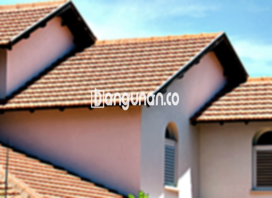

**Jual Genteng Kermaik & Beton di Dramaga Bogor** – Genteng merupakan material hunian yang sangat penting untuk dimiliki setiap pemilik rumah. Genteng memberikan perlindungan optimal bagi tempat tinggal Anda terhadap berbagai kondisi cuaca seperti hujan deras, panas terik matahari, dan elemen alam lainnya. Bagi Mitra Bangunan di Dramaga Bogor, memiliki atap yang kokoh dan terlindungi adalah prioritas utama, dan kami siap mewujudkannya. Investasi pada genteng berkualitas akan memastikan kenyamanan dan keamanan hunian Anda dalam jangka panjang.

Memilih genteng yang tepat untuk rumah Anda memerlukan pertimbangan yang matang. Ada beragam jenis genteng yang tersedia di pasaran, masing-masing menawarkan kelebihan dan kekurangan tersendiri. Pemilihan material atap yang tepat akan sangat berpengaruh pada estetika, durabilitas, dan kenyamanan rumah Anda di Dramaga Bogor. Kami di sini untuk membantu Anda menemukan solusi terbaik.



## Harga Genteng dari Toko Jual Genteng Kermaik & Beton di Dramaga Bogor

Bagi Anda yang sedang merencanakan pembangunan atau renovasi atap di Dramaga Bogor, mengetahui perkiraan harga genteng merupakan langkah penting dalam perencanaan anggaran. Kami menyediakan berbagai pilihan genteng dengan harga yang kompetitif dan kualitas terjamin. Berikut adalah informasi mengenai harga beberapa jenis genteng yang tersedia di toko kami:

### Harga Genteng Metal di Toko Genteng Kermaik & Beton di Dramaga Bogor

Genteng metal merupakan solusi modern yang semakin populer di kalangan pemilik rumah di Dramaga Bogor. Selain tampilannya yang minimalis dan elegan, genteng metal juga ringan, tahan lama, dan mudah dipasang. Berbagai pilihan warna dan bentuk tersedia untuk menyesuaikan dengan gaya arsitektur rumah Anda.

### Harga Genteng Aspal di Toko Genteng Kermaik & Beton di Dramaga Bogor

Genteng aspal menawarkan tampilan yang mewah dan klasik, seringkali dipilih oleh mereka yang menginginkan estetika tradisional. Material yang terbuat dari serat kayu dan aspal memberikan ketahanan yang baik terhadap kondisi cuaca ekstrem, serta menawarkan sifat fleksibel yang dapat menyesuaikan dengan berbagai bentuk atap.

### Harga Genteng Keramik & Beton di Dramaga Bogor

Genteng keramik dan beton adalah pilihan yang paling umum dan banyak digunakan di Dramaga Bogor karena menawarkan kombinasi ideal antara kekuatan, daya tahan, dan harga yang terjangkau. Kedua jenis genteng ini tersedia dalam berbagai warna, tekstur, dan desain, memungkinkan Anda menciptakan tampilan atap yang sesuai dengan preferensi Anda. Untuk informasi harga terkini, silakan merujuk pada tabel harga di bawah atau menghubungi tim ahli kami.

### Harga Genteng Kaca di Toko Genteng Kermaik & Beton di Dramaga Bogor

Genteng kaca seringkali digunakan sebagai elemen dekoratif untuk menciptakan efek pencahayaan alami yang unik di dalam ruangan. Meskipun tidak direkomendasikan untuk seluruh bagian atap karena dapat meningkatkan panas, genteng kaca dapat menjadi pilihan menarik untuk area tertentu seperti teras atau ruang keluarga.

### Harga Genteng Seng di Toko Genteng Kermaik & Beton di Dramaga Bogor

Genteng seng merupakan solusi ekonomis yang cocok untuk rumah dengan anggaran terbatas. Meskipun memerlukan perawatan rutin untuk mencegah karat, genteng seng tetap menjadi pilihan populer di Dramaga Bogor, terutama untuk bangunan tradisional atau sementara.

### Harga Genteng Beton di Toko Genteng Kermaik & Beton di Dramaga Bogor

Genteng beton menawarkan kekuatan dan daya tahan yang luar biasa, menjadikannya pilihan yang ideal untuk iklim tropis seperti di Dramaga Bogor. Terbuat dari campuran semen, pasir, dan air berkualitas tinggi, genteng beton tahan terhadap cuaca ekstrem dan memberikan perlindungan optimal bagi rumah Anda.



## Berbagai Macam Ragam Genteng dari Toko Jual Genteng Kermaik & Beton di Dramaga Bogor

Kami menyediakan berbagai macam pilihan genteng untuk memenuhi kebutuhan dan preferensi setiap pelanggan di Dramaga Bogor. Berikut adalah beberapa jenis genteng yang dapat Anda pertimbangkan:

### Genteng Keramik dari Toko Jual Genteng Kermaik & Beton di Dramaga Bogor

Genteng keramik adalah pilihan klasik yang menawarkan tampilan yang elegan dan tahan lama. Dengan berbagai pilihan warna, motif, dan tekstur, Anda dapat menciptakan atap yang sesuai dengan gaya arsitektur rumah Anda. Genteng keramik juga dikenal karena kemampuannya dalam menjaga rumah tetap sejuk dengan memantulkan sinar matahari.

### Genteng Seng dan Genteng Kermaik & Beton di Dramaga Bogor

Genteng seng menawarkan solusi yang ekonomis untuk atap rumah Anda. Meskipun membutuhkan perawatan ekstra untuk mencegah karat, genteng seng tetap menjadi pilihan populer bagi mereka yang mencari material atap yang terjangkau dan mudah didapatkan di Dramaga Bogor.

### Genteng Asbes dan Genteng Kermaik & Beton di Dramaga Bogor

Genteng asbes merupakan salah satu jenis genteng yang masih sering ditemui di Dramaga Bogor. Namun, perlu diperhatikan bahwa genteng asbes memiliki beberapa kelemahan, termasuk daya tahan yang rendah dan potensi risiko kesehatan. Kami menyarankan Anda untuk mempertimbangkan alternatif lain yang lebih aman dan ramah lingkungan.

### Genteng Kanopi Baja Ringan dan Genteng Kermaik & Beton di Dramaga Bogor

Genteng kanopi baja ringan adalah pilihan ideal untuk carport, teras, atau area outdoor lainnya di Dramaga Bogor. Selain ringan dan kuat, genteng ini juga tahan terhadap korosi dan mudah dipasang, menjadikannya solusi yang praktis dan efisien.

### Genteng Sirap Kayu Ulin dan Genteng Kermaik & Beton di Dramaga Bogor

Genteng sirap kayu ulin memberikan tampilan alami dan tradisional pada rumah Anda, sangat cocok untuk mereka yang menginginkan estetika yang unik dan bernuansa klasik di Dramaga Bogor. Kayu ulin yang digunakan memiliki ketahanan yang tinggi terhadap cuaca dan serangan hama, memastikan atap Anda tetap indah dan terlindungi selama bertahun-tahun.

Anda, sebagai Mitra Bangunan, dapat menemukan berbagai jenis Genteng Kermaik & Beton di Dramaga Bogor yang sesuai dengan kebutuhan dan anggaran Anda. Tentukan jenis, ukuran, dan jumlah genteng yang Anda inginkan, lalu serahkan kepada kami untuk pengadaan dan pengiriman terbaik. Hubungi kami melalui tombol WhatsApp atau Telepon yang tersedia di halaman ini untuk mendapatkan konsultasi gratis dan penawaran harga terkini.

**Ref by:**  [Genteng Kermaik & Beton  Dramaga Bogor](https://id.wikipedia.org/wiki/Genteng)