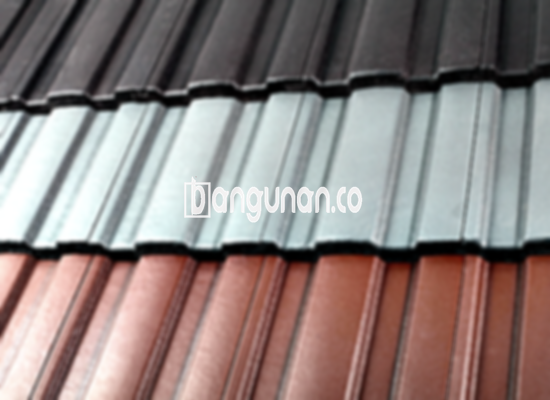

**Jual Genteng Kermaik & Beton di Dukuh Jakarta** – Genteng merupakan material vital pada setiap hunian yang sebaiknya dimiliki oleh setiap pemilik properti. Genteng menawarkan perlindungan optimal bagi tempat tinggal Anda dari berbagai kondisi cuaca, seperti hujan deras dan sengatan matahari yang terik. Dengan genteng yang berkualitas, Anda dapat memastikan rumah tetap aman dan nyaman. Mitra Bangunan hadir untuk menyediakan solusi genteng terbaik bagi Anda di Dukuh Jakarta.

Memilih genteng yang tepat adalah keputusan penting dalam pembangunan atau renovasi rumah. Tersedia berbagai jenis genteng dengan karakteristik uniknya masing-masing. Mempertimbangkan kualitas dan kesesuaian dengan desain rumah adalah kunci utama dalam memilih genteng yang ideal. Investasi pada genteng berkualitas akan memberikan manfaat jangka panjang bagi hunian Anda.



## Harga Genteng Dari Toko Jual Genteng Kermaik & Beton di Dukuh Jakarta

Bagi Anda yang tengah merencanakan pembangunan atau perbaikan atap di Dukuh Jakarta, memahami kisaran harga genteng merupakan langkah awal yang bijaksana. Berbagai jenis genteng yang ditawarkan di pasaran memiliki rentang harga yang berbeda-beda, tergantung pada material, ukuran, dan desainnya. Berikut adalah gambaran umum harga beberapa jenis genteng yang banyak digunakan oleh masyarakat:

### \- Harga Genteng Metal Di Toko Genteng Kermaik & Beton di Dukuh Jakarta

Genteng metal menjadi favorit banyak orang karena bobotnya yang ringan, kekuatan yang prima, serta tampilan modern yang ditawarkannya. Estetika bersih dan minimalis pada genteng metal membuatnya sangat cocok untuk desain rumah modern. Untuk mendapatkan informasi harga genteng metal yang lebih detail dan terkini, silakan merujuk pada tabel harga yang kami sediakan.

### \- Harga Genteng Aspal Di Toko Genteng Kermaik & Beton di Dukuh Jakarta

Genteng aspal dikenal akan fleksibilitas dan ketahanannya terhadap api yang unggul. Dibuat dari kombinasi serat kayu dan aspal, material ini memberikan perlindungan yang handal terhadap cuaca ekstrem. Jika Anda ingin mengetahui harga genteng aspal saat ini, Anda dapat memeriksa pengumuman harga terbaru pada tabel yang tersedia.

### \- Harga Genteng Kermaik & Beton di Dukuh Jakarta

Genteng keramik dan beton merupakan pilihan klasik yang menawarkan kombinasi antara keindahan dan ketahanan. Karakteristik warna dan teksturnya yang unik menjadikan kedua jenis genteng ini menjadi favorit banyak orang. Anda dapat menemukan detail harga genteng keramik dan beton pada tabel harga yang kami sediakan.

### \- Harga Genteng Kaca Di Toko Genteng Kermaik & Beton di Dukuh Jakarta

Genteng kaca seringkali dimanfaatkan sebagai elemen dekoratif untuk menciptakan efek pencahayaan alami pada sebuah ruangan. Namun, penting untuk diingat bahwa penggunaan genteng kaca secara berlebihan dapat meningkatkan suhu ruangan. Informasi harga genteng kaca terkini dapat Anda temukan pada tabel yang kami sediakan.

### \- Harga Genteng Seng Di Toko Genteng Kermaik & Beton di Dukuh Jakarta

Genteng seng adalah pilihan material atap yang ekonomis, sering digunakan pada bangunan-bangunan yang lebih tua. Ukurannya yang relatif panjang menjadikannya solusi yang hemat biaya. Anda dapat menemukan informasi harga genteng seng terbaru pada tabel yang kami sediakan.

### \- Harga Genteng Beton Di Toko Genteng Kermaik & Beton di Dukuh Jakarta

Genteng beton menawarkan kombinasi kekuatan dan daya tahan yang luar biasa, terbuat dari campuran semen, pasir, dan air berkualitas tinggi. Material ini merupakan pilihan yang populer karena kemampuannya menahan cuaca ekstrem dan memberikan perlindungan yang andal. Detail harga genteng beton dapat Anda temukan pada tabel harga yang kami sediakan.



## Beberapa Macam Genteng Dari Toko Jual Genteng Kermaik & Beton di Dukuh Jakarta

Kami menyediakan berbagai jenis genteng untuk memenuhi kebutuhan konstruksi dan renovasi Anda di Dukuh Jakarta. Berikut adalah beberapa jenis genteng yang tersedia di toko kami:

### Genteng Keramik Dari Toko Jual Genteng Kermaik & Beton di Dukuh Jakarta

Jika Anda sedang mencari genteng untuk hunian Anda, genteng keramik bisa menjadi pilihan yang sangat tepat. Jenis genteng ini memiliki daya tarik estetika yang unik, sehingga dapat meningkatkan penampilan rumah Anda secara signifikan. Selain itu, genteng keramik juga efektif dalam menjaga rumah Anda tetap sejuk dengan memantulkan panas matahari.

### Genteng Seng dan Genteng Kermaik & Beton di Dukuh Jakarta

Genteng seng merupakan jenis genteng yang sering ditemukan pada bangunan-bangunan yang lebih tua. Ukurannya yang panjang menawarkan keunggulan efisiensi biaya. Pemakaian paku yang tepat akan memastikan pemasangan genteng seng yang kuat dan tahan lama.

### Genteng Asbes dan Genteng Kermaik & Beton di Dukuh Jakarta

Genteng asbes, meskipun dulunya cukup populer, kini memiliki tingkat popularitas yang semakin menurun karena rentan terhadap kerusakan. Material ini cenderung mudah retak dan memerlukan penggantian secara berkala.

### Genteng Kanopi Baja Ringan dan Genteng Kermaik & Beton di Dukuh Jakarta

Genteng kanopi baja ringan menawarkan kombinasi antara fleksibilitas, kekuatan, dan desain yang mengagumkan. Material ini tahan terhadap berbagai kondisi cuaca dan memberikan tampilan yang modern pada rumah Anda.

### Genteng Sirap Kayu Ulin dan Genteng Kermaik & Beton di Dukuh Jakarta

Genteng sirap kayu ulin menghadirkan sentuhan alami dan tradisonal yang hangat pada rumah Anda. Terbuat dari kayu ulin berkualitas tinggi, material ini tahan terhadap cuaca ekstrem dan memberikan keindahan yang tahan lama.

Anda dapat menemukan berbagai jenis Genteng Kermaik & Beton di Dukuh Jakarta yang sesuai dengan kebutuhan dan anggaran Anda. Tentukan jumlah, material, dan model genteng yang diinginkan, dan kami siap membantu Anda mewujudkan atap rumah impian Anda. Mitra Bangunan siap melayani Anda dengan pelayanan terbaik dan harga yang kompetitif. Jangan ragu untuk menghubungi kami melalui tombol WhatsApp atau Telepon untuk mendapatkan penawaran harga terbaik dan informasi lebih lanjut.

**Ref by:**  [Genteng Kermaik & Beton  Dukuh Jakarta](https://id.wikipedia.org/wiki/Genteng)