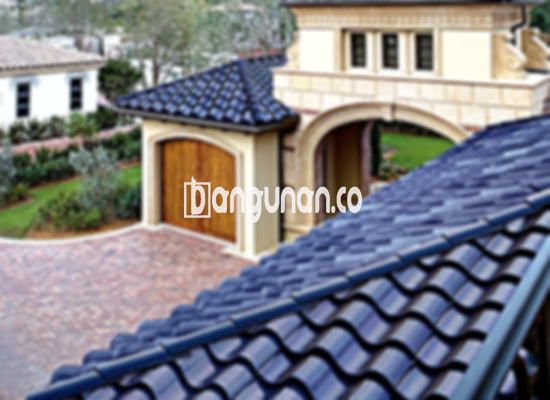

**Jual Genteng Kermaik & Beton di Dukuhturi** – Genteng adalah material hunian yang sangat penting untuk dimiliki setiap pemilik rumah. Melindungi tempat tinggal dari hujan, panas matahari, dan berbagai kondisi cuaca ekstrem, genteng juga berperan vital dalam menciptakan kenyamanan dan keamanan. Mitra Bangunan di Dukuhturi memahami betul kebutuhan Anda akan atap yang berkualitas. Kami menyediakan beragam pilihan genteng untuk memastikan rumah Anda terlindungi dengan baik.

Memilih genteng yang tepat sangatlah krusial. Ada banyak jenis genteng yang tersedia di pasaran, masing-masing dengan kelebihan dan kekurangannya tersendiri. Pertimbangan utama meliputi kualitas material, daya tahan, estetika, dan tentu saja, harga. Untuk itu, Kami hadir sebagai solusi terpercaya bagi Anda yang mencari genteng berkualitas di Dukuhturi.



## Informasi Harga Genteng dari Toko Jual Genteng Kermaik & Beton di Dukuhturi

Tersedia berbagai macam pilihan genteng yang dapat Anda sesuaikan dengan kebutuhan dan anggaran. Berikut adalah gambaran harga beberapa jenis genteng yang populer di Dukuhturi:

### – Harga Genteng Metal di Toko Genteng Kermaik & Beton di Dukuhturi

Genteng metal sangat populer karena kekuatannya dan penampilannya yang modern. Cocok untuk rumah minimalis, genteng metal memberikan kesan elegan dan tahan lama. Anda dapat menemukan berbagai pilihan warna dan desain untuk menyesuaikan dengan gaya arsitektur rumah Anda.

### – Harga Genteng Aspal di Toko Genteng Kermaik & Beton di Dukuhturi

Genteng aspal terbuat dari serat kayu dan aspal berkualitas tinggi. Material ini dikenal karena fleksibilitas dan ketahanannya terhadap api. Genteng aspal juga memberikan isolasi termal yang baik, membantu menjaga suhu ruangan tetap nyaman.

### – Harga Genteng Kermaik & Beton di Dukuhturi

Genteng keramik dan beton merupakan pilihan klasik yang tetap diminati. Genteng keramik terkenal dengan pilihan warna dan motif yang unik, memberikan sentuhan estetika pada hunian Anda. Sementara genteng beton menawarkan kekuatan dan daya tahan yang optimal.

### – Harga Genteng Kaca di Toko Genteng Kermaik & Beton di Dukuhturi

Genteng kaca sering digunakan sebagai aksen untuk memberikan pencahayaan alami pada rumah Anda. Pemasangan genteng kaca biasanya dikombinasikan dengan jenis genteng lain untuk menciptakan tampilan yang menarik dan fungsional.

### – Harga Genteng Seng di Toko Genteng Kermaik & Beton di Dukuhturi

Genteng seng merupakan pilihan ekonomis yang sering digunakan pada bangunan-bangunan tradisional. Meskipun tergolong ringan, genteng seng perlu dipasang dengan cermat menggunakan paku untuk memastikan kekuatannya.

### – Harga Genteng Beton di Toko Genteng Kermaik & Beton di Dukuhturi

Genteng beton adalah pilihan yang solid dan tahan lama. Terbuat dari campuran semen, pasir, dan air berkualitas tinggi, genteng beton sangat cocok untuk berbagai jenis atap dan kondisi cuaca. Untuk informasi harga yang lebih detail, silakan lihat tabel yang tersedia  atau hubungi kami.

**Ref by:**  [Genteng Kermaik & Beton  Dukuhturi](https://id.wikipedia.org/wiki/Genteng)

## Ragam Jenis Genteng dari Toko Jual Genteng Kermaik & Beton di Dukuhturi

Berikut adalah beberapa jenis genteng yang dapat Anda pertimbangkan untuk bangunan Anda:

### Genteng Keramik dari Toko Jual Genteng Kermaik & Beton di Dukuhturi

Genteng keramik merupakan pilihan tepat jika Anda menginginkan tampilan rumah yang klasik dan elegan. Bahan keramik memberikan isolasi termal yang baik, menjaga rumah tetap sejuk di siang hari dan hangat di malam hari.

### Genteng Seng dan Genteng Kermaik & Beton di Dukuhturi

Genteng seng adalah pilihan ekonomis yang cocok untuk rumah dengan anggaran terbatas. Anda dapat mengoptimalkan kekuatan genteng seng dengan pemasangan yang tepat menggunakan paku dan pemasangan yang cermat.

### Genteng Asbes dan Genteng Kermaik & Beton di Dukuhturi

Genteng asbes dulunya cukup populer, namun kini kurang direkomendasikan karena rentan terhadap kerusakan dan potensi masalah kesehatan. Pertimbangkan alternatif lain yang lebih tahan lama dan aman.

### Genteng Kanopi Baja Ringan dan Genteng Kermaik & Beton di Dukuhturi

Genteng kanopi baja ringan menawarkan kombinasi antara kekuatan, ringan, dan fleksibilitas desain. Cocok untuk berbagai jenis atap, genteng baja ringan memberikan solusi yang praktis dan estetis.

### Genteng Sirap Kayu Ulin dan Genteng Kermaik & Beton di Dukuhturi

Genteng sirap kayu ulin memberikan kesan alami dan tradisional pada rumah Anda. Kayu ulin dikenal karena ketahanannya terhadap cuaca ekstrem dan serangan hama.

Anda dapat memilih jenis Genteng Kermaik & Beton di Dukuhturi yang paling sesuai dengan preferensi Anda. Tentukan jumlah, bahan genteng, dan jenis genteng yang Anda butuhkan, dan Kami akan memberikan solusi terbaik untuk proyek Anda. Mitra Bangunan siap melayani Anda dengan cepat dan efisien. Jangan ragu untuk menghubungi kami melalui tombol WhatsApp atau Telepon di halaman ini untuk mendapatkan penawaran harga terbaik hari ini.