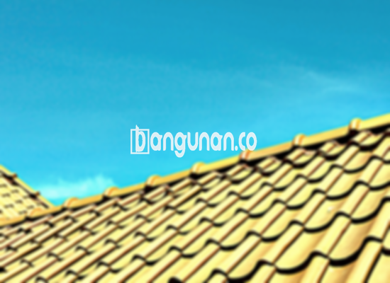

**Jual Genteng Kermaik & Beton di Duren Sawit Jakarta** – Membangun atau merenovasi atap rumah memerlukan material yang tepat. Mitra Bangunan di Duren Sawit Jakarta hadir untuk menyediakan solusi atap berkualitas tinggi. Genteng bukan hanya pelindung rumah dari cuaca, tetapi juga penentu estetika bangunan Anda. Kami menawarkan beragam pilihan genteng yang tahan lama dan mempercantik hunian.

Memilih genteng yang sesuai dengan kebutuhan dan anggaran adalah hal penting. Ada berbagai jenis genteng yang tersedia di pasaran, masing-masing dengan kelebihan dan kekurangannya. Dengan banyaknya pilihan, Anda mungkin merasa bingung. Mari kita bahas lebih lanjut mengenai berbagai jenis genteng yang kami sediakan di Duren Sawit Jakarta.



## Harga Genteng dari Toko Jual Genteng Kermaik & Beton di Duren Sawit Jakarta

Keputusan memilih genteng seringkali dipengaruhi oleh harga. Kami memahami hal ini dan menyediakan beragam pilihan harga yang sesuai dengan kebutuhan Anda. Berikut adalah perkiraan harga beberapa jenis genteng yang tersedia di toko kami di Duren Sawit Jakarta:

### - Harga Genteng Metal di Toko Genteng Kermaik & Beton di Duren Sawit Jakarta

Genteng metal adalah pilihan populer karena ringan, kuat, dan tahan lama. Desainnya yang modern cocok untuk rumah minimalis. Anda akan merasakan kesan menarik dan menawan ketika menggunakan jenis genteng ini. Untuk informasi harga yang lebih akurat, silakan lihat tabel harga di bawah ini atau hubungi tim kami.

### - Harga Genteng Aspal di Toko Genteng Kermaik & Beton di Duren Sawit Jakarta

Genteng aspal terbuat dari serat kayu dan aspal berkualitas tinggi. Material ini memberikan keunggulan dalam hal fleksibilitas dan kekuatan. Genteng aspal juga tahan terhadap api. Silakan periksa tabel harga untuk mengetahui harga terkini.

### - Harga Genteng Kermaik & Beton di Duren Sawit Jakarta

Genteng keramik merupakan pilihan klasik yang banyak diminati. Keunikan warna dan desainnya membuat banyak orang tertarik. Anda dapat menemukan berbagai pilihan warna dan motif di toko kami di Duren Sawit Jakarta. Informasi harga lengkap tersedia di tabel harga.

### - Harga Genteng Kaca di Toko Genteng Kermaik & Beton di Duren Sawit Jakarta

Genteng kaca sering digunakan sebagai aksen untuk memberikan pencahayaan alami pada ruangan. Karena tidak cocok untuk penggunaan menyeluruh, genteng ini biasanya dipasang secara terbatas. Untuk mengetahui harga genteng kaca, silakan lihat tabel harga.

### - Harga Genteng Seng di Toko Genteng Kermaik & Beton di Duren Sawit Jakarta

Genteng seng adalah pilihan ekonomis yang populer untuk rumah-rumah tradisional. Ukurannya yang panjang membuat pemasangan lebih efisien. Untuk memastikan kekuatan pemasangan, gunakan paku yang sesuai. Detail harga dapat Anda temukan di tabel harga.

### - Harga Genteng Beton di Toko Genteng Kermaik & Beton di Duren Sawit Jakarta

Genteng beton terbuat dari campuran semen, pasir, dan air berkualitas tinggi. Material ini sangat kuat dan tahan lama. Banyak orang lebih memilih genteng beton karena keunggulannya. Silakan lihat tabel harga untuk informasi lebih lanjut. 



## Berbagai Macam Genteng dari Toko Jual Genteng Kermaik & Beton di Duren Sawit Jakarta

Toko kami di Duren Sawit Jakarta menyediakan berbagai macam genteng untuk memenuhi kebutuhan Anda. Berikut beberapa pilihan yang tersedia:

### Genteng Keramik dari Toko Jual Genteng Kermaik & Beton di Duren Sawit Jakarta

Jika Anda sedang mencari genteng untuk rumah Anda, genteng keramik bisa menjadi pilihan yang tepat. Genteng keramik menawarkan keunggulan dalam hal efisiensi energi dan perlindungan terhadap cuaca. Dengan genteng keramik, rumah Anda akan lebih nyaman dan terlindungi.

### Genteng Seng dan Genteng Kermaik & Beton di Duren Sawit Jakarta

Genteng seng adalah pilihan yang hemat biaya, terutama untuk rumah-rumah yang sudah berdiri lama. Dengan ukuran yang lebih panjang, genteng seng dapat menghemat biaya pemasangan. Pemasangan yang kuat dapat dicapai dengan menggunakan paku yang sesuai.

### Genteng Asbes dan Genteng Kermaik & Beton di Duren Sawit Jakarta

Meskipun banyak digunakan di masa lalu, genteng asbes kurang direkomendasikan karena rentan terhadap kerusakan. Penggunaan genteng asbes dapat menyebabkan masalah perawatan dan penggantian yang lebih sering.

### Genteng Kanopi Baja Ringan dan Genteng Kermaik & Beton di Duren Sawit Jakarta

Genteng kanopi baja ringan adalah pilihan populer karena sifatnya yang ringan dan tahan lama. Desainnya yang unik memberikan kesan modern dan elegan pada bangunan Anda.

### Genteng Sirap Kayu Ulin dan Genteng Kermaik & Beton di Duren Sawit Jakarta

Genteng sirap kayu ulin terbuat dari kayu ulin berkualitas tinggi. Harganya relatif terjangkau dan memberikan tampilan alami pada rumah Anda. Genteng ini menciptakan suasana nyaman dan asri.

Anda dapat menemukan berbagai jenis Genteng Kermaik & Beton di Duren Sawit Jakarta yang sesuai dengan preferensi Anda. Tentukan jumlah, material, dan jenis genteng yang Anda butuhkan. Jangan ragu untuk menghubungi kami untuk mendapatkan penawaran harga terbaik. Kami siap membantu Anda mewujudkan atap impian Anda. 
<table class="table">
  <caption>Perbandingan Jenis Genteng</caption>
  <thead>
    <tr><th>Jenis Genteng</th><th>Kelebihan</th><th>Kekurangan</th></tr>
  </thead>
  <tbody>
    <tr><td>Genteng Metal</td><td>Ringan, Kuat, Tahan Lama</td><td>Harga Relatif Tinggi</td></tr>
    <tr><td>Genteng Aspal</td><td>Fleksibel, Kuat, Tahan Api</td><td>Membutuhkan Perawatan</td></tr>
    <tr><td>Genteng Keramik</td><td>Estetis, Tahan Lama</td><td>Lebih Berat</td></tr>
    <tr><td>Genteng Beton</td><td>Sangat Kuat, Tahan Lama</td><td>Memerlukan Struktur Atap yang Kuat</td></tr>
    <tr><td>Genteng Seng</td><td>Hemat Biaya</td><td>Mudah Berkarat</td></tr>
  </tbody>
</table>

**Ref by:**  [Genteng Kermaik & Beton  Duren Sawit Jakarta](https://id.wikipedia.org/wiki/Genteng)

Mitra Bangunan siap melayani kebutuhan genteng Anda di Duren Sawit Jakarta. Hubungi kami melalui tombol WhatsApp atau Telepon di halaman ini untuk konsultasi dan pemesanan. Kami berkomitmen memberikan pelayanan terbaik dan produk berkualitas tinggi untuk kepuasan Anda.