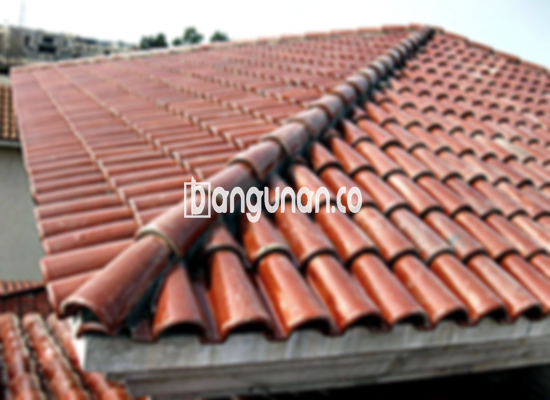

**Jual Genteng Kermaik & Beton di Duren Tiga Jakarta** – Membangun atau merenovasi rumah di Duren Tiga Jakarta membutuhkan material berkualitas, dan genteng adalah salah satu yang paling penting. Mitra Bangunan menyediakan berbagai pilihan genteng untuk melindungi hunian Anda dari cuaca ekstrem, mulai dari hujan deras hingga teriknya matahari. Dengan genteng yang tepat, rumah Anda tidak hanya terlindungi, tetapi juga terlihat lebih nyaman dan indah.

Memilih genteng yang sesuai dengan kebutuhan dan gaya rumah Anda adalah hal yang krusial. Ada beragam jenis genteng yang tersedia, masing-masing dengan kelebihan dan kekurangannya. Pertimbangkan dengan matang jenis genteng yang paling cocok untuk hunian Anda agar mendapatkan hasil yang optimal dan tahan lama.



## Penawaran Harga Genteng dari Toko Jual Genteng Kermaik & Beton di Duren Tiga Jakarta

Kami menyediakan beragam pilihan genteng dengan harga yang kompetitif. Berikut adalah estimasi harga berbagai jenis genteng yang bisa Anda pertimbangkan untuk proyek pembangunan Anda di Duren Tiga Jakarta:

### Harga Genteng Metal di Toko Genteng Kermaik & Beton di Duren Tiga Jakarta

Genteng metal adalah pilihan populer karena ringan, kuat, dan mudah dipasang. Desain modernnya juga sangat cocok untuk rumah-rumah minimalis di Duren Tiga Jakarta. Tampilan rumah Anda akan terlihat cantik dan elegan dengan penggunaan genteng metal.

### Harga Genteng Aspal di Toko Genteng Kermaik & Beton di Duren Tiga Jakarta

Genteng aspal menawarkan tampilan yang unik dan mewah dengan daya tahan yang baik. Terbuat dari serat kayu dan aspal berkualitas tinggi, genteng ini tahan terhadap api dan cuaca ekstrem. Pilihan tepat untuk Anda yang menginginkan atap rumah yang estetik dan aman.

### Harga Genteng Kermaik & Beton di Duren Tiga Jakarta

Genteng keramik dan beton adalah pilihan klasik yang tetap digemari karena keawetannya. Dengan berbagai pilihan warna dan desain, Anda dapat menciptakan tampilan rumah yang unik dan sesuai dengan selera Anda di Duren Tiga Jakarta.

### Harga Genteng Kaca di Toko Genteng Kermaik & Beton di Duren Tiga Jakarta

Genteng kaca sering digunakan sebagai aksen untuk menciptakan pencahayaan alami di dalam rumah. Meskipun tidak digunakan sebagai penutup atap utama, genteng kaca dapat memberikan sentuhan artistik dan modern pada desain rumah Anda.

### Harga Genteng Seng di Toko Genteng Kermaik & Beton di Duren Tiga Jakarta

Genteng seng adalah pilihan ekonomis yang cocok untuk bangunan dengan anggaran terbatas. Bentuknya yang panjang dan ringan membuatnya mudah dipasang dan efisien dalam penggunaan material.

### Harga Genteng Beton di Toko Genteng Kermaik & Beton di Duren Tiga Jakarta

Genteng beton dikenal karena kekuatannya dan ketahanannya terhadap cuaca buruk. Terbuat dari campuran semen, pasir, dan air berkualitas tinggi, genteng ini merupakan investasi jangka panjang yang akan melindungi rumah Anda selama bertahun-tahun.

Untuk informasi harga yang lebih detail dan penawaran khusus, silakan hubungi tim kami.



## Berbagai Jenis Genteng dari Toko Jual Genteng Kermaik & Beton di Duren Tiga Jakarta

Kami menyediakan beragam jenis genteng untuk memenuhi kebutuhan Anda. Berikut adalah beberapa pilihan yang tersedia:

### Genteng Keramik dari Toko Jual Genteng Kermaik & Beton di Duren Tiga Jakarta

Genteng keramik adalah pilihan yang populer karena keindahan dan ketahanannya. Dengan berbagai pilihan warna dan desain, Anda dapat menciptakan tampilan atap yang menarik dan elegan. Anda akan mendapatkan hunian yang lebih nyaman dan terlindungi dengan memilih genteng keramik.

### Genteng Seng dan Genteng Kermaik & Beton di Duren Tiga Jakarta

Genteng seng adalah pilihan ekonomis yang sering digunakan pada bangunan-bangunan tradisional. Ukurannya yang panjang membuat pemasangan lebih cepat dan hemat biaya. Untuk memperkuat pemasangan, pastikan untuk menggunakan paku berkualitas tinggi.

### Genteng Asbes dan Genteng Kermaik & Beton di Duren Tiga Jakarta

Meskipun dulu sering digunakan, genteng asbes kurang direkomendasikan karena potensi bahayanya bagi kesehatan. Bahan yang mudah rusak juga membuatnya kurang tahan lama dibandingkan jenis genteng lainnya.

### Genteng Kanopi Baja Ringan dan Genteng Kermaik & Beton di Duren Tiga Jakarta

Genteng kanopi baja ringan adalah pilihan yang ringan, kuat, dan tahan lama. Desainnya yang modern dan fleksibel membuatnya cocok untuk berbagai jenis bangunan di Duren Tiga Jakarta.

### Genteng Sirap Kayu Ulin dan Genteng Kermaik & Beton di Duren Tiga Jakarta

Genteng sirap kayu ulin memberikan tampilan alami dan tradisional pada rumah Anda. Terbuat dari kayu ulin berkualitas tinggi, genteng ini tahan terhadap cuaca ekstrem dan memberikan perlindungan yang optimal.

Anda dapat menemukan berbagai model Genteng Kermaik & Beton di Duren Tiga Jakarta yang sesuai dengan anggaran dan preferensi Anda. Jangan ragu untuk menghubungi kami untuk mendapatkan rekomendasi terbaik dan penawaran harga khusus.

**Ref by:**  [Genteng Kermaik & Beton  Duren Tiga Jakarta](https://id.wikipedia.org/wiki/Genteng)

Mitra Bangunan siap membantu Anda menemukan genteng yang sempurna untuk rumah Anda di Duren Tiga Jakarta. Hubungi kami sekarang juga melalui tombol WhatsApp atau Telepon di halaman ini untuk konsultasi gratis dan penawaran terbaik!