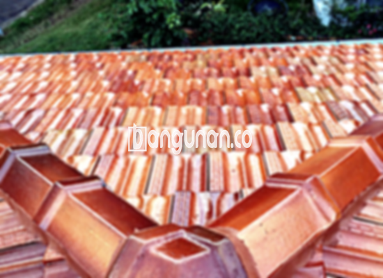

**Jual Genteng Kermaik & Beton di Gambir Jakarta** – Genteng merupakan material bangunan yang sangat penting untuk setiap pemilik hunian. Genteng berfungsi melindungi rumah Anda dari berbagai kondisi cuaca seperti hujan deras dan sengatan matahari terik. Dengan memilih genteng yang tepat, Anda dapat meningkatkan keamanan dan kenyamanan rumah Anda. Mitra Bangunan di Gambir Jakarta hadir untuk menyediakan beragam pilihan genteng berkualitas yang sesuai dengan kebutuhan Anda.

Mempertimbangkan kualitas genteng adalah langkah krusial dalam pembangunan atau renovasi rumah. Terdapat berbagai macam genteng yang tersedia di pasaran, masing-masing memiliki karakteristik unik. Memahami kelebihan dan kekurangan setiap jenis genteng akan membantu Anda membuat keputusan yang tepat sesuai dengan gaya arsitektur dan anggaran yang Anda miliki. Kami di Gambir Jakarta siap memberikan panduan yang Anda butuhkan.



## Harga Genteng dari Toko Jual Genteng Kermaik & Beton di Gambir Jakarta

Kami menyediakan berbagai variasi genteng dengan harga yang kompetitif. Berikut adalah tinjauan harga beberapa jenis genteng yang tersedia di toko kami di Gambir Jakarta. Dengan informasi ini, Anda dapat memperkirakan biaya yang dibutuhkan untuk proyek atap rumah Anda.

### \- Harga Genteng Metal di Toko Genteng Kermaik & Beton di Gambir Jakarta

Genteng metal menjadi pilihan populer karena bobotnya yang ringan dan ketahanannya terhadap cuaca. Seringkali digunakan pada desain rumah minimalis, memberikan sentuhan modern dan elegan. Untuk mendapatkan informasi harga terkini, Anda dapat melihat tabel harga di bawah ini atau menghubungi tim dukungan pelanggan kami.

### \- Harga Genteng Aspal di Toko Genteng Kermaik & Beton di Gambir Jakarta

Genteng aspal terbuat dari kombinasi serat kayu dan bahan aspal, menawarkan keseimbangan antara daya tahan dan fleksibilitas. Material ini juga dikenal akan sifat tahan apinya. Untuk mengetahui detail harga genteng aspal, silakan periksa daftar harga yang tersedia.

### \- Harga Genteng Kermaik & Beton di Gambir Jakarta

Genteng keramik sangat populer karena keindahan dan ketahanannya. Dengan berbagai pilihan warna dan desain, Anda dapat menciptakan tampilan atap yang unik dan menarik. Jangan ragu untuk menghubungi kami jika Anda ingin mendapatkan informasi harga terbaru.

### \- Harga Genteng Kaca di Toko Genteng Kermaik & Beton di Gambir Jakarta

Genteng kaca sering digunakan sebagai aksen dekoratif untuk menciptakan pencahayaan alami di dalam rumah. Perlu diperhatikan bahwa penggunaan genteng kaca secara berlebihan dapat meningkatkan suhu ruangan. Informasi harga lengkap tersedia di bagian harga kami.

### \- Harga Genteng Seng di Toko Genteng Kermaik & Beton di Gambir Jakarta

Genteng seng merupakan pilihan ekonomis yang sering digunakan pada bangunan-bangunan tradisional. Bentuknya yang panjang memungkinkan pemasangan yang cepat dan efisien. Untuk penawaran harga terbaik, hubungi kami sekarang juga.

### \- Harga Genteng Beton di Toko Genteng Kermaik & Beton di Gambir Jakarta

Genteng beton terbuat dari campuran semen, pasir, dan air, menjadikannya pilihan yang kuat dan tahan lama. Material ini cocok untuk berbagai gaya arsitektur dan kondisi iklim. Anda dapat mempelajari lebih lanjut tentang harga genteng beton pada tabel yang tersedia.



## Beberapa Tipe Genteng dari Toko Jual Genteng Kermaik & Beton di Gambir Jakarta

Kami menyediakan beragam jenis genteng yang bisa Anda pertimbangkan untuk proyek bangunan Anda. Berikut adalah beberapa pilihan yang tersedia di toko kami di Gambir Jakarta:

### Genteng Keramik dari Toko Jual Genteng Kermaik & Beton di Gambir Jakarta

Bagi Anda yang mencari genteng dengan tampilan yang indah dan tahan lama, genteng keramik adalah pilihan yang sangat tepat. Material ini menawarkan beragam warna dan desain yang dapat mempercantik tampilan rumah Anda.

### Genteng Seng dan Genteng Kermaik & Beton di Gambir Jakarta

Genteng seng adalah solusi yang ekonomis dan praktis, terutama untuk proyek dengan anggaran terbatas. Dengan bentuknya yang panjang, pemasangan genteng seng dapat menghemat waktu dan biaya.

### Genteng Asbes dan Genteng Kermaik & Beton di Gambir Jakarta

Genteng asbes adalah material ringan dan terjangkau, namun perlu diingat bahwa ketahanannya mungkin tidak sebaik jenis genteng lainnya. Anda perlu mempertimbangkan kelebihan dan kekurangan genteng asbes sebelum membuat keputusan.

### Genteng Kanopi Baja Ringan dan Genteng Kermaik & Beton di Gambir Jakarta

Genteng kanopi baja ringan menawarkan kombinasi kekuatan, fleksibilitas, dan desain yang modern. Material ini sangat cocok untuk berbagai jenis konstruksi atap.

### Genteng Sirap Kayu Ulin dan Genteng Kermaik & Beton di Gambir Jakarta

Genteng sirap kayu ulin memberikan nuansa alami dan estetis pada rumah Anda. Terbuat dari kayu ulin berkualitas tinggi, genteng ini menawarkan daya tahan dan keindahan yang alami.

Anda dapat memilih jenis Genteng Kermaik & Beton di Gambir Jakarta yang paling sesuai dengan keinginan Anda. Tentukan jumlah, bahan, dan jenis genteng yang dibutuhkan, dan jangan ragu untuk menghubungi tim kami untuk mendapatkan penawaran terbaik. Mitra Bangunan siap melayani Anda dan memastikan proyek atap rumah Anda berjalan lancar.

**Ref by:**  [Genteng Kermaik & Beton  Gambir Jakarta](https://id.wikipedia.org/wiki/Genteng)