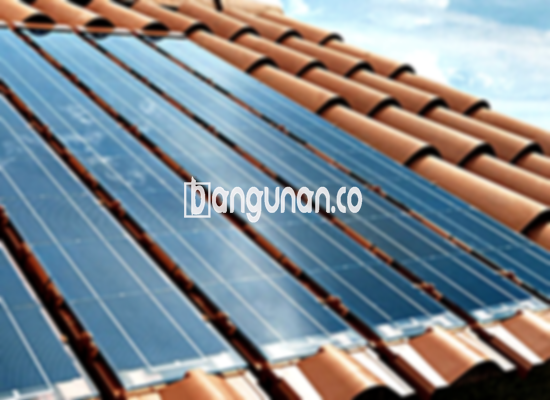

**Jual Genteng Kermaik & Beton di Gandaria Jakarta** – Genteng adalah material hunian yang sangat penting yang sebaiknya dimiliki setiap pemilik rumah. Genteng berfungsi melindungi rumah Anda dari berbagai kondisi cuaca seperti hujan, panas terik matahari, dan lainnya. Dengan genteng yang tepat, kondisi tempat tinggal akan menjadi jauh lebih aman dan nyaman. Rumah tanpa genteng tentu akan terasa pengap dan kurang terlindungi. Mitra Bangunan hadir di Gandaria Jakarta untuk menyediakan solusi atap terbaik bagi Anda.

Memilih genteng yang tepat sangatlah penting untuk kenyamanan dan keamanan hunian Anda. Tersedia berbagai macam genteng dengan kelebihan dan kekurangan masing-masing, serta preferensi yang berbeda-beda bagi setiap orang. Karena rumah adalah investasi jangka panjang, memilih genteng berkualitas adalah keputusan yang bijak dan perlu dipertimbangkan dengan matang.



## Informasi Harga Genteng dari Toko Jual Genteng Kermaik & Beton di Gandaria Jakarta

Terdapat berbagai pilihan genteng yang dapat Anda aplikasikan untuk proyek pembangunan atau renovasi Anda di Gandaria Jakarta. Setiap jenis genteng memiliki karakteristik dan harga yang berbeda. Berikut adalah informasi harga beberapa jenis genteng yang bisa Anda jadikan referensi.

### Harga Genteng Metal di Gandaria Jakarta

Genteng metal menjadi salah satu pilihan yang sangat populer di kalangan masyarakat. Bentuknya yang modern dan ringan membuatnya banyak diminati, terutama untuk desain rumah minimalis. Genteng metal juga dikenal karena kemudahan pemasangannya dan beragam pilihan warna yang menarik. Saat ini, harga genteng metal berkisar Rp. 26.000 per lembar.

### Harga Genteng Aspal di Gandaria Jakarta

Genteng aspal merupakan pilihan yang semakin diminati karena sifatnya yang fleksibel dan tahan terhadap api. Terbuat dari kombinasi serat kayu dan aspal, genteng ini memberikan perlindungan yang optimal bagi rumah Anda. Selain itu, genteng aspal juga memiliki daya serap suara yang baik dan tersedia dalam berbagai warna dan tekstur. Harga genteng aspal saat ini adalah Rp.125.000 per m².

### Harga Genteng Keramik & Beton di Gandaria Jakarta

Genteng keramik dan beton adalah pilihan klasik yang telah lama dikenal karena daya tahannya. Kedua jenis genteng ini tersedia dalam berbagai warna dan desain, memberikan Anda kebebasan untuk menyesuaikan dengan gaya arsitektur rumah Anda. Ketahanan dan kemudahan perawatannya menjadikan keduanya pilihan yang populer bagi banyak orang. Harga genteng keramik terbaru adalah Rp. 9.800 per buah.

### Harga Genteng Kaca di Gandaria Jakarta

Genteng kaca adalah pilihan yang unik dan menarik untuk memberikan sentuhan modern pada atap rumah Anda. Genteng ini biasanya digunakan sebagai aksen atau untuk menciptakan efek pencahayaan alami. Namun, perlu diperhatikan bahwa genteng kaca dapat membuat ruangan di bawahnya terasa lebih panas. Harga genteng kaca terbaru adalah Rp. 8.800 per biji.

### Harga Genteng Seng di Gandaria Jakarta

Genteng seng adalah pilihan yang ekonomis dan sering digunakan pada bangunan-bangunan lama. Ukurannya yang panjang membuat pemasangan lebih efisien dan hemat biaya. Meski tergolong sederhana, genteng seng tetap merupakan solusi atap yang praktis dan terjangkau. Harga genteng seng terbaru adalah Rp. 39.000 per lembar.

### Harga Genteng Beton di Gandaria Jakarta

Genteng beton dikenal karena kekuatannya dan ketahanannya terhadap cuaca ekstrem. Terbuat dari campuran semen, pasir, dan air berkualitas tinggi, genteng beton menjamin atap rumah Anda awet dan tahan lama. Anda dapat menemukan berbagai bentuk dan warna genteng beton yang sesuai dengan preferensi Anda. Harga genteng beton hari ini adalah Rp. 5.800 per buah.



## Berbagai Jenis Genteng dari Toko Jual Genteng Kermaik & Beton di Gandaria Jakarta

Berikut adalah beberapa jenis genteng yang dapat Anda temukan di toko kami di Gandaria Jakarta, beserta keunggulan masing-masing. Pilihlah jenis yang paling sesuai dengan kebutuhan dan anggaran Anda.

### Genteng Keramik dari Toko Jual Genteng Kermaik & Beton di Gandaria Jakarta

Jika Anda mencari genteng yang estetis dan tahan lama, genteng keramik adalah pilihan yang tepat. Dengan berbagai pilihan warna dan desain, Anda dapat menciptakan tampilan yang unik dan menarik untuk rumah Anda. Genteng keramik juga memberikan perlindungan yang baik terhadap panas dan hujan, menciptakan lingkungan yang nyaman di dalam rumah Anda.

### Genteng Seng dan Genteng Kermaik & Beton di Gandaria Jakarta

Genteng seng merupakan pilihan yang ekonomis dan praktis, terutama jika Anda memiliki anggaran terbatas. Ukurannya yang panjang memungkinkan pemasangan yang lebih cepat dan hemat biaya. Untuk kekuatan ekstra, pastikan Anda menggunakan paku yang berkualitas saat memasang genteng seng.

### Genteng Asbes dan Genteng Kermaik & Beton di Gandaria Jakarta

Meski dahulu populer, genteng asbes kini kurang direkomendasikan karena beberapa alasan. Genteng ini cenderung lebih rentan terhadap kerusakan dan memiliki umur pakai yang lebih pendek dibandingkan dengan jenis genteng lainnya. Pertimbangkan alternatif lain yang lebih tahan lama dan ramah lingkungan.

### Genteng Kanopi Baja Ringan dan Genteng Kermaik & Beton di Gandaria Jakarta

Genteng kanopi baja ringan adalah pilihan yang modern dan fleksibel. Material ini ringan, kuat, dan tahan terhadap berbagai kondisi cuaca. Ketersediaan berbagai warna dan bentuk memungkinkan Anda untuk menciptakan tampilan yang sesuai dengan gaya rumah Anda.

### Genteng Sirap Kayu Ulin dan Genteng Kermaik & Beton di Gandaria Jakarta

Genteng sirap kayu ulin memberikan kesan alami dan elegan pada rumah Anda. Terbuat dari kayu ulin berkualitas tinggi, genteng ini tahan terhadap cuaca ekstrem dan memberikan isolasi yang baik. Harganya relatif terjangkau dan memberikan nilai tambah pada estetika rumah Anda.

Mitra Bangunan di Gandaria Jakarta siap membantu Anda dalam memilih genteng yang tepat untuk hunian Anda. Kami menyediakan berbagai pilihan jenis genteng dengan harga yang kompetitif dan kualitas terjamin. Hubungi kami sekarang juga untuk mendapatkan penawaran terbaik dan layanan konsultasi gratis!

**Ref by:**  [Genteng Kermaik & Beton  Gandaria Jakarta](https://id.wikipedia.org/wiki/Genteng)