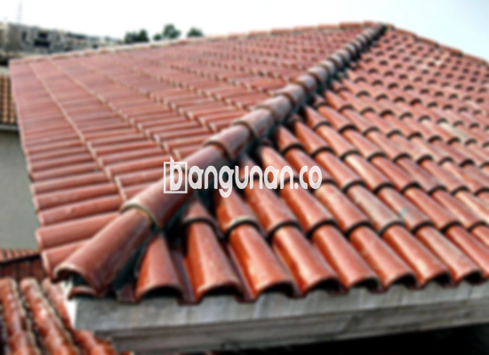

**Jual Genteng Kermaik & Beton di Gandul Depok** – Genteng merupakan bagian penting dari sebuah hunian yang sangat perlu dimiliki oleh setiap pemilik tempat tinggal. Material ini berfungsi melindungi rumah Anda dari berbagai kondisi cuaca seperti hujan, panas matahari yang terik, dan lain sebagainya, sehingga menciptakan lingkungan yang aman dan nyaman. Bagi Mitra Bangunan di Gandul Depok, kami hadir sebagai solusi terpercaya untuk memenuhi kebutuhan genteng berkualitas.

Mempertimbangkan berbagai jenis genteng yang tersedia dan memilih yang paling sesuai dengan kebutuhan dan anggaran Anda adalah langkah penting. Setiap jenis genteng memiliki keunggulan dan kekurangan masing-masing, dan preferensi setiap orang tentu berbeda-beda. Karena rumah adalah investasi jangka panjang, memilih genteng berkualitas adalah langkah bijak untuk memastikan ketahanan dan keindahan atap rumah Anda.



## Daftar Harga Genteng dari Toko Jual Genteng Kermaik & Beton di Gandul Depok

Terdapat beragam variasi harga genteng yang dapat Anda gunakan sebagai referensi. Berikut adalah estimasi harga dari beberapa jenis genteng yang kami tawarkan di toko kami yang berlokasi di Gandul Depok, yang dapat membantu Anda dalam perencanaan anggaran proyek Anda.

### – Harga Genteng Metal di Toko Genteng Kermaik & Beton di Gandul Depok

Genteng metal menjadi pilihan populer karena desainnya yang modern dan ringan. Sering digunakan pada desain rumah minimalis, material ini memberikan tampilan yang elegan dan menawan. Anda dapat menemukan berbagai pilihan desain dan warna yang menarik untuk menyesuaikan dengan gaya rumah Anda.

### – Harga Genteng Aspal di Toko Genteng Kermaik & Beton di Gandul Depok

Genteng aspal adalah pilihan yang banyak diminati karena daya tahannya dan penampilan estetikanya. Terbuat dari serat kayu dan aspal, material ini dikenal kuat, tahan lama, dan memiliki sifat anti-api yang menjadikannya pilihan aman. Selain itu, genteng aspal juga menawarkan isolasi termal yang baik.

### – Harga Genteng Keramik & Beton di Gandul Depok

Genteng keramik dan beton adalah pilihan klasik yang selalu menjadi favorit karena keindahan dan ketahanannya. Tersedia dalam berbagai warna dan desain, Anda dapat menyesuaikan pilihan genteng dengan gaya arsitektur rumah Anda. Material ini memberikan tampilan yang klasik namun tetap modern.

### – Harga Genteng Kaca di Toko Genteng Kermaik & Beton di Gandul Depok

Genteng kaca sering digunakan sebagai elemen dekoratif untuk menciptakan tampilan yang unik dan menarik. Meskipun tidak disarankan untuk seluruh permukaan atap karena dapat meningkatkan panas dalam ruangan, penggunaan genteng kaca dapat memberikan pencahayaan alami yang indah.

### – Harga Genteng Seng di Toko Genteng Kermaik & Beton di Gandul Depok

Genteng seng merupakan pilihan ekonomis yang sering digunakan pada bangunan tradisional. Material ini ringan, mudah dipasang, dan cocok untuk proyek renovasi dengan anggaran terbatas. Pastikan untuk menggunakan paku berkualitas tinggi untuk memastikan pemasangan yang aman dan tahan lama.

### – Harga Genteng Beton di Toko Genteng Kermaik & Beton di Gandul Depok

Genteng beton menawarkan kekuatan dan daya tahan yang luar biasa. Terbuat dari campuran semen, pasir, dan air berkualitas tinggi, material ini tahan terhadap cuaca ekstrem dan memiliki umur pakai yang panjang, menjadikannya investasi yang menguntungkan.



## Berbagai Jenis Genteng dari Toko Jual Genteng Kermaik & Beton di Gandul Depok

Tersedia berbagai jenis genteng untuk memenuhi kebutuhan spesifik Anda dalam membangun atau merenovasi atap rumah Anda di Gandul Depok. Berikut adalah beberapa opsi yang dapat Anda pertimbangkan:

### Genteng Keramik

Bagi Anda yang mencari genteng dengan tampilan klasik dan elegan, genteng keramik adalah pilihan yang sangat tepat. Material ini memberikan isolasi termal yang baik, membantu menjaga rumah Anda tetap sejuk di siang hari dan hangat di malam hari. Selain itu, genteng keramik juga memberikan estetika yang menarik.

### Genteng Seng dan Genteng Kermaik & Beton di Gandul Depok

Genteng seng merupakan pilihan ekonomis yang sering digunakan pada bangunan tradisional. Ukurannya yang agak panjang menjadikan genteng ini pilihan yang hemat biaya. Untuk memastikan pemasangan yang kuat dan tahan lama, disarankan untuk menggunakan paku berkualitas tinggi.

### Genteng Asbes

Meskipun kurang populer karena pertimbangan kesehatan dan lingkungan, genteng asbes masih tersedia sebagai opsi yang terjangkau. Namun, perlu diingat bahwa material ini cenderung lebih rapuh dan mungkin memerlukan perawatan ekstra untuk menjaga kondisinya.

### Genteng Kanopi Baja Ringan

Genteng kanopi baja ringan menawarkan kombinasi optimal antara kekuatan, ringan, dan estetika modern. Material ini tahan terhadap karat dan benturan, menjadikannya pilihan yang ideal untuk berbagai jenis atap. Genteng ini juga mudah dipasang dan dirawat.

### Genteng Sirap Kayu Ulin

Genteng sirap kayu ulin memberikan tampilan alami dan unik pada rumah Anda. Terbuat dari kayu ulin berkualitas tinggi, material ini tahan terhadap cuaca ekstrem dan memiliki daya tahan yang baik. Anda akan mendapatkan tampilan yang unik dan berkarakter dengan memilih genteng ini.

Anda dapat menemukan berbagai jenis Genteng Kermaik & Beton di Gandul Depok yang sesuai dengan kebutuhan dan preferensi Anda di toko kami. Jika Anda sedang mencari pilihan serupa, pertimbangkan [Jual Genteng Kermaik & Beton di Bojongsari Baru Depok](/jual-genteng-kermaik-beton-di-bojongsari-baru-depok/) sebagai alternatif. Kami siap membantu Anda dalam memilih material yang paling tepat untuk proyek Anda. Jangan ragu untuk menghubungi kami untuk mendapatkan informasi lebih lanjut dan penawaran harga terbaik, Mitra Bangunan.

**Ref by:**  [Genteng Kermaik & Beton  Gandul Depok](https://id.wikipedia.org/wiki/Genteng)