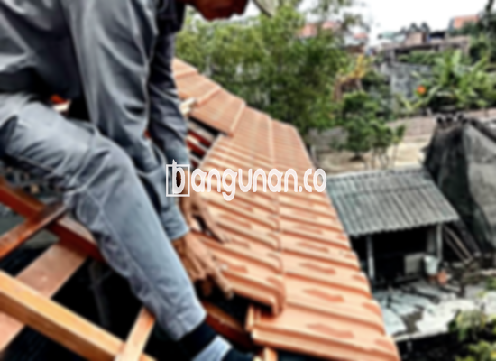

**Jual Genteng Kermaik & Beton di Garut** – Genteng merupakan salah satu material krusial untuk setiap hunian, yang wajib dimiliki oleh setiap pemilik rumah. Perlindungan maksimal dari hujan, panas terik matahari, dan berbagai kondisi cuaca dapat diandalkan dengan genteng berkualitas. Mitra Bangunan di Garut hadir untuk menyediakan genteng yang tepat guna menciptakan hunian yang aman dan nyaman. Kami memahami pentingnya memilih material atap yang tepat, dan berkomitmen untuk membantu Anda menemukan solusi terbaik.

Memiliki atap yang kokoh dan tahan lama tentu menjadi prioritas utama setiap pemilik rumah. Investasi pada genteng berkualitas adalah langkah bijak untuk memastikan hunian Anda terlindungi secara optimal. Pilihlah genteng yang sesuai dengan gaya arsitektur rumah Anda dan iklim di Garut, agar investasi Anda memberikan manfaat jangka panjang.



## Harga Genteng Dari Toko Jual Genteng Kermaik & Beton di Garut

Berbagai jenis genteng tersedia di pasaran, masing-masing dengan harga yang bervariasi. Memahami kisaran harga dapat membantu Anda dalam perencanaan anggaran proyek pembangunan atau renovasi. Sebagai panduan, berikut adalah informasi harga beberapa jenis genteng yang dapat Anda temukan di toko kami di Garut.

### – Harga Genteng Metal Di Toko Genteng Kermaik & Beton di Garut

Genteng metal adalah pilihan populer karena ringan, kuat, dan memiliki tampilan modern. Material ini sangat cocok untuk rumah minimalis, memberikan kesan elegan dan kontemporer. Untuk mengetahui harga terbarunya, Anda dapat melihat detail pada tabel harga di bawah ini.

### – Harga Genteng Aspal Di Toko Genteng Kermaik & Beton di Garut

Genteng aspal terbuat dari serat kayu dan aspal, menawarkan fleksibilitas dan ketahanan terhadap api. Material ini banyak dipilih karena kualitas dan keamanannya. Informasi harga lengkap dan detailnya dapat ditemukan pada tabel harga yang kami sediakan.

### – Harga Genteng Kermaik & Beton di Garut

Genteng keramik adalah pilihan klasik yang tetap populer hingga saat ini. Keindahan dan daya tahannya menjadikannya investasi yang menguntungkan. Tersedia dalam berbagai warna dan desain, genteng keramik dapat mempercantik tampilan atap rumah Anda. Untuk informasi harga terkini, silakan periksa tabel harga yang tersedia.

### – Harga Genteng Kaca Di Toko Genteng Kermaik & Beton di Garut

Genteng kaca sering digunakan sebagai aksen untuk memberikan pencahayaan alami ke dalam ruangan. Namun, perlu diingat bahwa genteng kaca dapat menyebabkan ruangan menjadi lebih panas. Anda dapat menemukan detail harga genteng kaca pada tabel yang kami sediakan.

### – Harga Genteng Seng Di Toko Genteng Kermaik & Beton di Garut

Genteng seng merupakan pilihan ekonomis, terutama untuk bangunan tradisional. Ukurannya yang panjang membuatnya efisien dan cost-effective. Informasi harga terbaru untuk genteng seng dapat Anda temukan pada tabel harga di bawah ini.

### – Harga Genteng Beton Di Toko Genteng Kermaik & Beton di Garut

Genteng beton dikenal dengan kekuatannya dan ketahanannya yang luar biasa. Terbuat dari campuran semen, pasir, dan air berkualitas tinggi, material ini merupakan pilihan ideal untuk atap yang tahan lama. Silakan periksa tabel harga untuk mendapatkan informasi harga genteng beton terbaru.



## Beberapa Macam Genteng Dari Toko Jual Genteng Kermaik & Beton di Garut

Kami menyediakan berbagai macam genteng untuk memenuhi semua kebutuhan atap Anda. Setiap jenis genteng memiliki karakteristik unik dan keunggulan tersendiri. Berikut adalah beberapa opsi yang tersedia di toko kami di Garut:

### Genteng Keramik Dari Toko Jual Genteng Kermaik & Beton di Garut

Jika Anda mencari genteng dengan estetika klasik dan daya tahan yang teruji, genteng keramik adalah pilihan yang tepat. Material ini memberikan keindahan dan perlindungan optimal bagi hunian Anda. Anda akan merasakan kenyamanan maksimal dengan genteng keramik yang berkualitas.

### Genteng Seng dan Genteng Kermaik & Beton di Garut

Genteng seng merupakan solusi ekonomis untuk atap rumah Anda. Ukurannya yang panjang memberikan efisiensi biaya, sementara pemasangan yang benar dengan paku akan memastikan kekokohannya. Material ini sering digunakan pada bangunan-bangunan tradisional.

### Genteng Asbes dan Genteng Kermaik & Beton di Garut

Genteng asbes dulunya banyak digunakan, namun saat ini kurang direkomendasikan karena rentan terhadap kerusakan. Anda mungkin perlu mempertimbangkan penggantian genteng asbes dengan material yang lebih tahan lama dan berkualitas.

### Genteng Kanopi Baja Ringan dan Genteng Kermaik & Beton di Garut

Genteng kanopi baja ringan menawarkan kombinasi antara kekuatan, fleksibilitas, dan desain yang menarik. Material ini cocok digunakan untuk berbagai jenis atap, memberikan perlindungan optimal dan tampilan yang modern.

### Genteng Sirap Kayu Ulin dan Genteng Kermaik & Beton di Garut

Genteng sirap kayu ulin terbuat dari kayu ulin yang memiliki kekuatan dan ketahanan alami. Material ini memberikan solusi atap yang terjangkau dan ramah lingkungan. Dengan memilih genteng sirap kayu ulin, Anda berinvestasi pada atap yang kuat dan tahan lama.

Anda dapat memilih jenis Genteng Kermaik & Beton di Garut yang paling sesuai dengan preferensi dan anggaran Anda. Jangan ragu untuk menghubungi kami untuk mendapatkan konsultasi gratis dan penawaran harga terbaik. Mitra Bangunan siap membantu Anda mewujudkan atap impian untuk hunian Anda di Garut.

**Ref by:**  [Genteng Kermaik & Beton  Garut](https://id.wikipedia.org/wiki/Genteng)