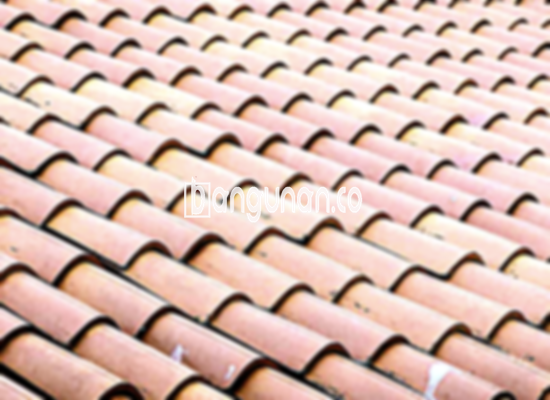

**Jual Genteng Kermaik & Beton di Gedong Jakarta** – Membangun hunian impian di Gedong Jakarta memerlukan material bangunan berkualitas tinggi, dan genteng merupakan salah satu elemen krusial yang perlu Anda pertimbangkan. Genteng tidak hanya berfungsi sebagai pelindung atap dari berbagai kondisi cuaca seperti hujan dan panas, tetapi juga berperan penting dalam estetika rumah Anda. Kami hadir sebagai solusi bagi Mitra Bangunan yang mencari genteng berkualitas dengan harga terjangkau di Gedong Jakarta.

Memilih jenis genteng yang tepat adalah investasi jangka panjang untuk kenyamanan dan keamanan keluarga Anda. Berbagai pilihan genteng tersedia di pasaran, masing-masing menawarkan keunggulan dan karakteristik unik. Sebagai konsumen cerdas, Anda perlu memahami perbedaan antara jenis-jenis genteng tersebut agar bisa membuat keputusan yang paling sesuai dengan kebutuhan dan anggaran Anda.



## Harga Genteng dari Toko Jual Genteng Kermaik & Beton di Gedong Jakarta

Kami menyediakan beragam opsi genteng dengan rentang harga yang bervariasi, memungkinkan Anda menemukan solusi yang paling sesuai dengan anggaran proyek Anda. Berikut adalah panduan perkiraan harga untuk berbagai jenis genteng yang tersedia di toko kami di Gedong Jakarta.

### - Harga Genteng Metal di Toko Genteng Kermaik & Beton di Gedong Jakarta

Genteng metal merupakan pilihan yang populer di kalangan pemilik rumah modern karena bobotnya yang ringan, kekuatan yang mumpuni, dan kemudahan dalam proses pemasangan. Material ini juga dikenal memiliki ketahanan terhadap korosi sehingga minim perawatan. Anda dapat menikmati tampilan atap yang bersih dan minimalis dengan memilih genteng metal.

### - Harga Genteng Aspal di Toko Genteng Kermaik & Beton di Gedong Jakarta

Genteng aspal menawarkan solusi atap yang estetis dan tahan lama. Terbuat dari kombinasi serat kayu dan aspal berkualitas tinggi, material ini memberikan isolasi termal yang baik, membantu menjaga suhu ruangan tetap nyaman. Anda dapat memilih dari berbagai warna dan tekstur untuk menciptakan tampilan atap yang sesuai dengan gaya rumah Anda. Untuk informasi harga terbaru, silakan periksa tabel harga di bawah atau hubungi tim kami.

### - Harga Genteng Keramik & Beton di Gedong Jakarta

Genteng keramik dan beton merupakan pilihan klasik yang telah lama digunakan di Indonesia. Kedua jenis genteng ini menawarkan kekuatan, daya tahan, serta ketersediaan dalam beragam warna dan desain. Anda dapat menemukan genteng keramik atau beton yang sesuai dengan gaya arsitektur rumah Anda untuk menciptakan tampilan yang harmonis dan tahan lama.

### - Harga Genteng Kaca di Toko Genteng Kermaik & Beton di Gedong Jakarta

Genteng kaca sering digunakan sebagai elemen dekoratif untuk memberikan sentuhan unik dan alami pada atap rumah Anda. Material ini memungkinkan cahaya matahari masuk ke dalam ruangan, menciptakan suasana yang lebih terang dan segar. Perlu diingat bahwa genteng kaca umumnya digunakan sebagai aksen dan tidak disarankan untuk seluruh bagian atap karena dapat meningkatkan panas di dalam ruangan.

### - Harga Genteng Seng di Toko Genteng Kermaik & Beton di Gedong Jakarta

Genteng seng adalah solusi ekonomis yang sering digunakan untuk bangunan dengan anggaran terbatas. Meskipun relatif ringan dan terjangkau, genteng seng membutuhkan perawatan rutin seperti pengecatan untuk mencegah karat. Anda dapat menghemat biaya dengan memilih genteng seng, namun perlu memastikan pemasangan yang tepat agar atap tetap kokoh dan aman.

### - Harga Genteng Beton di Toko Genteng Kermaik & Beton di Gedong Jakarta

Genteng beton adalah pilihan yang sangat kuat dan tahan lama, ideal untuk bangunan yang membutuhkan perlindungan ekstra terhadap cuaca ekstrem. Terbuat dari campuran semen, pasir, dan air berkualitas tinggi, genteng beton menawarkan ketahanan yang luar biasa terhadap hujan, panas, dan angin kencang.



## Berbagai Macam Ragam Genteng Dari Toko Jual Genteng Kermaik & Beton di Gedong Jakarta

Kami menyediakan beragam jenis genteng yang dapat Anda pilih untuk memenuhi kebutuhan bangunan Anda di Gedong Jakarta, antara lain:

### Genteng Keramik Dari Toko Jual Genteng Kermaik & Beton di Gedong Jakarta

Genteng keramik merupakan pilihan yang populer karena desainnya yang indah dan durabilitasnya yang teruji. Anda akan menemukan berbagai warna, pola, dan ukuran untuk menyesuaikan dengan gaya arsitektur rumah Anda. Selain itu, genteng keramik memiliki sifat insulasi yang baik, membantu menjaga suhu ruangan tetap stabil.

### Genteng Seng dan Genteng Kermaik & Beton di Gedong Jakarta

Genteng seng masih menjadi pilihan praktis bagi banyak pemilik rumah, terutama karena harganya yang terjangkau dan pemasangannya yang relatif mudah. Agar dapat bertahan lama, pastikan Anda menggunakan paku berkualitas tinggi dan melakukan perawatan rutin untuk mencegah karat.

### Genteng Asbes dan Genteng Kermaik & Beton di Gedong Jakarta

Meskipun harganya ekonomis, penggunaan genteng asbes kini semakin diminati berkurang karena risiko kesehatan dan lingkungan yang terkait dengan kandungan asbes. Pertimbangkan alternatif lain yang lebih ramah lingkungan dan aman bagi kesehatan keluarga Anda.

### Genteng Kanopi Baja Ringan dan Genteng Kermaik & Beton di Gedong Jakarta

Genteng kanopi baja ringan menawarkan kombinasi antara kekuatan, ringan, dan daya tahan. Material ini tahan terhadap karat dan memiliki umur pakai yang panjang, menjadikannya pilihan ideal untuk berbagai jenis atap rumah Anda. Anda juga dapat memilih dari berbagai desain dan warna untuk menciptakan tampilan atap yang menarik.

### Genteng Sirap Kayu Ulin dan Genteng Kermaik & Beton di Gedong Jakarta

Genteng sirap kayu ulin memberikan tampilan alami dan elegan pada rumah Anda. Terbuat dari kayu ulin yang telah diawetkan secara khusus, material ini tahan terhadap cuaca ekstrem dan memiliki umur pakai yang panjang. Anda akan mendapatkan atap yang unik dan nyaman dengan memilih genteng sirap kayu ulin.

Untuk mendapatkan penawaran terbaik dan informasi lebih lanjut mengenai Genteng Kermaik & Beton di Gedong Jakarta, jangan ragu untuk menghubungi kami. Kami siap membantu Anda menemukan solusi atap yang sempurna untuk hunian impian Anda. Sebagai Mitra Bangunan yang terpercaya, kami menjamin kualitas produk dan pelayanan yang memuaskan.

**Ref by:**  [Genteng Kermaik & Beton  Gedong Jakarta](https://id.wikipedia.org/wiki/Genteng)