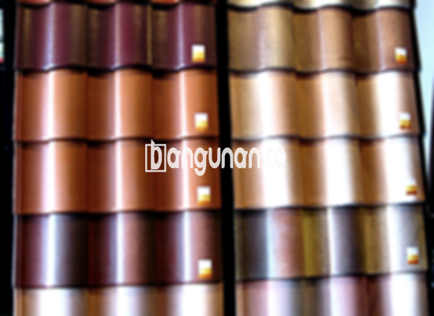

**Jual Genteng Kermaik & Beton di Gelora Jakarta** – Genteng adalah salah satu material hunian yang sangat penting untuk dimiliki setiap pemilik rumah. Genteng berperan melindungi bangunan Anda dari berbagai kondisi cuaca seperti hujan lebat, terik matahari yang menyengat, dan faktor lingkungan lainnya. Dengan genteng yang tepat, kondisi rumah akan terasa lebih aman dan nyaman. Bagi Mitra Bangunan di Gelora Jakarta yang sedang mencari solusi atap berkualitas, kami hadir untuk memenuhi kebutuhan Anda.

Memilih genteng yang sesuai dengan kebutuhan dan anggaran Anda adalah langkah krusial dalam membangun atau merenovasi rumah. Terdapat berbagai jenis genteng yang tersedia di pasaran, masing-masing memiliki kelebihan dan kekurangan tersendiri. Mempertimbangkan investasi jangka panjang, banyak orang lebih memilih genteng berkualitas tinggi demi memastikan atap rumah mereka lebih awet dan terlindungi.



## Informasi Harga Genteng dari Toko Jual Genteng Kermaik & Beton di Gelora Jakarta

Berbagai pilihan jenis genteng tersedia untuk Anda, masing-masing dengan karakteristik dan harga yang berbeda. Berikut adalah informasi mengenai perkiraan harga yang dapat Anda jadikan pertimbangan:

### - Harga Genteng Metal di Toko Genteng Kermaik & Beton di Gelora Jakarta

Genteng metal merupakan salah satu pilihan yang sangat populer karena menawarkan tampilan modern dan elegan, sehingga sangat cocok untuk rumah bergaya minimalis. Jenis genteng ini dikenal karena ringan, kuat, dan relatif mudah dalam proses pemasangannya. Informasi harga yang lebih rinci dapat Anda temukan di tabel harga yang tersedia.

### - Harga Genteng Aspal di Toko Genteng Kermaik & Beton di Gelora Jakarta

Genteng aspal terbuat dari kombinasi serat kayu dan material aspal yang direkayasa khusus. Material ini menawarkan daya tahan yang baik serta fleksibilitas yang menjadikannya pilihan populer di kalangan banyak orang. Selain itu, genteng aspal juga memiliki sifat tahan api yang merupakan nilai tambah dalam hal keamanan. Anda dapat melihat harga terbaru pada daftar harga kami.

### - Harga Genteng Kermaik & Beton di Gelora Jakarta

Genteng keramik dan beton adalah pilihan klasik yang tetap diminati hingga saat ini. Kedua jenis genteng ini unggul dalam hal kekuatan, daya tahan, serta pilihan desain dan warna yang beragam. Dengan begitu, Anda dapat menemukan genteng yang sesuai dengan gaya arsitektur rumah Anda. Daftar harga lengkap tersedia untuk Anda konsultasikan.

### - Harga Genteng Kaca di Toko Genteng Kermaik & Beton di Gelora Jakarta

Genteng kaca seringkali digunakan sebagai elemen dekoratif untuk memberikan sentuhan estetika unik pada desain atap. Penggunaannya umumnya terbatas pada sebagian area saja karena memiliki potensi meningkatkan temperatur di dalam ruangan. Informasi harga lebih lanjut tersedia di tabel harga kami.

### - Harga Genteng Seng di Toko Genteng Kermaik & Beton di Gelora Jakarta

Genteng seng merupakan pilihan ekonomis yang seringkali ditemukan pada bangunan-bangunan yang lebih tua. Ukurannya yang relatif panjang membuat proses pemasangan lebih efisien dan dapat menghemat biaya. Informasi harga yang akurat dapat Anda peroleh pada tabel harga yang disediakan.

### - Harga Genteng Beton di Toko Genteng Kermaik & Beton di Gelora Jakarta

Genteng beton terbuat dari campuran bahan-bahan berkualitas seperti semen, pasir, dan air. Proses pembuatan ini menghasilkan material yang kokoh dan tahan lama, ideal untuk melindungi rumah Anda dari berbagai kondisi cuaca. Untuk mengetahui harga terkini, silakan merujuk pada tabel harga yang tersedia.



## Jenis-jenis Genteng yang Tersedia di Toko Jual Genteng Kermaik & Beton di Gelora Jakarta

Berikut adalah berbagai jenis genteng yang dapat Anda pilih untuk bangunan Anda:

### Genteng Keramik dari Toko Jual Genteng Kermaik & Beton di Gelora Jakarta

Jika Anda sedang mencari genteng yang memberikan tampilan estetis dan tahan lama, genteng keramik adalah pilihan yang tepat. Jenis genteng ini menawarkan keunggulan dalam melindungi rumah dari panas matahari dan memberikan tampilan yang menarik.

### Genteng Seng dan Genteng Kermaik & Beton di Gelora Jakarta

Genteng seng merupakan opsi yang ekonomis dan sering digunakan pada bangunan-bangunan tradisional. Bentuknya yang panjang membuat pemasangan lebih cepat dan efisien, menghemat biaya konstruksi Anda.

### Genteng Asbes dan Genteng Kermaik & Beton di Gelora Jakarta

Genteng asbes dulunya banyak digunakan, namun saat ini kurang direkomendasikan karena kurang tahan lama dan memiliki potensi risiko kesehatan. Ada banyak alternatif yang lebih baik dan aman untuk dipilih.

### Genteng Kanopi Baja Ringan dan Genteng Kermaik & Beton di Gelora Jakarta

Genteng kanopi baja ringan menawarkan kombinasi antara kekuatan, ringan, dan desain modern yang menarik. Material ini ideal untuk berbagai jenis atap dan memberikan tampilan yang stylish.

### Genteng Sirap Kayu Ulin dan Genteng Kermaik & Beton di Gelora Jakarta

Genteng sirap kayu ulin memberikan sentuhan alami dan tradisional pada bangunan Anda. Terbuat dari kayu ulin berkualitas tinggi, genteng ini tahan lama dan memberikan estetika yang unik.

Anda dapat memilih jenis Genteng Kermaik & Beton di Gelora Jakarta yang paling sesuai dengan kebutuhan dan preferensi Anda. Tentukan jumlah yang diperlukan, jenis material, dan desain yang Anda inginkan, dan kami siap melayani Anda. Mitra Bangunan yang sedang mencari atap berkualitas, jangan ragu untuk menghubungi kami melalui tombol WhatsApp atau Telepon di halaman ini untuk mendapatkan penawaran harga terbaik dan konsultasi gratis.

**Ref by:**  [Genteng Kermaik & Beton  Gelora Jakarta](https://id.wikipedia.org/wiki/Genteng)