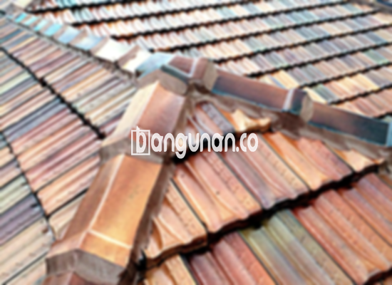

**Jual Genteng Kermaik & Beton di Genteng Bogor** – Genteng merupakan salah satu material hunian yang sangat penting yang seharusnya dimiliki setiap pemilik rumah. Melindungi rumah dari berbagai kondisi cuaca, seperti hujan deras, panas terik matahari, dan kondisi ekstrem lainnya, adalah fungsi utamanya. Investasi pada genteng berkualitas akan memastikan rumah Anda terlindungi dan nyaman dalam jangka waktu yang lama. Bagi Mitra Bangunan di Genteng Bogor yang mencari solusi atap terbaik, kami hadir untuk menyediakan beragam pilihan genteng berkualitas tinggi.

Mempertimbangkan kualitas atap sebagai prioritas utama adalah bijak. Banyak sekali jenis genteng yang tersedia, masing-masing dengan karakteristik unik, kelebihan, dan kekurangan. Memahami perbedaan ini akan membantu Anda membuat keputusan yang tepat sesuai dengan kebutuhan dan anggaran. Pilihan tepat akan memberikan kenyamanan dan keamanan bagi hunian Anda.



## Harga Genteng dari Toko Jual Genteng Kermaik & Beton di Genteng Bogor

Apabila Anda sedang merencanakan pembangunan atau renovasi rumah di Genteng Bogor, penting untuk memahami estimasi biaya yang dibutuhkan. Kami menawarkan berbagai pilihan genteng dengan harga yang kompetitif, sesuai dengan kualitas dan jenisnya. Berikut adalah perkiraan harga beberapa jenis genteng yang dapat Anda pertimbangkan sebagai acuan:

### - Harga Genteng Metal di Toko Genteng Kermaik & Beton di Genteng Bogor

Genteng metal menjadi pilihan yang sangat populer di kalangan masyarakat karena sifatnya yang ringan, kuat, dan mudah dalam proses pemasangan. Material ini sering digunakan untuk desain rumah modern atau minimalis, memberikan tampilan yang elegan. Anda dapat menemukan variasi desain dan warna pada genteng metal sesuai dengan preferensi Anda.

### - Harga Genteng Aspal di Toko Genteng Kermaik & Beton di Genteng Bogor

Genteng aspal menawarkan daya tarik visual yang unik dengan tampilan yang menyerupai sirap kayu alami. Terbuat dari serat kayu berkualitas tinggi yang dilapisi aspal, genteng ini memberikan ketahanan terhadap cuaca ekstrem dan api. Dengan berbagai pilihan warna dan tekstur, Anda dapat menciptakan tampilan atap yang menawan.

### - Harga Genteng Kermaik & Beton di Genteng Bogor

Genteng keramik dan beton telah lama menjadi pilihan utama bagi banyak orang karena keawetannya serta tampilan klasiknya. Variasi warna dan desain yang tak terhitung jumlahnya memungkinkan Anda menyesuaikan tampilan atap dengan konsep arsitektur rumah Anda. Pilihlah material yang berkualitas untuk keawetan jangka panjang.

### - Harga Genteng Kaca di Toko Genteng Kermaik & Beton di Genteng Bogor

Genteng kaca memberikan sentuhan mewah dan unik pada desain atap rumah Anda. Biasanya digunakan sebagai aksen pada area tertentu untuk menciptakan pencahayaan alami yang menarik. Perlu diingat, penggunaan genteng kaca yang berlebihan dapat meningkatkan suhu ruangan.

### - Harga Genteng Seng di Toko Genteng Kermaik & Beton di Genteng Bogor

Genteng seng merupakan pilihan ekonomis yang sering dijumpai pada bangunan-bangunan tradisional. Ukurannya yang panjang membantu menghemat biaya karena membutuhkan lebih sedikit pemasangan. Penggunaan paku yang kuat sangat penting untuk memastikan ketahanan genteng seng terhadap angin kencang.

### - Harga Genteng Beton di Toko Genteng Kermaik & Beton di Genteng Bogor

Genteng beton menawarkan kekuatan dan daya tahan yang luar biasa. Dibuat dari campuran semen, pasir, dan air berkualitas tinggi, material ini mampu menahan berbagai kondisi cuaca ekstrem. Pilihan ideal untuk Anda yang menginginkan atap yang kokoh dan tahan lama.



## Jenis-Jenis Genteng dari Toko Jual Genteng Kermaik & Beton di Genteng Bogor

Memahami karakteristik masing-masing jenis genteng akan mempermudah Anda dalam menentukan pilihan yang terbaik. Berikut adalah beberapa jenis genteng yang tersedia di toko kami, siap untuk memenuhi kebutuhan pembangunan Anda:

### Genteng Keramik dari Toko Jual Genteng Kermaik & Beton di Genteng Bogor

Genteng keramik merupakan pilihan yang sangat populer karena keindahan dan ketahanannya. Anda akan menemukan beragam pilihan warna dan desain yang dapat disesuaikan dengan gaya arsitektur rumah Anda.  Genteng ini memberikan perlindungan optimal terhadap cuaca buruk dan memberikan kenyamanan maksimal bagi penghuni rumah. Anda dapat menemukan inspirasi desain menarik di [Jual Genteng Kermaik & Beton di Baranangsiang Bogor](/jual-genteng-kermaik-beton-di-baranangsiang-bogor/).

### Genteng Seng dan Genteng Kermaik & Beton di Genteng Bogor

Genteng seng, yang sering digunakan pada bangunan-bangunan lama, menawarkan solusi hemat biaya. Dengan ukuran yang panjang, genteng ini membutuhkan sedikit pemasangan. Pastikan Anda menggunakan paku yang berkualitas untuk memastikan kekokohan pemasangan.

### Genteng Asbes dan Genteng Kermaik & Beton di Genteng Bogor

Meskipun dahulu banyak digunakan, genteng asbes kini memiliki beberapa kekurangan. Genteng ini cenderung kurang tahan lama dan berpotensi menimbulkan masalah kesehatan. Kami menyarankan Anda untuk mempertimbangkan alternatif yang lebih ramah lingkungan dan aman.

### Genteng Kanopi Baja Ringan dan Genteng Kermaik & Beton di Genteng Bogor

Genteng kanopi baja ringan adalah pilihan yang praktis dan efisien. Material ini ringan, kuat, dan mudah dipasang, menjadikannya solusi ideal untuk berbagai desain atap. Anda dapat menikmati ketenangan pikiran dengan atap yang tahan lama dan minim perawatan.

### Genteng Sirap Kayu Ulin dan Genteng Kermaik & Beton di Genteng Bogor

Genteng sirap kayu ulin menawarkan keindahan alami yang unik dan menawan. Terbuat dari kayu ulin berkualitas tinggi yang tahan terhadap cuaca ekstrem, genteng ini memberikan tampilan yang hangat dan tradisional pada rumah Anda.

Anda dapat menemukan berbagai pilihan Genteng Kermaik & Beton di Genteng Bogor yang sesuai dengan kebutuhan rumah Anda. Hubungi kami hari ini untuk mendapatkan konsultasi gratis dan penawaran terbaik! Bagi Mitra Bangunan yang mencari solusi atap yang terpercaya dan berkualitas di Genteng Bogor, jangan ragu untuk menghubungi kami melalui tombol WhatsApp atau Telepon yang tersedia di halaman ini. Kami siap melayani Anda dengan sepenuh hati.

**Ref by:**  [Genteng Kermaik & Beton  Genteng Bogor](https://id.wikipedia.org/wiki/Genteng)