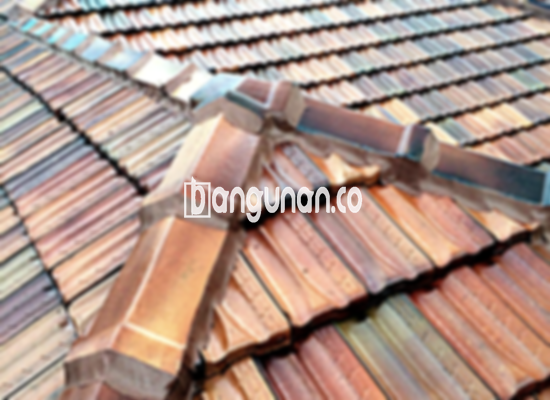

**Jual Genteng Kermaik & Beton di Gondangdia Jakarta** – Genteng adalah bagian material tempat tinggal yang sangat penting untuk dimiliki setiap pemilik rumah. Genteng berperan penting dalam melindungi rumah Anda dari berbagai kondisi cuaca, seperti hujan lebat dan panas terik matahari. Dengan memilih genteng yang tepat, Mitra Bangunan di Gondangdia Jakarta dapat menciptakan lingkungan hunian yang aman dan nyaman.

Mempertimbangkan dengan cermat jenis genteng yang akan digunakan dalam pembangunan rumah adalah sebuah keputusan yang bijaksana. Terdapat berbagai macam pilihan genteng dengan keunggulan dan kekurangannya masing-masing. Setiap individu memiliki preferensi yang berbeda-beda dalam menentukan jenis genteng yang paling sesuai dengan gaya arsitektur dan kebutuhan rumah mereka. Karena rumah merupakan investasi jangka panjang, memilih genteng yang bermutu tinggi adalah prioritas utama.



## Harga Genteng dari Toko Jual Genteng Kermaik & Beton di Gondangdia Jakarta

Ada begitu banyak variasi genteng yang tersedia untuk dipilih oleh Anda. Setiap jenis genteng tentunya memiliki keunggulan tersendiri. Berikut adalah beberapa informasi terkait harga genteng yang bisa Anda gunakan sebagai referensi:

### \- Harga Genteng Metal di Toko Genteng Kermaik & Beton di Gondangdia Jakarta

Genteng metal adalah salah satu pilihan yang paling banyak diminati oleh masyarakat. Jenis genteng ini memberikan tampilan yang modern dan sering digunakan pada desain rumah minimalis. Penampilannya yang cantik dan elegan akan meningkatkan estetika rumah Anda. Informasi harga genteng metal terbaru dapat Anda peroleh dengan melihat tabel harga yang tersedia atau dengan menghubungi tim kami.

### \- Harga Genteng Aspal di Toko Genteng Kermaik & Beton di Gondangdia Jakarta

Genteng aspal juga merupakan pilihan populer yang banyak digunakan. Terbuat dari serat kayu dan bahan aspal berkualitas tinggi, genteng ini menawarkan kombinasi daya tahan dan fleksibilitas. Selain itu, genteng aspal memiliki sifat tahan api yang menjadikannya pilihan yang aman untuk hunian Anda. Anda dapat melihat detail harga genteng aspal terbaru di tabel harga yang kami sediakan.

### \- Harga Genteng Kermaik & Beton di Gondangdia Jakarta

Genteng keramik merupakan salah satu jenis genteng yang paling dikenal dan banyak digunakan. Keunggulannya terletak pada variasi warna yang unik dan menarik, sehingga dapat memberikan sentuhan estetika yang khas pada rumah Anda. Pilihan ini sangat cocok bagi Anda yang menginginkan tampilan rumah yang tradisional atau klasik. Anda dapat menemukan informasi harga genteng keramik terkini pada tabel harga kami.

### \- Harga Genteng Kaca di Toko Genteng Kermaik & Beton di Gondangdia Jakarta

Genteng kaca seringkali digunakan sebagai elemen dekoratif untuk menciptakan efek pencahayaan alami di dalam rumah. Penggunaan genteng kaca biasanya tidak menutupi seluruh area atap karena dapat menyebabkan ruangan menjadi lebih panas. Jenis genteng ini lebih ideal untuk digunakan pada area tertentu yang membutuhkan pencahayaan tambahan. Anda dapat melihat daftar harga genteng kaca terbaru pada tabel harga yang tersedia.

### \- Harga Genteng Seng di Toko Genteng Kermaik & Beton di Gondangdia Jakarta

Genteng seng sering ditemukan pada bangunan-bangunan tua. Ukurannya yang relatif panjang menjadikan genteng ini sebagai pilihan yang hemat biaya. Agar pemasangannya lebih kuat, Anda perlu memastikan genteng dipaku dengan baik. Informasi harga genteng seng terbaru dapat Anda temukan di tabel harga kami.

### \- Harga Genteng Beton di Toko Genteng Kermaik & Beton di Gondangdia Jakarta

Genteng beton dikenal karena kekuatan dan ketahanannya. Terbuat dari campuran semen, pasir, dan air berkualitas tinggi, genteng ini mampu menahan berbagai kondisi cuaca ekstrem. Banyak pemilik rumah memilih genteng beton karena kualitasnya yang unggul. Untuk informasi harga genteng beton terkini, silakan merujuk pada tabel harga yang kami sediakan.



## Beberapa Macam Genteng dari Toko Jual Genteng Kermaik & Beton di Gondangdia Jakarta

Berikut adalah beberapa variasi genteng yang dapat Anda pertimbangkan untuk bangunan rumah Anda:

### Genteng Keramik dari Toko Jual Genteng Kermaik & Beton di Gondangdia Jakarta

Bagi Anda yang sedang mencari genteng untuk hunian Anda, genteng keramik bisa menjadi pilihan yang sangat tepat. Jenis genteng ini memiliki daya tarik tersendiri, dan akan meningkatkan efisiensi rumah Anda. Selain itu, hunian Anda juga akan terlindungi dengan baik dari sengatan matahari yang dapat menyebabkan panas.

### Genteng Seng dan Genteng Kermaik & Beton di Gondangdia Jakarta

Genteng seng merupakan salah satu jenis genteng yang populer di masa lalu, ditandai dengan ukurannya yang relatif panjang. Ukuran yang panjang tersebut menjadikan jenis genteng ini lebih ekonomis dalam segi biaya. Agar pemasangannya lebih efektif dan tahan lama, Anda dapat menambahkan paku untuk memperkuatnya agar tidak mudah bergeser atau rusak.

### Genteng Asbes dan Genteng Kermaik & Beton di Gondangdia Jakarta

Salah satu jenis genteng yang cukup banyak digunakan oleh masyarakat adalah genteng asbes. Namun, jenis genteng ini tergolong kurang ideal untuk digunakan karena materialnya mudah rusak. Kerusakan pada genteng asbes dapat menyebabkan masalah dan memerlukan penggantian yang lebih sering.

### Genteng Kanopi Baja Ringan dan Genteng Kermaik & Beton di Gondangdia Jakarta

Beberapa jenis genteng yang sangat populer dan banyak digunakan adalah genteng kanopi baja ringan. Genteng ini memiliki kesan yang modern dan unik, serta menawarkan ketahanan yang tinggi terhadap berbagai jenis atap.

### Genteng Sirap Kayu Ulin dan Genteng Kermaik & Beton di Gondangdia Jakarta

Jenis genteng selanjutnya adalah genteng sirap kayu ulin. Genteng ini terbuat dari bahan dasar kayu ulin yang dipilih karena kualitasnya yang baik. Harganya pun relatif terjangkau dan tentunya akan membuat hunian Anda terasa nyaman jika menggunakan jenis genteng ini.

Anda dapat membeli berbagai jenis Genteng Kermaik & Beton di Gondangdia Jakarta yang sesuai dengan kebutuhan Anda. Silakan tentukan jumlah, material genteng, dan jenis genteng yang Anda butuhkan, dan kami siap membantu Anda. Hubungi kami segera untuk mendapatkan penawaran harga terbaik dan layanan konsultasi gratis. Dengan demikian, Mitra Bangunan dapat mewujudkan atap hunian impian Anda dengan mudah dan tepat.

**Ref by:**  [Genteng Kermaik & Beton  Gondangdia Jakarta](https://id.wikipedia.org/wiki/Genteng)