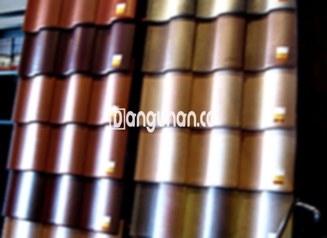

**Jual Genteng Kermaik & Beton di Grogol Jakarta** – Genteng merupakan material esensial dalam pembangunan sebuah rumah yang seharusnya dimiliki setiap pengguna hunian. Genteng berfungsi melindungi tempat tinggal Anda dari berbagai kondisi cuaca seperti hujan dan panas terik. Bagi Mitra Bangunan di Grogol Jakarta, menemukan solusi atap yang tepat kini semakin mudah. Kami hadir dengan berbagai pilihan genteng berkualitas yang akan menjadikan rumah Anda lebih aman dan nyaman.

Memastikan rumah terlindungi dengan baik memerlukan pemilihan material yang tepat. Ada beragam jenis genteng yang tersedia, masing-masing dengan karakteristik unik. Pertimbangkan dengan cermat kebutuhan dan gaya arsitektur rumah Anda agar mendapatkan hasil yang optimal. Dengan genteng yang berkualitas, Anda dapat meningkatkan nilai estetika serta ketahanan bangunan Anda.



## Harga Genteng dari Toko Jual Genteng Kermaik & Beton di Grogol Jakarta

Banyak sekali jenis genteng yang tersedia bagi Anda untuk diaplikasikan pada bangunan hunian. Setiap jenis memiliki keunggulan tersendiri, sehingga penting untuk mempertimbangkan kebutuhan spesifik Anda. Berikut adalah beberapa perkiraan harga genteng yang dapat Anda gunakan sebagai acuan.

### – Harga Genteng Metal di Toko Genteng Kermaik & Beton di Grogol Jakarta

Bagi banyak orang, genteng metal menjadi pilihan utama karena desainnya yang modern dan elegan. Genteng ini sangat populer untuk rumah dengan gaya minimalis. Untuk informasi lebih detail mengenai harga genteng metal terbaru, silakan lihat detailnya di bawah ini.

### – Harga Genteng Aspal di Toko Genteng Kermaik & Beton di Grogol Jakarta

Genteng aspal, yang terbuat dari serat kayu dan aspal, menawarkan kombinasi daya tahan dan fleksibilitas yang luar biasa. Material dasarnya yang efektif menjadikannya pilihan yang diminati banyak orang. Selain itu, kekuatan dan ketahanannya terhadap api menjadikannya investasi yang cerdas. Informasi harga genteng aspal terkini tersedia di sini.

### – Harga Genteng Keramik & Beton di Grogol Jakarta

Genteng keramik telah lama menjadi pilihan favorit banyak orang karena keindahan dan keunikannya. Dengan berbagai pilihan warna yang menarik, genteng ini dapat memberikan sentuhan estetika yang mempesona pada rumah Anda.  Untuk mengetahui harga genteng keramik terbaru, Anda dapat melihat informasinya di bawah.

### – Harga Genteng Kaca di Toko Genteng Kermaik & Beton di Grogol Jakarta

Genteng kaca sering digunakan sebagai elemen dekoratif untuk memberikan pencahayaan alami pada rumah. Namun, perlu diingat bahwa penggunaan genteng kaca secara berlebihan dapat menyebabkan ruangan menjadi lebih panas. Untuk informasi harga genteng kaca terkini, silakan lihat detailnya di bawah ini.

### – Harga Genteng Seng di Toko Genteng Kermaik & Beton di Grogol Jakarta

Genteng seng adalah pilihan ekonomis yang kerap digunakan pada bangunan-bangunan tradisional. Ukurannya yang relatif panjang membuatnya hemat biaya, menjadikannya pilihan yang menarik bagi banyak orang. Untuk memastikan pemasangan yang kuat, disarankan untuk menggunakan paku tambahan. Informasi harga genteng seng terbaru tersedia di sini.

### – Harga Genteng Beton Di Toko Genteng Kermaik & Beton di Grogol Jakarta

Genteng beton, yang terbuat dari campuran semen, pasir, dan air, dikenal karena kekuatannya dan daya tahannya. Banyak orang lebih memilih genteng beton karena kualitasnya yang terjamin dan kemampuannya untuk menahan berbagai kondisi cuaca. Informasi harga genteng beton terkini dapat Anda temukan di sini.



## Jenis-jenis Genteng dari Toko Jual Genteng Kermaik & Beton di Grogol Jakarta

Ada beraneka ragam jenis genteng yang tersedia bagi Anda untuk dipilih. Berikut adalah beberapa pilihan yang dapat Anda pertimbangkan untuk bangunan hunian Anda.

### Genteng Keramik dari Toko Jual Genteng Kermaik & Beton di Grogol Jakarta

Jika Anda mencari genteng yang menawarkan tampilan klasik dan elegan, genteng keramik adalah pilihan yang tepat. Jenis genteng ini memberikan perlindungan terhadap panas matahari, sehingga menjaga rumah Anda tetap sejuk dan nyaman. Anda akan merasakan kenyamanan yang optimal di tempat tinggal Anda.

### Genteng Seng dan Genteng Kermaik & Beton di Grogol Jakarta

Genteng seng adalah pilihan ekonomis yang sering digunakan pada bangunan-bangunan lama. Ukurannya yang panjang membuatnya hemat biaya dan mudah dipasang. Untuk memastikan genteng tetap kuat dan tahan lama, tambahkan paku saat pemasangan.

### Genteng Asbes dan Genteng Kermaik & Beton di Grogol Jakarta

Genteng asbes merupakan salah satu jenis genteng yang cukup banyak digunakan karena harganya yang terjangkau. Namun, perlu diingat bahwa genteng asbes cenderung kurang tahan lama dan mudah rusak, sehingga memerlukan penggantian secara berkala.

### Genteng Kanopi Baja Ringan dan Genteng Kermaik & Beton di Grogol Jakarta

Genteng kanopi baja ringan menawarkan kombinasi antara kekuatan, fleksibilitas, dan desain yang unik. Jenis genteng ini cocok untuk berbagai jenis atap dan memberikan perlindungan yang efektif terhadap cuaca ekstrem.

### Genteng Sirap Kayu Ulin dan Genteng Kermaik & Beton di Grogol Jakarta

Genteng sirap kayu ulin terbuat dari kayu ulin yang kuat dan tahan lama. Jenis genteng ini memberikan kesan alami dan nyaman pada rumah Anda. Selain itu, harganya yang relatif terjangkau menjadikannya pilihan yang menarik bagi banyak orang.

Anda dapat memilih berbagai jenis Genteng Kermaik & Beton di Grogol Jakarta yang sesuai dengan kebutuhan dan anggaran Anda. Kami siap membantu Anda dalam memilih dan menyediakan material yang tepat. Sebagai Mitra Bangunan, jangan ragu untuk menghubungi kami melalui tombol WhatsApp atau Telepon di halaman ini untuk mendapatkan penawaran harga terbaik. Kami akan dengan senang hati membantu Anda mewujudkan rumah impian Anda.

**Ref by:**  [Genteng Kermaik & Beton  Grogol Jakarta](https://id.wikipedia.org/wiki/Genteng)