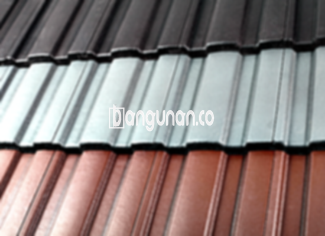

**Jual Genteng Kermaik & Beton di Guntur Jakarta** – Genteng adalah material penting untuk setiap hunian yang wajib dimiliki setiap pemilik rumah. Genteng melindungi rumah Anda dari berbagai kondisi cuaca seperti hujan, panas terik matahari, dan lain sebagainya. Hunian yang terlindungi genteng akan terasa lebih nyaman dan aman bagi Mitra Bangunan. Rumah tanpa genteng tentu akan terasa pengap dan rentan terhadap kerusakan.

Memilih genteng yang tepat sangatlah penting untuk kenyamanan dan keamanan rumah Anda. Ada beragam jenis genteng yang tersedia, masing-masing dengan keunggulan dan kekurangannya tersendiri. Setiap orang memiliki preferensi masing-masing untuk jenis genteng yang akan digunakan pada rumah mereka. Mempertimbangkan rumah sebagai investasi jangka panjang, banyak yang memilih genteng berkualitas untuk keawetan dan estetika.



## Informasi Harga Genteng dari Toko Jual Genteng Kermaik & Beton di Guntur Jakarta

Tersedia beragam pilihan genteng dengan karakteristik uniknya masing-masing. Berikut ini adalah gambaran harga beberapa jenis genteng yang dapat menjadi acuan bagi Anda:

### \- Harga Genteng Metal di Toko Genteng Kermaik & Beton di Guntur Jakarta

Genteng metal merupakan salah satu pilihan populer di kalangan masyarakat. Jenis ini sangat digemari karena tampilannya yang modern dan sering digunakan pada rumah minimalis. Penggunaan genteng metal dapat memberikan kesan elok dan indah pada hunian Anda. Untuk informasi harga terbarunya, silakan merujuk ke tabel harga berikut ini.

### \- Harga Genteng Aspal di Toko Genteng Kermaik & Beton di Guntur Jakarta

Genteng aspal juga banyak digunakan karena terbuat dari serat kayu dan aspal berkualitas tinggi. Bahan dasar ini memberikan kekuatan dan fleksibilitas pada genteng, serta tahan terhadap api. Genteng aspal menjadi pilihan menarik bagi Anda yang mengutamakan keamanan dan ketahanan. Untuk detail harga, Anda bisa melihat pada tabel yang tersedia.

### \- Harga Genteng Kermaik & Beton di Guntur Jakarta

Genteng keramik merupakan pilihan klasik yang banyak disukai. Jenis ini memiliki nilai estetika tersendiri dengan pilihan warna dan desain yang unik. Genteng keramik dapat memberikan tampilan yang menarik dan berkarakter pada rumah Anda. Untuk mengetahui harga terbaru, silakan lihat tabel harga kami.

### \- Harga Genteng Kaca di Toko Genteng Kermaik & Beton di Guntur Jakarta

Genteng kaca biasanya digunakan sebagai pelengkap atau aksen pada atap rumah. Penggunaannya tidak secara keseluruhan karena dapat menyebabkan ruangan menjadi lebih panas. Genteng kaca lebih sering dimanfaatkan untuk memberikan pencahayaan alami pada hunian Anda. Silakan lihat tabel harga untuk mengetahui detailnya.

### \- Harga Genteng Seng di Toko Genteng Kermaik & Beton di Guntur Jakarta

Genteng seng sering ditemukan pada rumah-rumah tradisional. Ukurannya cenderung lebih panjang dan merupakan pilihan ekonomis. Jika Anda mencari alternatif yang hemat biaya, genteng seng bisa menjadi pertimbangan. Pastikan pemasangan dilakukan dengan benar menggunakan paku untuk memastikan kekuatannya. Untuk informasi harga, lihat tabel harga yang tersedia.

### \- Harga Genteng Beton di Toko Genteng Kermaik & Beton di Guntur Jakarta

Genteng beton dibuat dari campuran semen, pasir, dan air berkualitas tinggi. Jenis ini dikenal kokoh dan kuat. Banyak orang lebih memilih genteng beton karena daya tahannya yang terjamin. Untuk mengetahui harga terbarunya, silakan merujuk pada tabel harga di bawah ini.



## Beragam Pilihan Genteng dari Toko Jual Genteng Kermaik & Beton di Guntur Jakarta

Berikut adalah beberapa jenis genteng yang dapat Anda pertimbangkan untuk bangunan rumah Anda:

### Genteng Keramik dari Toko Jual Genteng Kermaik & Beton di Guntur Jakarta

Jika Anda sedang mencari genteng untuk rumah Anda, genteng keramik bisa menjadi pilihan yang tepat. Jenis ini menawarkan keindahan tersendiri yang dapat meningkatkan nilai estetika rumah Anda. Selain itu, genteng keramik membantu menjaga kondisi rumah dari panas matahari.

### Genteng Seng dan Genteng Kermaik & Beton di Guntur Jakarta

Genteng seng adalah pilihan klasik yang sering digunakan di masa lalu. Ukurannya yang panjang menjadikannya pilihan ekonomis. Untuk memastikan kekuatannya, Anda dapat menambahkan paku saat pemasangan.

### Genteng Asbes dan Genteng Kermaik & Beton di Guntur Jakarta

Genteng asbes cukup banyak digunakan, namun kurang direkomendasikan karena bahannya mudah rusak. Penggantian genteng asbes mungkin diperlukan lebih sering.

### Genteng Kanopi Baja Ringan dan Genteng Kermaik & Beton di Guntur Jakarta

Genteng kanopi baja ringan sangat populer karena ringan, elastis, dan kuat. Jenis ini cocok untuk berbagai jenis atap dan memberikan kesan modern pada rumah Anda.

### Genteng Sirap Kayu Ulin dan Genteng Kermaik & Beton di Guntur Jakarta

Genteng sirap kayu ulin terbuat dari kayu ulin berkualitas tinggi. Harganya relatif terjangkau dan dapat menciptakan suasana nyaman di dalam rumah Anda.

Anda dapat membeli berbagai jenis Genteng Kermaik & Beton di Guntur Jakarta yang sesuai dengan kebutuhan Anda. Tentukan jumlah, bahan, dan jenis genteng yang diinginkan. Dengan begitu, Anda akan mendapatkan genteng yang tepat untuk rumah Anda. Hubungi kami segera untuk mendapatkan penawaran harga terbaik, dan jangan ragu untuk berkonsultasi dengan tim kami. Mitra Bangunan siap membantu Anda menemukan solusi atap yang ideal.

**Ref by:**  [Genteng Kermaik & Beton  Guntur Jakarta](https://id.wikipedia.org/wiki/Genteng)