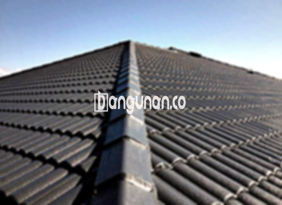

**Jual Genteng Kermaik & Beton di Gunung Batu Bogor** – Genteng merupakan material hunian yang sangat penting yang seharusnya dimiliki setiap pemilik rumah. Kami di Gunung Batu Bogor memahami betul kebutuhan akan perlindungan maksimal bagi tempat tinggal Anda. Genteng memberikan perlindungan optimal dari berbagai kondisi cuaca, seperti hujan deras, panas terik matahari, dan berbagai elemen alam lainnya. Dengan memilih genteng yang tepat, [Mitra Bangunan](/jual-genteng-kermaik-beton-di-batu-malang/) dapat memastikan kondisi tempat tinggal tetap aman dan nyaman. Rumah tanpa genteng akan terasa kurang terlindungi dan mudah panas.

Sangatlah penting bagi Anda untuk memilih genteng yang sesuai untuk hunian Anda. Ada banyak sekali ragam genteng yang tersedia di pasaran, masing-masing dengan kelebihan dan kekurangannya. Setiap jenis genteng memiliki karakteristik unik yang dapat disesuaikan dengan preferensi dan kebutuhan Anda. Mempertimbangkan bahwa rumah adalah investasi jangka panjang, banyak orang memilih genteng berkualitas tinggi untuk memastikan ketahanan dan keindahan bangunan mereka.



## Harga Genteng dari Toko Jual Genteng Kermaik & Beton di Gunung Batu Bogor

Tersedia berbagai pilihan genteng yang dapat Anda aplikasikan sesuai dengan anggaran dan kebutuhan Anda. Setiap jenis genteng menawarkan keunggulan tersendiri. Sebagai referensi, berikut adalah perkiraan harga beberapa jenis genteng yang kami sediakan:

### – Harga Genteng Metal di Toko Genteng Kermaik & Beton di Gunung Batu Bogor

Genteng metal adalah salah satu jenis genteng yang paling banyak digunakan, dikenal karena desainnya yang modern dan ringan. Material ini sering menjadi pilihan utama untuk rumah dengan gaya minimalis, memberikan tampilan yang elegan dan bersih. Untuk mendapatkan informasi harga terbaru genteng metal, silakan merujuk ke tabel harga di bawah ini atau hubungi tim penjualan kami.

### – Harga Genteng Aspal di Toko Genteng Kermaik & Beton di Gunung Batu Bogor

Genteng aspal juga populer di kalangan pemilik rumah karena tampilannya yang menarik dan ketahanannya. Terbuat dari serat kayu dan aspal berkualitas tinggi, material ini menawarkan perlindungan yang baik terhadap cuaca. Anda dapat menemukan detail harga genteng aspal yang tersedia di tabel harga kami.

### – Harga Genteng Kermaik & Beton di Gunung Batu Bogor

Genteng keramik dan beton merupakan pilihan klasik yang sering digunakan oleh banyak orang. Jenis genteng ini menawarkan keindahan tersendiri dan memiliki daya tahan yang baik. Tersedia dalam berbagai warna dan tekstur, memungkinkan Anda menciptakan tampilan yang unik dan personal untuk rumah Anda. Harga genteng keramik dan beton dapat ditemukan pada tabel harga yang kami sediakan.

### – Harga Genteng Kaca di Toko Genteng Kermaik & Beton di Gunung Batu Bogor

Genteng kaca sering digunakan sebagai elemen dekoratif untuk menciptakan pencahayaan alami di dalam ruangan. Namun, penting untuk diingat bahwa penggunaan genteng kaca secara berlebihan dapat menyebabkan ruangan terasa lebih panas. Anda dapat menemukan informasi harga genteng kaca pada tabel harga yang tersedia.

### – Harga Genteng Seng di Toko Genteng Kermaik & Beton di Gunung Batu Bogor

Genteng seng adalah pilihan ekonomis yang sering digunakan pada bangunan tradisional. Ukurannya yang panjang membuatnya lebih efisien dalam pemasangan dan mengurangi biaya. Untuk mengetahui harga genteng seng terkini, silakan periksa tabel harga yang kami sediakan.

### – Harga Genteng Beton di Toko Genteng Kermaik & Beton di Gunung Batu Bogor

Genteng beton dibuat dari campuran semen, pasir, dan air berkualitas tinggi, menghasilkan material yang kuat dan tahan lama. Banyak orang memilih genteng beton karena kemampuannya menahan cuaca ekstrem dan umur pakainya yang panjang. Detail harga genteng beton dapat Anda temukan di tabel harga yang kami sediakan.



## Beberapa Tipe Genteng dari Toko Jual Genteng Kermaik & Beton di Gunung Batu Bogor

Berikut adalah beberapa tipe genteng yang bisa Anda pertimbangkan untuk membangun atau merenovasi hunian Anda di Gunung Batu Bogor:

### Genteng Keramik dari Toko Jual Genteng Kermaik & Beton di Gunung Batu Bogor

Bagi Anda yang mencari genteng dengan tampilan klasik dan elegan, genteng keramik adalah pilihan yang tepat. Material ini memberikan perlindungan optimal terhadap cuaca dan meningkatkan nilai estetika rumah Anda. Sentuhan artistik pada desain genteng keramik akan memberikan karakter tersendiri pada hunian Anda.

### Genteng Seng dan Genteng Kermaik & Beton di Gunung Batu Bogor

Genteng seng merupakan pilihan populer di masa lalu, dan masih banyak digunakan hingga kini. Ukurannya yang lebih panjang menjadikannya solusi ekonomis karena mengurangi jumlah genteng yang dibutuhkan. Agar pemasangannya lebih kuat dan tahan lama, pastikan untuk menggunakan paku yang berkualitas.

### Genteng Asbes dan Genteng Kermaik & Beton di Gunung Batu Bogor

Meskipun dulu banyak digunakan, genteng asbes kini kurang direkomendasikan karena sifatnya yang mudah rusak dan potensinya membahayakan kesehatan. Material ini memerlukan perawatan ekstra dan penggantian yang lebih sering.

### Genteng Kanopi Baja Ringan dan Genteng Kermaik & Beton di Gunung Batu Bogor

Genteng kanopi baja ringan menawarkan kombinasi kekuatan dan fleksibilitas yang menarik. Material ini cocok untuk berbagai desain atap dan memberikan perlindungan optimal terhadap cuaca. Keunggulannya terletak pada bobotnya yang ringan dan kemudahan pemasangannya.

### Genteng Sirap Kayu Ulin dan Genteng Kermaik & Beton di Gunung Batu Bogor

Genteng sirap kayu ulin terbuat dari kayu ulin yang berkualitas tinggi, memberikan tampilan alami yang menawan. Material ini relatif terjangkau dan memberikan perlindungan yang baik terhadap cuaca. Keindahan alami kayu ulin akan menambah kesan hangat dan alami pada rumah Anda.

Anda dapat memilih berbagai macam Genteng Kermaik & Beton di Gunung Batu Bogor yang sesuai dengan keinginan dan kebutuhan Anda. Tentukan jumlah, bahan, dan jenis genteng yang Anda butuhkan, dan jangan ragu untuk berkonsultasi dengan tim kami. Mitra Bangunan yang sedang mencari solusi atap terbaik, hubungi kami sekarang juga melalui tombol WhatsApp atau Telepon di halaman ini untuk mendapatkan penawaran dan layanan terbaik.

**Ref by:**  [Genteng Kermaik & Beton  Gunung Batu Bogor](https://id.wikipedia.org/wiki/Genteng)