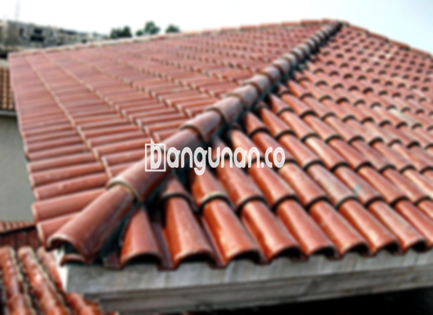

**Jual Genteng Kermaik & Beton di Gunung Sahari Jakarta** – Membangun atau merenovasi atap rumah? Mitra Bangunan di Gunung Sahari Jakarta hadir sebagai solusi lengkap kebutuhan genteng Anda. Genteng bukan sekadar pelindung rumah dari cuaca, melainkan juga penentu estetika dan kenyamanan hunian. Kami menyediakan beragam pilihan genteng berkualitas untuk mewujudkan atap impian Anda.

Memilih genteng yang tepat adalah investasi jangka panjang. Ada berbagai jenis genteng yang tersedia di pasaran, masing-masing dengan kelebihan dan kekurangannya. Mempertimbangkan kebutuhan, gaya arsitektur rumah, serta anggaran adalah kunci untuk mendapatkan hasil yang optimal. Kami siap membantu Anda dalam proses seleksi ini.



## Informasi Harga Genteng dari Toko Jual Genteng Kermaik & Beton di Gunung Sahari Jakarta

Tentu saja, salah satu pertimbangan utama dalam membeli genteng adalah harganya. Berikut adalah gambaran umum mengenai harga berbagai jenis genteng yang tersedia di toko kami di Gunung Sahari Jakarta. Informasi ini dapat menjadi acuan awal sebelum Anda menghubungi kami untuk penawaran harga yang lebih detail dan sesuai dengan kebutuhan proyek Anda.

### \- Harga Genteng Metal di Toko Genteng Kermaik & Beton di Gunung Sahari Jakarta

Genteng metal adalah pilihan populer karena ringan, kuat, dan tahan lama. Desain modernnya cocok untuk rumah-rumah bergaya minimalis. Tampilan estetis yang ditawarkan genteng metal menjadikannya favorit banyak orang. Untuk informasi harga terkini, silakan cek tabel harga atau hubungi kami.

### \- Harga Genteng Aspal di Toko Genteng Kermaik & Beton di Gunung Sahari Jakarta

Genteng aspal menawarkan tampilan yang elegan dan mewah. Terbuat dari serat kayu dan aspal, material ini memberikan insulasi yang baik dan tahan terhadap api. Ketahanan dan fleksibilitas genteng aspal membuatnya menjadi pilihan menarik bagi Anda. Dapatkan detail harga di tabel harga kami.

### \- Harga Genteng Kermaik & Beton di Gunung Sahari Jakarta

Genteng keramik dan beton adalah pilihan klasik yang dikenal dengan keawetan dan keindahannya. Tersedia dalam berbagai warna dan tekstur, genteng ini dapat memberikan tampilan yang unik pada rumah Anda. Untuk mengetahui harga terbaru, silakan lihat tabel harga atau hubungi tim kami.

### \- Harga Genteng Kaca di Toko Genteng Kermaik & Beton di Gunung Sahari Jakarta

Genteng kaca sering digunakan sebagai aksen untuk memberikan pencahayaan alami pada ruangan. Meskipun tidak digunakan sebagai penutup atap utama, genteng kaca dapat menambah estetika dan menciptakan suasana yang cerah. Detail harga dapat Anda temukan di tabel harga.

### \- Harga Genteng Seng di Toko Genteng Kermaik & Beton di Gunung Sahari Jakarta

Genteng seng merupakan pilihan ekonomis yang sering digunakan pada bangunan tradisional. Karena ringan dan mudah dipasang, genteng seng menjadi solusi praktis untuk berbagai jenis atap. Informasi harga lengkap tersedia di tabel harga.

### \- Harga Genteng Beton di Toko Genteng Kermaik & Beton di Gunung Sahari Jakarta

Genteng beton adalah pilihan yang kuat dan tahan lama, terbuat dari campuran semen, pasir, dan air berkualitas tinggi. Genteng ini ideal untuk iklim tropis seperti di Indonesia karena tahan terhadap panas dan hujan. Kami menyediakan berbagai pilihan genteng beton dengan harga kompetitif. Lihat tabel harga untuk detailnya.



## Ragam Jenis Genteng dari Toko Jual Genteng Kermaik & Beton di Gunung Sahari Jakarta

Berikut adalah beberapa jenis genteng yang tersedia di toko kami, beserta keunggulannya:

### Genteng Keramik dari Toko Jual Genteng Kermaik & Beton di Gunung Sahari Jakarta

Genteng keramik menawarkan tampilan yang menarik dan tahan lama. Tahan terhadap cuaca ekstrem dan mudah perawatannya merupakan nilai plus dari jenis genteng ini. Anda akan menikmati kenyamanan dan keindahan atap rumah Anda.

### Genteng Seng dan Genteng Kermaik & Beton di Gunung Sahari Jakarta

Genteng seng, dengan ukurannya yang panjang, adalah opsi ekonomis yang cocok untuk proyek renovasi atau pembangunan dengan anggaran terbatas. Pemasangan yang mudah dan harga yang terjangkau menjadikannya pilihan populer.

### Genteng Asbes dan Genteng Kermaik & Beton di Gunung Sahari Jakarta

Genteng asbes adalah pilihan yang ringan dan hemat biaya, tetapi perlu diperhatikan kekurangannya dalam hal ketahanan terhadap kerusakan. Pertimbangkan dengan cermat sebelum memilih genteng asbes.

### Genteng Kanopi Baja Ringan dan Genteng Kermaik & Beton di Gunung Sahari Jakarta

Genteng kanopi baja ringan menawarkan kombinasi antara kekuatan, ringan, dan estetika modern. Material ini tahan terhadap karat dan memberikan tampilan yang bersih dan rapi pada atap rumah Anda.

### Genteng Sirap Kayu Ulin dan Genteng Kermaik & Beton di Gunung Sahari Jakarta

Genteng sirap kayu ulin memberikan sentuhan alami dan unik pada rumah Anda. Terbuat dari kayu ulin berkualitas tinggi, genteng ini tahan terhadap cuaca dan memberikan tampilan yang elegan. Anda dapat menemukan berbagai macam pilihan genteng yang sesuai dengan selera dan kebutuhan Anda di toko kami di Gunung Sahari Jakarta.

Anda dapat memilih jenis Genteng Kermaik & Beton di Gunung Sahari Jakarta yang paling sesuai dengan preferensi Anda. Tentukan jumlah, bahan, dan jenis genteng yang dibutuhkan, dan kami akan membantu Anda mewujudkannya. Jangan ragu untuk menghubungi kami untuk mendapatkan penawaran harga terbaik.

**Ref by:**  [Genteng Kermaik & Beton  Gunung Sahari Jakarta](https://id.wikipedia.org/wiki/Genteng)

Mitra Bangunan berkomitmen untuk menyediakan genteng berkualitas dengan harga yang bersaing di Gunung Sahari Jakarta. Segera hubungi kami melalui tombol WhatsApp atau Telepon yang tersedia di halaman ini untuk konsultasi gratis dan pemesanan. Kami siap membantu Anda menciptakan atap rumah yang indah dan tahan lama.