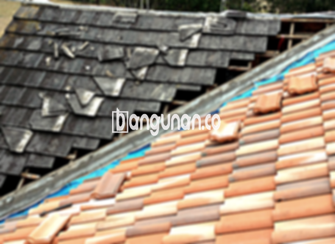

**Jual Genteng Kermaik & Beton di Gunung Sindur** – Genteng merupakan bagian material rumah yang sangat penting yang semestinya dimiliki setiap pemilik hunian. Mitra Bangunan memahami betul kebutuhan akan perlindungan atap yang kokoh dan tahan lama di Gunung Sindur. Genteng akan menjaga hunian Anda dari berbagai kondisi cuaca seperti hujan, panas terik matahari, dan lainnya. Hunian yang tanpa pelindungan genteng yang tepat tentu akan terasa kurang nyaman.

Memastikan kualitas atap adalah investasi jangka panjang yang cerdas. Tersedia beragam jenis genteng dengan karakteristik uniknya masing-masing. Mempertimbangkan dengan seksama jenis genteng yang paling sesuai untuk rumah Anda akan memastikan perlindungan optimal dan estetika yang memuaskan. Banyak pemilik rumah di Gunung Sindur memperhatikan kualitas genteng sebagai prioritas utama.



## Harga Genteng Dari Toko Jual Genteng Kermaik & Beton di Gunung Sindur

Ada banyak sekali variasi genteng yang dapat Anda pilih untuk proyek Anda. Setiap jenis genteng menawarkan kelebihan dan kekurangan yang berbeda-beda, sehingga memungkinkan Anda menemukan yang paling sesuai dengan anggaran dan kebutuhan Anda. Berikut adalah perkiraan harga beberapa jenis genteng yang tersedia di toko kami:

### - Harga Genteng Metal Di Toko Genteng Kermaik & Beton di Gunung Sindur

Genteng metal adalah pilihan yang populer karena ringan, kuat, dan mudah dipasang. Cocok untuk berbagai gaya arsitektur, terutama rumah minimalis modern, menawarkan tampilan yang bersih dan menarik. Material ini sangat diminati karena kemudahan pemasangannya.

### - Harga Genteng Aspal Di Toko Genteng Kermaik & Beton di Gunung Sindur

Genteng aspal adalah pilihan yang baik jika Anda mencari keseimbangan antara estetika dan fungsi. Terbuat dari serat kayu dan aspal berkualitas, material ini menawarkan daya tahan, fleksibilitas, dan insulasi yang baik. Selain itu, genteng aspal juga memiliki tingkat ketahanan api yang memadai.

### - Harga Genteng Kermaik & Beton di Gunung Sindur

Genteng keramik tetap menjadi favorit banyak orang karena keindahan dan karakteristiknya yang unik. Pilihan warna dan desain yang beragam memungkinkan Anda menciptakan tampilan atap yang sesuai dengan gaya rumah Anda. Selain estetika, genteng keramik juga mampu membantu menjaga suhu ruangan tetap nyaman.

### - Harga Genteng Kaca Di Toko Genteng Kermaik & Beton di Gunung Sindur

Genteng kaca dapat memberikan sentuhan modern dan menarik pada rumah Anda. Biasanya digunakan sebagai aksen untuk menciptakan pencahayaan alami di dalam ruangan. Namun, perlu diingat bahwa penggunaan genteng kaca yang berlebihan dapat menyebabkan ruangan menjadi lebih panas. Anda perlu mempertimbangkan hal ini dengan cermat.

### - Harga Genteng Seng Di Toko Genteng Kermaik & Beton di Gunung Sindur

Genteng seng masih menjadi pilihan ekonomis yang populer, terutama untuk bangunan tradisional atau proyek dengan anggaran terbatas. Meskipun relatif terjangkau, genteng seng tetap dapat memberikan perlindungan yang memadai terhadap cuaca. Kekuatan utama genteng seng terletak pada harganya yang bersahabat.

### - Harga Genteng Beton Di Toko Genteng Kermaik & Beton di Gunung Sindur

Genteng beton menawarkan kombinasi kekuatan, daya tahan, dan harga yang terjangkau. Terbuat dari campuran semen, pasir, dan air berkualitas tinggi, material ini mampu menahan beban berat dan tahan terhadap berbagai kondisi cuaca ekstrem. Anda dapat mengandalkan genteng beton untuk perlindungan jangka panjang.



## Beberapa Macam Genteng Dari Toko Jual Genteng Kermaik & Beton di Gunung Sindur

Berikut adalah beberapa jenis genteng yang dapat Anda pertimbangkan untuk meningkatkan kualitas dan estetika atap hunian Anda:

### Genteng Keramik Dari Toko Jual Genteng Kermaik & Beton di Gunung Sindur

Bagi Anda yang mencari genteng dengan tampilan klasik dan elegan, genteng keramik adalah pilihan yang ideal. Genteng ini memberikan sentuhan estetika yang unik dan dapat meningkatkan nilai visual rumah Anda. Selain itu, genteng keramik juga efektif dalam menjaga suhu ruangan tetap nyaman.

### Genteng Seng dan Genteng Kermaik & Beton di Gunung Sindur

Genteng seng adalah pilihan yang hemat biaya dan sering digunakan pada bangunan-bangunan lama. Ukurannya yang panjang memungkinkan pemasangan yang lebih efisien dan ekonomis. Untuk memastikan kekokohan pemasangan, disarankan untuk menggunakan paku tambahan.

### Genteng Asbes dan Genteng Kermaik & Beton di Gunung Sindur

Meskipun dahulu populer, genteng asbes kini mulai ditinggalkan karena masalah kesehatan dan lingkungan. Bahan genteng asbes cenderung mudah rusak dan memerlukan penggantian yang sering. Anda sebaiknya mempertimbangkan alternatif lain yang lebih aman dan berkelanjutan.

### Genteng Kanopi Baja Ringan dan Genteng Kermaik & Beton di Gunung Sindur

Genteng kanopi baja ringan menawarkan kombinasi antara kekuatan, ringan, dan tampilan yang modern. Genteng ini ideal untuk berbagai jenis atap dan memberikan sentuhan estetika yang menarik. Ketahanannya terhadap cuaca ekstrem menjadikannya pilihan yang praktis.

### Genteng Sirap Kayu Ulin dan Genteng Kermaik & Beton di Gunung Sindur

Genteng sirap kayu ulin memberikan kehangatan dan keindahan alami pada rumah Anda. Terbuat dari kayu ulin berkualitas tinggi, material ini tahan terhadap cuaca dan memiliki tampilan yang unik. Harga genteng ini relatif terjangkau dan memberikan perlindungan yang optimal.

Anda dapat memilih jenis Genteng Kermaik & Beton di Gunung Sindur yang paling sesuai dengan kebutuhan dan gaya rumah Anda. Dengan berbagai pilihan yang tersedia, Anda dapat menemukan solusi atap yang sempurna. Mitra Bangunan siap membantu Anda dalam memilih dan menyediakan genteng berkualitas tinggi. Hubungi kami sekarang juga untuk mendapatkan penawaran harga terbaik dan berkonsultasi dengan ahli kami.

**Ref by:**  [Genteng Kermaik & Beton  Gunung Sindur](https://id.wikipedia.org/wiki/Genteng)