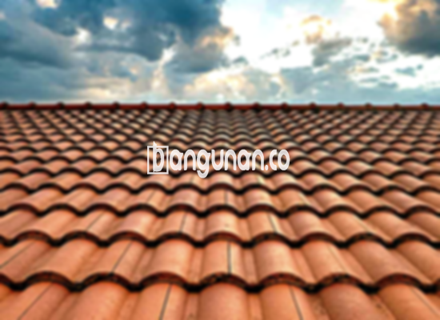

**Jual Genteng Kermaik & Beton di Gunungkaler Tangerang** – Genteng merupakan material hunian yang sangat penting dan sepatutnya dimiliki oleh setiap pemilik rumah. Memberikan perlindungan terhadap berbagai kondisi seperti panas matahari dan guyuran hujan, genteng memastikan kenyamanan dan keamanan tempat tinggal Anda. Hunian tanpa genteng akan terasa kurang nyaman dan rentan terhadap kerusakan. Mitra Bangunan hadir sebagai solusi terpercaya untuk kebutuhan atap Anda di Gunungkaler Tangerang.

Memilih genteng yang sesuai adalah keputusan penting dalam membangun atau merenovasi rumah. Terdapat berbagai jenis genteng dengan kelebihan dan kekurangannya masing-masing. Mempertimbangkan kebutuhan dan preferensi Anda akan membantu Anda menentukan pilihan yang paling tepat. Banyak orang mengutamakan kualitas genteng untuk menjamin ketahanan dan keindahan atap rumah mereka dalam jangka waktu yang lama.



## Harga Genteng dari Toko Jual Genteng Kermaik & Beton di Gunungkaler Tangerang

Beragam variasi genteng tersedia untuk memenuhi kebutuhan Anda. Setiap jenis memiliki keunggulan tersendiri. Berikut referensi harga yang dapat Anda gunakan sebagai pertimbangan:

### - Harga Genteng Metal di Toko Genteng Kermaik & Beton di Gunungkaler Tangerang

Genteng metal banyak digunakan karena desain modernnya yang cocok untuk rumah minimalis. Material ini memberikan kesan elegan dan estetik pada bangunan Anda. Informasi harga paling baru mengenai genteng metal dapat Anda temukan di tabel harga atau dengan menghubungi tim kami.

### - Harga Genteng Aspal di Toko Genteng Kermaik & Beton di Gunungkaler Tangerang

Genteng aspal dibuat dari kombinasi serat kayu dan aspal berkualitas. Material ini menawarkan daya tahan dan kekuatan yang luar biasa. Ketahanannya terhadap api dan cuaca ekstrem menjadikannya pilihan yang ideal. Detail harga genteng aspal terbaru dapat Anda peroleh melalui tabel harga yang kami sediakan.

### - Harga Genteng Kermaik & Beton di Gunungkaler Tangerang

Genteng keramik adalah opsi klasik yang populer karena keindahan dan keunikan desainnya. Pilihan warna yang beragam memungkinkan Anda menciptakan tampilan rumah yang menarik. Anda bisa menemukan harga genteng keramik terkini pada tabel harga yang telah kami siapkan.

### - Harga Genteng Kaca di Toko Genteng Kermaik & Beton di Gunungkaler Tangerang

Genteng kaca sering dimanfaatkan sebagai elemen dekoratif untuk menciptakan pencahayaan alami dalam rumah. Pemasangannya biasanya tidak mencakup seluruh area atap karena dapat meningkatkan suhu ruangan. Informasi harga genteng kaca terbaru tertera pada tabel harga yang tersedia.

### - Harga Genteng Seng di Toko Genteng Kermaik & Beton di Gunungkaler Tangerang

Genteng seng adalah solusi ekonomis yang sering digunakan pada bangunan tradisional. Ukurannya yang panjang memberikan efisiensi biaya. Memastikan pemasangan yang kuat dengan paku akan meningkatkan daya tahannya. Harga genteng seng terbaru dapat Anda lihat pada tabel harga yang kami tampilkan.

### - Harga Genteng Beton di Toko Genteng Kermaik & Beton di Gunungkaler Tangerang

Genteng beton dibuat dari campuran semen, pasir, dan air berkualitas tinggi, menjadikannya material yang kokoh dan tahan lama. Banyak pembeli memilih genteng beton karena kualitasnya yang terjamin. Harga genteng beton terkini dapat Anda periksa pada tabel harga yang kami sediakan.



## Beberapa Tipe Genteng dari Toko Jual Genteng Kermaik & Beton di Gunungkaler Tangerang

Berikut adalah beberapa jenis genteng yang dapat Anda pilih untuk melengkapi proyek pembangunan Anda:

### Genteng Keramik dari Toko Jual Genteng Kermaik & Beton di Gunungkaler Tangerang

Jika Anda mencari genteng dengan daya tarik visual dan fungsi perlindungan yang baik, genteng keramik adalah pilihan yang tepat. Material ini memberikan tampilan yang menarik dan menjaga rumah Anda tetap sejuk dan nyaman.

### Genteng Seng dan Genteng Kermaik & Beton di Gunungkaler Tangerang

Genteng seng merupakan opsi tradisional yang hemat biaya dengan ukuran yang panjang. Pemasangan yang kuat dengan paku akan menjamin stabilitasnya.

### Genteng Asbes dan Genteng Kermaik & Beton di Gunungkaler Tangerang

Genteng asbes kurang direkomendasikan karena rentan terhadap kerusakan dan kurang tahan lama dibandingkan material lain. Pertimbangkan alternatif yang lebih berkualitas untuk memastikan umur panjang atap Anda.

### Genteng Kanopi Baja Ringan dan Genteng Kermaik & Beton di Gunungkaler Tangerang

Genteng kanopi baja ringan populer karena fleksibilitas dan kekuatannya, cocok untuk berbagai desain atap. Material ini menawarkan solusi yang ringan namun tahan lama.

### Genteng Sirap Kayu Ulin dan Genteng Kermaik & Beton di Gunungkaler Tangerang

Genteng sirap kayu ulin terbuat dari kayu berkualitas tinggi, menawarkan harga yang terjangkau dan kesan alami yang menenangkan. Material ini memberikan tampilan unik dan berpadu harmonis dengan lingkungan sekitar.

Anda dapat menemukan semua jenis Genteng Kermaik & Beton di Gunungkaler Tangerang yang Anda butuhkan di toko kami. Silakan tentukan jumlah, material, dan jenis genteng yang diinginkan, dan serahkan kepada kami untuk proses pembelian yang lancar. Mitra Bangunan siap melayani kebutuhan atap Anda di Gunungkaler Tangerang—hubungi kami segera melalui tombol WhatsApp atau Telepon yang tersedia di halaman ini untuk mendapatkan penawaran harga terbaik dan layanan konsultasi gratis.

**Ref by:**  [Genteng Kermaik & Beton  Gunungkaler Tangerang](https://id.wikipedia.org/wiki/Genteng)