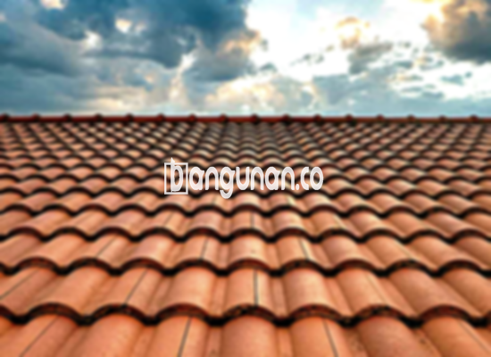

**Jual Genteng Kermaik & Beton di Halim Jakarta** – Genteng adalah material yang sangat penting untuk setiap pemilik hunian. Perlindungan terhadap hujan, panas terik, dan kondisi cuaca lainnya menjadi fungsi utamanya. Mitra Bangunan di Halim Jakarta hadir untuk menyediakan solusi atap yang aman dan nyaman bagi Anda. Kami menyediakan beragam pilihan genteng berkualitas tinggi untuk memenuhi kebutuhan proyek konstruksi Anda.

Memilih genteng yang tepat adalah investasi jangka panjang untuk rumah Anda. Ada beberapa jenis genteng yang tersedia di pasaran, masing-masing dengan kelebihan dan kekurangan tersendiri. Mempertimbangkan kebutuhan, anggaran, dan gaya arsitektur rumah Anda adalah kunci untuk membuat keputusan yang tepat. Dengan memilih genteng berkualitas, Anda memastikan atap rumah Anda tahan lama dan melindungi keluarga Anda dari berbagai kondisi cuaca.



## Harga Genteng dari Toko Jual Genteng Kermaik & Beton di Halim Jakarta

Untuk membantu Anda dalam perencanaan anggaran, berikut adalah perkiraan harga beberapa jenis genteng yang tersedia di toko kami di Halim Jakarta. Kami menyediakan berbagai pilihan harga yang sesuai dengan kebutuhan dan anggaran Anda.

### \- Harga Genteng Metal di Toko Genteng Kermaik & Beton di Halim Jakarta

Genteng metal merupakan pilihan yang populer karena ringan, kuat, dan mudah dipasang. Bahan ini seringkali menjadi pilihan utama bagi hunian dengan desain minimalis. Anda akan mendapatkan tampilan yang modern dan elegan dengan menggunakan genteng metal. Harga genteng metal saat ini adalah Rp. 26.000 per buah.

### \- Harga Genteng Aspal di Toko Genteng Kermaik & Beton di Halim Jakarta

Genteng aspal menawarkan kombinasi antara keindahan dan ketahanan. Terbuat dari serat kayu dan aspal berkualitas tinggi, genteng ini memberikan perlindungan yang baik terhadap cuaca ekstrem dan tahan terhadap api. Harganya saat ini adalah Rp.125.000 per m2.

### \- Harga Genteng Kermaik & Beton di Halim Jakarta

Genteng keramik adalah pilihan klasik yang memberikan sentuhan tradisional dan elegan pada rumah Anda. Dengan berbagai pilihan warna dan desain, Anda dapat menciptakan atap yang unik dan sesuai dengan gaya arsitektur rumah Anda. Harganya saat ini adalah Rp. 9.800 per buah.

### \- Harga Genteng Kaca di Toko Genteng Kermaik & Beton di Halim Jakarta

Genteng kaca adalah pilihan yang ideal untuk menciptakan pencahayaan alami dalam ruangan. Meskipun tidak digunakan sebagai penutup atap utama, genteng kaca dapat memberikan sentuhan artistik dan meningkatkan estetika rumah Anda. Harganya saat ini adalah Rp. 8.800 per biji.

### \- Harga Genteng Seng di Toko Genteng Kermaik & Beton di Halim Jakarta

Genteng seng adalah pilihan yang ekonomis dan sering digunakan untuk bangunan tradisional atau renovasi. Meskipun ringan dan terjangkau, genteng seng tetap memberikan perlindungan yang cukup terhadap cuaca buruk. Harganya saat ini adalah Rp. 39.000 per buah.

### \- Harga Genteng Beton di Toko Genteng Kermaik & Beton di Halim Jakarta

Genteng beton dikenal karena kekuatannya dan ketahanannya terhadap berbagai kondisi cuaca. Terbuat dari campuran semen, pasir, dan air berkualitas tinggi, genteng beton adalah investasi jangka panjang yang tepat untuk atap rumah Anda. Harganya saat ini adalah Rp. 5.800 per pcs.



## Beberapa Macam Genteng dari Toko Jual Genteng Kermaik & Beton di Halim Jakarta

Kami menyediakan berbagai macam genteng dengan karakteristik yang berbeda-beda. Berikut adalah beberapa jenis genteng yang tersedia di toko kami di Halim Jakarta, untuk membantu Anda dalam memilih yang terbaik:

### Genteng Keramik dari Toko Jual Genteng Kermaik & Beton di Halim Jakarta

Genteng keramik adalah pilihan yang populer karena keindahan, ketahanan, dan kemudahan perawatannya. Anda dapat memilih dari berbagai warna dan desain untuk menciptakan tampilan atap yang sesuai dengan selera Anda. Genteng keramik juga memberikan perlindungan yang baik terhadap panas matahari dan hujan.

### Genteng Seng dan Genteng Kermaik & Beton di Halim Jakarta

Genteng seng adalah pilihan yang ekonomis dan ringan, cocok untuk bangunan dengan anggaran terbatas. Meskipun tidak sekuat genteng lainnya, genteng seng tetap memberikan perlindungan yang memadai terhadap cuaca buruk. Dengan pemasangan yang tepat, genteng seng dapat menjadi solusi praktis dan terjangkau.

### Genteng Asbes dan Genteng Kermaik & Beton di Halim Jakarta

Genteng asbes kurang direkomendasikan karena mengandung bahan yang berbahaya bagi kesehatan dan lingkungan. Pertimbangkan alternatif lain yang lebih aman dan ramah lingkungan untuk kesehatan Anda dan keluarga.

### Genteng Kanopi Baja Ringan dan Genteng Kermaik & Beton di Halim Jakarta

Genteng kanopi baja ringan menawarkan kombinasi antara kekuatan, ringan, dan tampilan modern. Bahan ini tahan terhadap korosi dan memberikan perlindungan yang optimal terhadap cuaca ekstrem. Anda akan mendapatkan atap yang kuat dan tahan lama dengan memilih genteng kanopi baja ringan.

### Genteng Sirap Kayu Ulin dan Genteng Kermaik & Beton di Halim Jakarta

Genteng sirap kayu ulin memberikan sentuhan alami dan elegan pada rumah Anda. Terbuat dari kayu ulin berkualitas tinggi, genteng ini tahan terhadap cuaca ekstrem dan memberikan isolasi termal yang baik. Anda akan mendapatkan atap yang indah dan nyaman dengan memilih genteng sirap kayu ulin.

Anda dapat menemukan jenis Genteng Kermaik & Beton di Halim Jakarta yang paling sesuai dengan preferensi Anda. Jangan ragu untuk berkonsultasi dengan tim kami untuk mendapatkan rekomendasi terbaik. Mitra Bangunan siap membantu Anda dalam mewujudkan atap rumah impian Anda dengan kualitas terbaik. Hubungi kami sekarang juga untuk mendapatkan penawaran menarik!

**Ref by:**  [Genteng Kermaik & Beton  Halim Jakarta](https://id.wikipedia.org/wiki/Genteng)