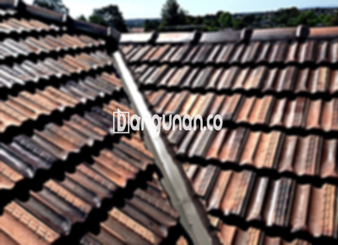

**Jual Genteng Kermaik & Beton di Harapan Mulya Jakarta** – Genteng adalah material penting yang wajib dimiliki setiap pengguna hunian. Genteng berfungsi melindungi tempat tinggal Anda dari berbagai kondisi cuaca, seperti hujan deras dan teriknya matahari. Bagi Mitra Bangunan yang ingin menciptakan hunian yang nyaman dan aman di Harapan Mulya Jakarta, memilih genteng yang tepat adalah prioritas utama.

Investasi pada genteng yang berkualitas akan memberikan perlindungan jangka panjang dan meningkatkan nilai properti Anda. Ada banyak sekali jenis genteng yang tersedia di pasaran, masing-masing dengan karakteristik dan keunggulannya sendiri. Keputusan memilih genteng yang ideal membutuhkan pertimbangan matang.



## Harga Genteng dari Toko Jual Genteng Kermaik & Beton di Harapan Mulya Jakarta

Memahami kisaran harga genteng sangat penting sebelum Anda melakukan pembelian. Toko Jual Genteng Kermaik & Beton di Harapan Mulya Jakarta menyediakan berbagai pilihan genteng dengan harga yang kompetitif. Berikut adalah gambaran umum harga beberapa jenis genteng yang kami tawarkan:

### Harga Genteng Metal di Toko Genteng Kermaik & Beton di Harapan Mulya Jakarta

Genteng metal menjadi semakin populer karena sifatnya yang ringan, kuat, dan tahan lama. Dengan desain modern yang elegan, genteng metal cocok untuk diaplikasikan pada rumah dengan gaya minimalis kontemporer di Harapan Mulya Jakarta. Material ini juga dikenal karena ketahanannya terhadap korosi dan perubahan cuaca.

### Harga Genteng Aspal di Toko Genteng Kermaik & Beton di Harapan Mulya Jakarta

Genteng aspal menawarkan tampilan yang unik dan estetis, serta tersedia dalam beragam warna dan gaya. Terbuat dari serat kayu dan aspal berkualitas tinggi, material ini memberikan perlindungan yang baik terhadap api dan meredam kebisingan. Anda dapat menemukan berbagai opsi genteng aspal yang sesuai dengan preferensi Anda.

### Harga Genteng Kermaik & Beton di Harapan Mulya Jakarta

Genteng keramik dan beton merupakan pilihan klasik yang memberikan tampilan yang kokoh dan tahan lama. Keduanya tersedia dalam berbagai warna dan tekstur, memungkinkan Anda untuk menciptakan atap yang unik sesuai dengan gaya rumah Anda di Harapan Mulya Jakarta. Ketahanan dan keawetannya menjadikan kedua jenis genteng ini pilihan yang populer.

### Harga Genteng Kaca di Toko Genteng Kermaik & Beton di Harapan Mulya Jakarta

Genteng kaca sering digunakan sebagai elemen dekoratif untuk memberikan pencahayaan alami pada ruangan di bawahnya. Meskipun memberikan kesan estetis, penting untuk mempertimbangkan bahwa genteng kaca dapat meningkatkan suhu ruangan karena membiarkan lebih banyak sinar matahari masuk. Pertimbangkan aplikasi yang tepat untuk mencapai hasil yang optimal.

### Harga Genteng Seng di Toko Genteng Kermaik & Beton di Harapan Mulya Jakarta

Genteng seng merupakan pilihan ekonomis yang sering digunakan pada bangunan-bangunan tradisional. Meskipun ringan dan terjangkau, genteng seng perlu dipasang dengan hati-hati dan memerlukan perawatan rutin untuk memastikan ketahanannya terhadap cuaca ekstrem.

### Harga Genteng Beton di Toko Genteng Kermaik & Beton di Harapan Mulya Jakarta

Genteng beton dikenal karena kekuatannya dan kemampuannya menahan beban berat. Terbuat dari campuran semen, pasir, dan air, material ini menjadi investasi jangka panjang yang tahan terhadap berbagai kondisi cuaca. Anda dapat menemukan berbagai pilihan genteng beton yang berkualitas tinggi untuk hunian Anda di Harapan Mulya Jakarta.



## Beragam Pilihan Genteng dari Toko Jual Genteng Kermaik & Beton di Harapan Mulya Jakarta

Kami menyediakan beragam pilihan genteng untuk memenuhi kebutuhan dan estetika yang Anda inginkan. Berikut adalah beberapa jenis genteng yang populer di Harapan Mulya Jakarta:

### Genteng Keramik dari Toko Jual Genteng Kermaik & Beton di Harapan Mulya Jakarta

Jika Anda mencari tampilan klasik dan nuansa yang tahan lama, genteng keramik adalah pilihan yang tepat. Dengan berbagai warna dan desain yang tersedia, Anda dapat menciptakan atap yang indah dan elegan untuk rumah Anda di Harapan Mulya Jakarta. Material ini juga tahan terhadap cuaca ekstrem dan tidak mudah pudar.

### Genteng Seng dan Genteng Kermaik & Beton di Harapan Mulya Jakarta

Genteng seng merupakan solusi ekonomis yang seringkali dipilih untuk bangunan-bangunan dengan anggaran terbatas. Ukurannya yang relatif panjang membuat pemasangan lebih cepat dan efisien. Pastikan pemasangan dilakukan dengan benar untuk memastikan bahwa genteng seng terpasang dengan kuat dan tahan lama.

### Genteng Asbes dan Genteng Kermaik & Beton di Harapan Mulya Jakarta

Meskipun dulu populer, genteng asbes kini kurang direkomendasikan karena potensi risiko kesehatan dan daya tahannya yang terbatas. Pertimbangkan alternatif lain yang lebih aman dan ramah lingkungan untuk melindungi keluarga Anda.

### Genteng Kanopi Baja Ringan dan Genteng Kermaik & Beton di Harapan Mulya Jakarta

Genteng kanopi baja ringan menawarkan kombinasi antara kekuatan, berat yang ringan, dan tampilan yang menarik. Material ini tahan terhadap korosi dan cocok untuk berbagai desain atap, termasuk atap dengan kemiringan yang curam.

### Genteng Sirap Kayu Ulin dan Genteng Kermaik & Beton di Harapan Mulya Jakarta

Genteng sirap kayu ulin memberikan tampilan alami dan unik pada atap rumah Anda. Kayu ulin dikenal karena kekuatannya dan ketahanannya terhadap cuaca ekstrem, menjadikannya pilihan yang ideal untuk iklim tropis seperti di Harapan Mulya Jakarta. 

Anda dapat memilih jenis Genteng Kermaik & Beton di Harapan Mulya Jakarta yang paling sesuai dengan kebutuhan dan preferensi Anda. Kami selalu siap memberikan bantuan dan rekomendasi terbaik. Sebagai Mitra Bangunan, jangan ragu untuk menghubungi kami melalui tombol WhatsApp atau Telepon di halaman ini untuk mendapatkan penawaran harga terbaik dan informasi lebih lanjut.

**Ref by:**  [Genteng Kermaik & Beton  Harapan Mulya Jakarta](https://id.wikipedia.org/wiki/Genteng)