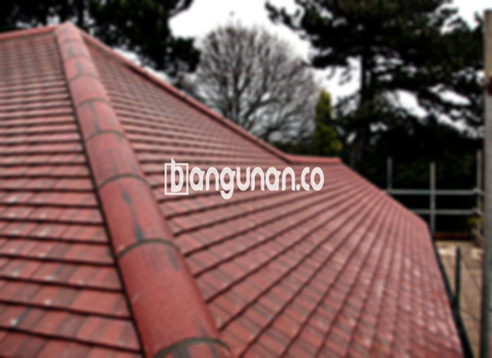

**Jual Genteng Kermaik & Beton di Harjamukti Depok** – Genteng merupakan bagian material tempat tinggal yang benar-benar seharusnya dimiliki setiap pengguna hunian. Melindungi rumah Anda dari beragam kondisi seperti hujan, panas terik matahari, dan berbagai elemen lainnya, genteng juga berkontribusi besar dalam menciptakan kenyamanan dan keamanan tempat tinggal. Rumah yang tidak memiliki perlindungan genteng yang memadai tentunya akan terasa lebih panas dan rentan terhadap kerusakan. Mitra Bangunan di Harjamukti Depok hadir untuk menyediakan solusi atap terbaik bagi Anda.

Memilih genteng yang tepat untuk rumah Anda adalah keputusan penting. Terdapat berbagai macam jenis genteng yang tersedia di pasar, masing-masing dengan kelebihan dan kekurangannya sendiri. Setiap orang memiliki preferensi dan kebutuhan yang berbeda, tergantung pada gaya arsitektur rumah, anggaran, dan iklim di daerah tersebut. Mengingat rumah adalah tempat tinggal yang digunakan dalam jangka waktu yang panjang, banyak yang sangat mengutamakan penggunaan genteng berkualitas tinggi. 



## Harga Genteng Dari Toko Jual Genteng Kermaik & Beton di Harjamukti Depok

Pilihan jenis genteng yang tersedia sangatlah beragam, dan masing-masing memiliki karakteristik serta keunggulan uniknya tersendiri. Berikut adalah referensi harga yang dapat Anda gunakan sebagai panduan dalam memilih genteng yang sesuai dengan anggaran dan kebutuhan Anda.

### - Harga Genteng Metal Di Toko Genteng Kermaik & Beton di Harjamukti Depok

Genteng metal merupakan salah satu jenis genteng yang sangat populer di kalangan masyarakat. Jenis ini dikenal karena ketahanannya dan memberikan tampilan modern pada hunian. Seringkali diaplikasikan pada rumah dengan desain minimalis, genteng metal dapat menciptakan kesan yang bersih dan elegan. Untuk mengetahui harga terbaru genteng metal, Anda dapat merujuk pada tabel harga yang tersedia.

### - Harga Genteng Aspal Di Toko Genteng Kermaik & Beton di Harjamukti Depok

Genteng aspal juga banyak dipilih sebagai material atap yang berkualitas. Terbuat dari serat kayu dan aspal, jenis ini menawarkan kombinasi kekuatan, fleksibilitas, dan ketahanan terhadap api. Material yang digunakan dalam pembuatan genteng aspal terbukti efektif dalam melindungi rumah dari berbagai risiko. Informasi harga terbaru genteng aspal dapat ditemukan pada tabel harga.

### - Harga Genteng Kermaik & Beton di Harjamukti Depok

Genteng keramik adalah jenis genteng yang populer karena keindahan dan daya tahannya. Dengan berbagai pilihan warna dan desain, Anda dapat menemukan genteng keramik yang sesuai dengan gaya arsitektur rumah Anda. Genteng keramik juga dikenal karena kemampuannya menjaga suhu ruangan tetap stabil. Detail harga genteng keramik dapat Anda lihat pada tabel harga yang tertera.

### - Harga Genteng Kaca Di Toko Genteng Kermaik & Beton di Harjamukti Depok

Genteng kaca biasanya digunakan sebagai elemen dekoratif untuk memberikan pencahayaan alami pada ruangan. Meskipun memberikan kesan estetis, penggunaan genteng kaca sebagai material utama atap tidak disarankan karena dapat meningkatkan suhu ruangan. Anda bisa menemukan harga genteng kaca terkini pada tabel harga.

### - Harga Genteng Seng Di Toko Genteng Kermaik & Beton di Harjamukti Depok

Genteng seng merupakan pilihan ekonomis yang sering digunakan pada bangunan tradisional. Ukurannya yang panjang membantu mengurangi biaya pemasangan dan menawarkan solusi praktis. Untuk memastikan pemasangan yang kuat dan tahan lama, pengunaan paku sangat disarankan. Informasi harga genteng seng terbaru tersedia di tabel harga.

### - Harga Genteng Beton Di Toko Genteng Kermaik & Beton di Harjamukti Depok

Genteng beton terbuat dari campuran semen, pasir, dan air, menghasilkan material yang kokoh dan tahan lama. Banyak orang memilih genteng beton karena kualitasnya yang terjamin dan ketahanannya terhadap berbagai kondisi cuaca. Jangan ragu untuk memeriksa harga genteng beton terbaru pada tabel harga yang tersedia. 



## Berbagai Macam Ragam Genteng Dari Toko Jual Genteng Kermaik & Beton di Harjamukti Depok

Terdapat beragam jenis genteng yang dapat Anda pilih untuk membangun atau merenovasi atap rumah Anda. Berikut adalah beberapa pilihan yang bisa Anda pertimbangkan:

### Genteng Keramik Dari Toko Jual Genteng Kermaik & Beton di Harjamukti Depok

Bagi Anda yang sedang mencari genteng untuk rumah idaman, genteng keramik merupakan pilihan yang sangat ideal. Jenis genteng ini memiliki daya tarik tersendiri dan dapat meningkatkan efisiensi energi rumah Anda dengan menjaga suhu ruangan tetap nyaman. Hunian Anda juga akan terlindungi dengan optimal dari paparan sinar matahari yang berlebihan.

### Genteng Seng dan Genteng Kermaik & Beton di Harjamukti Depok

Genteng seng adalah jenis genteng yang umum digunakan pada bangunan-bangunan lama. Ukurannya yang relatif panjang menjadikannya pilihan yang ekonomis untuk pemasangan. Dengan menggunakan paku yang kuat, Anda dapat memastikan pemasangan genteng seng yang aman dan tahan lama. [Jual Genteng Kermaik & Beton di Cimanggis Depok](/jual-genteng-kermaik-beton-di-cimanggis-depok/) juga menjual jenis genteng yang serupa.

### Genteng Asbes dan Genteng Kermaik & Beton di Harjamukti Depok

Genteng asbes merupakan jenis genteng yang cukup umum digunakan, namun memiliki kelemahan dalam hal daya tahan. Material yang digunakan cenderung mudah rusak, sehingga memerlukan penggantian secara berkala.

### Genteng Kanopi Baja Ringan dan Genteng Kermaik & Beton di Harjamukti Depok

Genteng kanopi baja ringan merupakan pilihan yang sangat populer karena sifatnya yang elastis, unik, dan tahan lama untuk berbagai jenis atap. Dengan kombinasi kekuatan dan fleksibilitas, genteng ini cocok untuk berbagai desain rumah.

### Genteng Sirap Kayu Ulin dan Genteng Kermaik & Beton di Harjamukti Depok

Genteng sirap kayu ulin menawarkan keindahan alami dengan material dasar kayu ulin yang kuat dan tahan lama. Harganya terjangkau dan dapat memberikan suasana nyaman dan alami pada rumah Anda. 

Anda dapat memilih berbagai jenis Genteng Kermaik & Beton di Harjamukti Depok yang sesuai dengan preferensi dan anggaran Anda. Tentukan jumlah yang dibutuhkan, material genteng yang diinginkan, dan jenis genteng yang paling cocok untuk rumah Anda. Mitra Bangunan yang sedang mencari solusi atap berkualitas di Harjamukti Depok, hubungi kami melalui tombol WhatsApp atau Telepon yang tersedia di halaman ini, dan kami siap membantu Anda menemukan pilihan yang terbaik!

**Ref by:**  [Genteng Kermaik & Beton  Harjamukti Depok](https://id.wikipedia.org/wiki/Genteng)