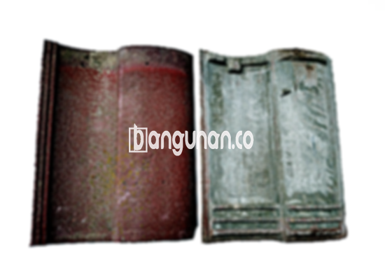

**Jual Genteng Keramik & Beton di Jagakarsa Jakarta** – Genteng merupakan salah satu material bangunan yang sangat penting untuk dimiliki setiap pemilik rumah. Genteng berfungsi melindungi hunian Anda dari berbagai kondisi cuaca, seperti hujan deras dan panas matahari yang terik. Dengan memiliki genteng yang berkualitas, Anda dapat memastikan rumah Anda terlindungi dengan optimal dan terasa lebih nyaman. Mitra Bangunan hadir di Jagakarsa Jakarta untuk menyediakan solusi genteng terbaik bagi kebutuhan Anda.

Mempertimbangkan pemilihan genteng yang tepat adalah hal esensial dalam proses pembangunan atau renovasi rumah. Banyak opsi genteng tersedia di pasaran, masing-masing menawarkan karakteristik dan keunggulan yang berbeda. Penting bagi Anda untuk memahami kebutuhan spesifik rumah Anda, gaya arsitektur yang diinginkan, serta anggaran yang tersedia agar dapat membuat keputusan yang tepat.



## Harga Genteng dari Toko Jual Genteng Keramik & Beton di Jagakarsa Jakarta

Toko kami menawarkan beragam pilihan genteng dengan harga yang kompetitif. Kami menyediakan informasi harga sebagai referensi awal bagi Anda, namun harga dapat bervariasi tergantung pada merek, ukuran, dan ketersediaan stok. Berikut adalah estimasi harga beberapa jenis genteng yang tersedia di toko kami:

### - Harga Genteng Metal di Toko Genteng Keramik & Beton di Jagakarsa Jakarta

Genteng metal menjadi pilihan populer karena daya tahannya yang tinggi dan bobotnya yang ringan. Material ini juga dikenal karena kemampuannya memantulkan panas, sehingga membantu menjaga suhu ruangan tetap sejuk. Genteng metal sering digunakan pada rumah bergaya modern dan minimalis. Kami menyarankan Anda untuk menghubungi kami guna mendapatkan informasi harga genteng metal terbaru.

### - Harga Genteng Aspal di Toko Genteng Keramik & Beton di Jagakarsa Jakarta

Genteng aspal menawarkan tampilan yang menarik dan tahan terhadap berbagai kondisi cuaca. Dibuat dari serat kayu dan aspal berkualitas tinggi, genteng ini memberikan perlindungan optimal bagi rumah Anda. Selain itu, genteng aspal juga memiliki sifat fleksibel dan tahan terhadap api. Informasi harga genteng aspal terkini dapat Anda peroleh dengan menghubungi tim kami.

### - Harga Genteng Keramik & Beton di Jagakarsa Jakarta

Genteng keramik dan beton merupakan pilihan tradisional yang masih banyak diminati hingga saat ini. Kedua jenis genteng ini menawarkan keunggulan dalam hal kekuatan, ketahanan, dan estetika. Pilihan warna dan desain genteng keramik dan beton sangat beragam, memungkinkan Anda untuk menyesuaikannya dengan gaya arsitektur rumah Anda. Silakan hubungi kami untuk mengetahui harga genteng keramik dan beton yang tersedia.

### - Harga Genteng Kaca di Toko Genteng Keramik & Beton di Jagakarsa Jakarta

Genteng kaca sering digunakan sebagai elemen dekoratif untuk menciptakan suasana yang unik dan menarik. Penggunaan genteng kaca dapat memberikan efek pencahayaan alami yang indah di dalam ruangan. Namun, perlu diingat bahwa genteng kaca dapat meningkatkan suhu ruangan, sehingga penggunaannya sebaiknya dibatasi pada area tertentu. Dapatkan informasi harga genteng kaca terkini dengan menghubungi kami.

### - Harga Genteng Seng di Toko Genteng Kermaik & Beton di Jagakarsa Jakarta

Genteng seng merupakan pilihan ekonomis yang sering digunakan untuk bangunan sederhana atau proyek renovasi. Material ini ringan, mudah dipasang, dan tersedia dalam berbagai ukuran. Untuk pemasangan yang lebih kuat, disarankan untuk menggunakan paku tambahan. Kami siap memberikan informasi harga genteng seng terkini kepada Anda.

### - Harga Genteng Beton Di Toko Genteng Kermaik & Beton di Jagakarsa Jakarta

Genteng beton adalah material atap yang sangat kuat dan tahan lama. Dibuat dari campuran semen, pasir, dan air berkualitas tinggi, genteng beton mampu menahan beban berat dan kondisi cuaca ekstrem. Banyak orang memilih genteng beton karena ketahanannya yang terjamin dan tampilan yang kokoh. Informasi lebih lanjut mengenai harga genteng beton dapat Anda peroleh dengan menghubungi kami.



## Berbagai Macam Ragam Genteng dari Toko Jual Genteng Keramik & Beton di Jagakarsa Jakarta

Kami menyediakan berbagai jenis genteng yang dapat Anda pilih sesuai dengan kebutuhan dan preferensi Anda. Berikut adalah beberapa pilihan genteng yang tersedia di toko kami:

### Genteng Keramik dari Toko Jual Genteng Keramik & Beton di Jagakarsa Jakarta

Jika Anda mencari genteng dengan tampilan yang klasik dan elegan, genteng keramik adalah pilihan yang tepat. Genteng keramik memberikan perlindungan optimal terhadap panas matahari dan hujan, serta menjaga rumah Anda tetap nyaman sepanjang tahun. Anda akan merasakan manfaat jangka panjang dengan memilih genteng berkualitas ini.

### Genteng Seng dan Genteng Kermaik & Beton di Jagakarsa Jakarta

Genteng seng adalah solusi hemat biaya yang sering digunakan untuk bangunan sederhana. Ukurannya yang panjang membantu mengurangi jumlah sambungan dan mempercepat proses pemasangan. Pastikan Anda menggunakan paku tambahan untuk memastikan pemasangan yang kuat dan tahan lama.

### Genteng Asbes dan Genteng Kermaik & Beton di Jagakarsa Jakarta

Genteng asbes dahulu cukup populer, namun saat ini kurang direkomendasikan karena daya tahannya yang terbatas dan potensi bahaya kesehatan. Material ini cenderung mudah rusak dan memerlukan penggantian yang lebih sering. Kami menyarankan Anda untuk mempertimbangkan alternatif lain yang lebih aman dan tahan lama.

### Genteng Kanopi Baja Ringan dan Genteng Kermaik & Beton di Jagakarsa Jakarta

Genteng kanopi baja ringan menawarkan kombinasi antara kekuatan, ringan, dan estetika modern. Material ini mudah dipasang dan tersedia dalam berbagai pilihan desain dan warna. Dengan ketahanannya yang tinggi, genteng kanopi baja ringan dapat menjadi investasi jangka panjang yang menguntungkan.

### Genteng Sirap Kayu Ulin dan Genteng Kermaik & Beton di Jagakarsa Jakarta

Genteng sirap kayu ulin memberikan tampilan alami dan unik pada rumah Anda. Terbuat dari kayu ulin berkualitas tinggi, material ini tahan terhadap cuaca ekstrem dan memberikan nuansa tradisional yang hangat. Anda dapat menciptakan suasana yang nyaman dan alami dengan menggunakan jenis genteng ini.

Anda dapat menemukan pilihan Genteng Kermaik & Beton di Jagakarsa Jakarta yang ideal untuk proyek bangunan Anda. Hubungi kami untuk mendapatkan penawaran harga terbaik dan layanan konsultasi gratis. Mitra Bangunan siap membantu Anda mewujudkan rumah impian Anda.

**Ref by:**  [Genteng Kermaik & Beton  Jagakarsa Jakarta](https://id.wikipedia.org/wiki/Genteng)