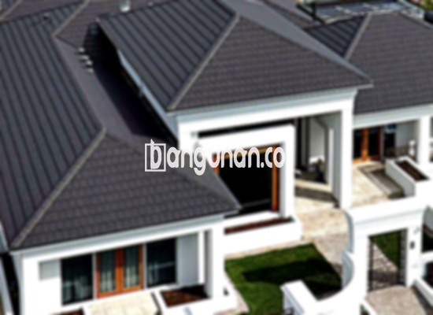

**Jual Genteng Kermaik & Beton di Jambe Tangerang** – Membangun atau merenovasi rumah di Jambe Tangerang membutuhkan material berkualitas, dan genteng adalah salah satu yang paling penting. Genteng melindungi hunian Anda dari hujan, panas terik, dan berbagai kondisi cuaca ekstrem. Rumah tanpa genteng yang baik tentu akan kurang nyaman. Mitra Bangunan menyediakan solusi lengkap kebutuhan genteng Anda.

Memilih genteng yang tepat sangat penting. Ada begitu banyak jenis genteng yang tersedia, masing-masing dengan keunggulan dan kekurangannya. Setiap orang memiliki preferensi sendiri, tetapi untuk investasi jangka panjang, genteng berkualitas adalah pilihan terbaik.



## Informasi Harga Genteng dari Toko Jual Genteng Kermaik & Beton di Jambe Tangerang

Ada beragam variasi genteng yang bisa Anda pertimbangkan. Setiap jenis memiliki keunggulan unik. Berikut adalah beberapa acuan harga genteng yang tersedia di toko kami:

### - Harga Genteng Metal di Toko Genteng Kermaik & Beton di Jambe Tangerang

Genteng metal adalah pilihan populer karena tampilannya yang modern dan sering digunakan pada rumah minimalis. Material ini memberikan kesan elegan dan tahan lama. Untuk detail harga, silakan lihat tabel harga terbaru kami atau hubungi tim kami.

### - Harga Genteng Aspal di Toko Genteng Kermaik & Beton di Jambe Tangerang

Genteng aspal terbuat dari serat kayu dan aspal, menawarkan kombinasi kekuatan dan fleksibilitas. Material ini dikenal tahan api dan memberikan perlindungan optimal. Untuk mendapatkan informasi harga yang akurat, Anda dapat menghubungi kami.

### - Harga Genteng Kermaik & Beton di Jambe Tangerang

Genteng keramik adalah pilihan klasik yang banyak disukai karena keindahan dan daya tahannya. Tersedia dalam berbagai warna dan desain, genteng keramik dapat mempercantik tampilan rumah Anda. Anda dapat melihat harga detail di tabel harga kami.

### - Harga Genteng Kaca di Toko Genteng Kermaik & Beton di Jambe Tangerang

Genteng kaca biasanya digunakan sebagai aksen atau untuk menciptakan efek pencahayaan alami di dalam ruangan. Karena sifatnya yang mentransmisikan cahaya, genteng kaca tidak ideal untuk seluruh atap. Untuk detail harga, silakan hubungi kami.

### - Harga Genteng Seng di Toko Genteng Kermaik & Beton di Jambe Tangerang

Genteng seng sering digunakan pada rumah-rumah tradisional atau sebagai solusi ekonomis. Ukurannya yang lebih panjang dapat membantu menghemat biaya. Jangan ragu untuk menghubungi kami untuk mendapatkan harga terbaru.

### - Harga Genteng Beton di Toko Genteng Kermaik & Beton di Jambe Tangerang

Genteng beton terbuat dari campuran semen, pasir, dan air, menjadikannya material yang kuat dan tahan lama. Banyak orang memilih genteng beton karena kualitasnya yang terjamin. Untuk informasi harga lengkapnya, lihat tabel harga kami.



## Berbagai Macam Jenis Genteng dari Toko Jual Genteng Kermaik & Beton di Jambe Tangerang

Berikut adalah beberapa jenis genteng yang dapat Anda aplikasikan untuk bangunan Anda:

### Genteng Keramik dari Toko Jual Genteng Kermaik & Beton di Jambe Tangerang

Jika Anda mencari genteng untuk rumah Anda, genteng keramik adalah pilihan yang sangat ideal. Jenis genteng ini memiliki daya tarik tersendiri dan dapat meningkatkan estetika rumah Anda. Genteng keramik juga memberikan perlindungan terhadap panas matahari.

### Genteng Seng dan Genteng Kermaik & Beton di Jambe Tangerang

Genteng seng adalah pilihan tradisional dengan ukuran yang cenderung lebih panjang. Ukurannya yang panjang dapat membantu menghemat biaya. Untuk memastikan pemasangan yang kuat, Anda dapat menggunakan paku.

### Genteng Asbes dan Genteng Kermaik & Beton di Jambe Tangerang

Genteng asbes merupakan pilihan yang umum digunakan, namun kurang direkomendasikan karena materialnya mudah rusak. Kerusakan dapat menyebabkan penggantian yang lebih sering.

### Genteng Kanopi Baja Ringan dan Genteng Kermaik & Beton di Jambe Tangerang

Genteng kanopi baja ringan adalah pilihan populer karena ringan, kuat, dan tahan lama. Jenis genteng ini cocok untuk berbagai jenis atap.

### Genteng Sirap Kayu Ulin dan Genteng Kermaik & Beton di Jambe Tangerang

Genteng sirap kayu ulin terbuat dari kayu ulin, menawarkan tampilan alami dan harga yang relatif ekonomis. Jenis genteng ini dapat memberikan kenyamanan dan keindahan pada rumah Anda. [Jual Genteng Kermaik & Beton di Benda Tangerang](/jual-genteng-kermaik-beton-di-benda-tangerang/) menyediakan pilihan yang bervariasi.

Anda dapat membeli berbagai jenis Genteng Kermaik & Beton di Jambe Tangerang yang sesuai dengan kebutuhan Anda. Tentukan jumlah, bahan genteng, dan jenis genteng yang diperlukan, lalu hubungi kami. Dengan begitu, Anda akan mendapatkan genteng yang tepat untuk rumah Anda. Mitra Bangunan siap membantu Anda menemukan solusi terbaik. Hubungi kami segera melalui tombol WhatsApp atau Telepon di halaman ini untuk mendapatkan penawaran harga terkini dan layanan terbaik.

**Ref by:**  [Genteng Kermaik & Beton  Jambe Tangerang](https://id.wikipedia.org/wiki/Genteng)