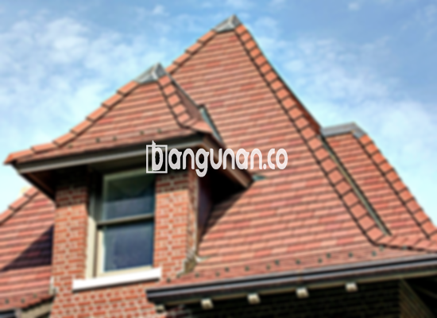

**Jual Genteng Kermaik & Beton di Jasinga** – Genteng adalah material penting untuk setiap hunian, yang seharusnya dimiliki setiap pemilik rumah. Fungsinya utama adalah melindungi rumah dari hujan, panas matahari, dan berbagai kondisi cuaca lainnya. Dengan genteng berkualitas, kondisi tempat tinggal menjadi lebih aman dan nyaman. Mitra Bangunan di Jasinga siap membantu Anda menemukan genteng yang tepat.

Untuk membangun atau merenovasi rumah, pemilihan material yang tepat sangat krusial. Genteng, sebagai bagian atap, memainkan peran penting dalam melindungi bangunan dari berbagai elemen cuaca. Memastikan atap tahan lama dan berkinerja baik adalah investasi yang bijak. Banyak pemilik properti di Jasinga mengutamakan kualitas genteng untuk memastikan hunian mereka terlindungi dengan baik.



## Harga Genteng Dari Toko Jual Genteng Kermaik & Beton di Jasinga

Ada berbagai jenis genteng yang bisa Anda pilih, masing-masing dengan karakteristik dan harga yang berbeda. Harga genteng bervariasi tergantung pada bahan, ukuran, dan desain. Memahami kisaran harga dapat membantu Anda merencanakan anggaran proyek pembangunan atau renovasi di Jasinga. Berikut adalah estimasi harga beberapa jenis genteng yang kami tawarkan:

### – Harga Genteng Metal Di Toko Genteng Kermaik & Beton di Jasinga

Genteng metal merupakan pilihan populer karena kekuatannya, ringan, dan pemasangannya yang relatif mudah. Jenis genteng ini sering digunakan untuk rumah modern dan minimalis, memberikan tampilan yang bersih dan elegan. Anda dapat menemukan berbagai pilihan warna dan profil genteng metal di toko kami di Jasinga. Untuk informasi harga yang lebih spesifik, silakan merujuk ke tabel harga kami.

### – Harga Genteng Aspal Di Toko Genteng Kermaik & Beton di Jasinga

Genteng aspal memberikan tampilan yang estetis dan tahan lama. Terbuat dari serat kayu dan aspal, material ini menawarkan perlindungan yang baik terhadap cuaca ekstrem.  Genteng aspal tersedia dalam berbagai warna dan gaya, memungkinkan Anda menyesuaikan tampilan atap dengan desain rumah Anda.  Untuk detail harga genteng aspal di Jasinga, lihat tabel harga yang tersedia.

### – Harga Genteng Kermaik & Beton di Jasinga

Genteng keramik dan beton menawarkan kombinasi daya tahan, tampilan estetis, dan harga yang kompetitif. Material ini populer di kalangan pemilik rumah di Jasinga karena kemampuannya untuk menahan panas dan hujan. Tersedia dalam berbagai warna, bentuk, dan tekstur, genteng keramik dan beton memungkinkan Anda menciptakan tampilan atap yang unik. Informasi harga lengkap dapat ditemukan pada tabel harga.

### – Harga Genteng Kaca Di Toko Genteng Kermaik & Beton di Jasinga

Genteng kaca adalah pilihan unik untuk menciptakan pencahayaan alami di dalam rumah. Meskipun tidak ideal untuk seluruh atap karena dapat meningkatkan panas, penggunaan genteng kaca sebagai aksen dapat menambahkan sentuhan modern dan estetis pada hunian Anda. Silakan hubungi kami untuk mendapatkan informasi harga genteng kaca di Jasinga.

### – Harga Genteng Seng Di Toko Genteng Kermaik & Beton di Jasinga

Genteng seng merupakan pilihan ekonomis yang cocok untuk bangunan dengan anggaran terbatas. Material ini ringan dan mudah dipasang, namun mungkin membutuhkan perawatan berkala untuk mencegah karat. Jika Anda mencari solusi atap yang terjangkau, genteng seng adalah opsi yang perlu dipertimbangkan. Detail harga terbaru genteng seng di Jasinga dapat dilihat pada tabel harga.

### – Harga Genteng Beton Di Toko Genteng Kermaik & Beton di Jasinga

Genteng beton adalah pilihan populer karena kekuatannya, daya tahannya, dan harganya yang terjangkau. Terbuat dari campuran semen, pasir, dan air, genteng beton tahan terhadap berbagai kondisi cuaca dan membutuhkan perawatan minimal. Dapatkan informasi harga genteng beton dan spesifikasi lengkapnya pada tabel harga.



## Beberapa Variasi Genteng Dari Toko Jual Genteng Kermaik & Beton di Jasinga

Kami menyediakan beragam variasi genteng untuk memenuhi kebutuhan estetika dan fungsional hunian Anda. Memilih genteng yang tepat dapat meningkatkan nilai dan daya tarik rumah Anda di Jasinga. Berikut adalah beberapa pilihan yang tersedia:

### Genteng Keramik Dari Toko Jual Genteng Kermaik & Beton di Jasinga

Genteng keramik adalah pilihan klasik yang memberikan tampilan elegan dan tahan lama.  Anda dapat memilih dari berbagai warna, tekstur, dan desain untuk menciptakan tampilan atap yang sesuai dengan gaya rumah Anda. Genteng keramik juga menawarkan insulasi termal yang baik, membantu menjaga suhu ruangan tetap nyaman.

### Genteng Seng dan Genteng Kermaik & Beton di Jasinga

Genteng seng adalah pilihan ekonomis yang sering digunakan untuk bangunan dengan anggaran terbatas. Material ini ringan dan mudah dipasang, namun perlu dipastikan terpasang dengan benar untuk mencegah kebocoran. Genteng seng dapat menjadi solusi praktis untuk atap rumah Anda di Jasinga.

### Genteng Asbes dan Genteng Kermaik & Beton di Jasinga

Meskipun pernah populer, penggunaan genteng asbes kini semakin terbatas karena masalah kesehatan dan lingkungan. Material ini dapat melepaskan serat asbestos yang berbahaya jika rusak atau terganggu. Sebaiknya pertimbangkan alternatif yang lebih aman dan ramah lingkungan untuk atap rumah Anda.

### Genteng Kanopi Baja Ringan dan Genteng Kermaik & Beton di Jasinga

Genteng kanopi baja ringan menawarkan kombinasi kekuatan, ringan, dan estetika yang modern. Material ini tahan terhadap cuaca ekstrem dan mudah dipasang. Jika Anda mencari solusi atap yang tahan lama dan bergaya, genteng kanopi baja ringan adalah pilihan yang tepat.

### Genteng Sirap Kayu Ulin dan Genteng Kermaik & Beton di Jasinga

Genteng sirap kayu ulin memberikan tampilan alami dan unik pada hunian Anda. Terbuat dari kayu ulin berkualitas tinggi, material ini tahan terhadap cuaca dan serangan hama. Meskipun memerlukan perawatan berkala, genteng sirap kayu ulin dapat menambahkan karakter dan keindahan pada rumah Anda di Jasinga.

Anda dapat menemukan berbagai pilihan Genteng Kermaik & Beton di Jasinga yang sesuai dengan kebutuhan dan anggaran Anda. Mitra Bangunan menyediakan layanan konsultasi gratis untuk membantu Anda memilih genteng yang tepat. Hubungi kami melalui tombol WhatsApp atau Telepon di halaman ini untuk mendapatkan penawaran harga terbaik dan informasi lebih lanjut. Terima kasih.

**Ref by:**  [Genteng Kermaik & Beton  Jasinga](https://id.wikipedia.org/wiki/Genteng)