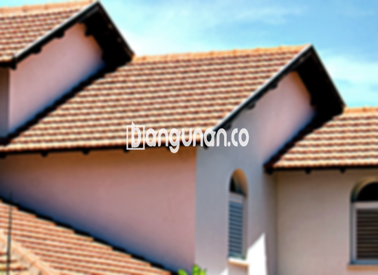

**Jual Genteng Kermaik & Beton di Jati Padang Jakarta** – Membangun atau merenovasi rumah di Jati Padang Jakarta membutuhkan material yang tepat, dan genteng adalah salah satu komponen krusial. Mitra Bangunan hadir sebagai solusi kebutuhan atap Anda dengan menyediakan beragam pilihan genteng berkualitas. Kami memahami pentingnya perlindungan optimal dari cuaca ekstrem, serta tampilan yang estetik untuk hunian Anda. Dengan begitu, Anda bisa menciptakan rumah yang nyaman dan tahan lama.

Banyak sekali pilihan material atap yang tersedia di pasaran, masing-masing dengan keunggulan dan kekurangannya. Memilih genteng yang sesuai dengan kebutuhan dan anggaran Anda membutuhkan pertimbangan matang. Kami hadir untuk membantu Anda menemukan solusi terbaik. 



## Penawaran Harga Genteng dari Toko Jual Genteng Kermaik & Beton di Jati Padang Jakarta

Kami menyediakan berbagai macam pilihan genteng untuk memenuhi kebutuhan Anda. Setiap jenis genteng memiliki karakteristik dan harga yang berbeda. Berikut adalah beberapa referensi harga yang dapat Anda pertimbangkan.

### - Harga Genteng Metal di Toko Genteng Kermaik & Beton di Jati Padang Jakarta

Genteng metal menjadi favorit banyak orang karena tampilannya yang modern dan ringan. Jenis genteng ini sangat cocok untuk hunian minimalis, memberikan kesan elegan dan kontemporer. Anda akan menemukan banyak pilihan desain dan warna yang sesuai dengan gaya arsitektur rumah Anda. 

### - Harga Genteng Aspal di Toko Genteng Kermaik & Beton di Jati Padang Jakarta

Genteng aspal menawarkan keunggulan dalam hal fleksibilitas dan kekuatan. Terbuat dari serat kayu dan aspal berkualitas tinggi, genteng ini tahan terhadap cuaca ekstrem dan memiliki sifat anti-api yang baik. Material dasar ini menjadikannya pilihan yang aman dan tahan lama.

### - Harga Genteng Kermaik & Beton di Jati Padang Jakarta

Genteng keramik adalah pilihan klasik yang populer, dikenal karena keindahan dan daya tahannya. Komposisi warnanya yang unik akan memberikan sentuhan artistik pada hunian Anda. Anda bisa menciptakan tampilan rumah yang khas dan menawan dengan genteng keramik.

### - Harga Genteng Kaca di Toko Genteng Kermaik & Beton di Jati Padang Jakarta

Genteng kaca bukan digunakan sebagai penutup atap utama, melainkan sebagai aksen untuk pencahayaan alami. Penggunaan genteng kaca strategis dapat memberikan kesan mewah dan modern pada rumah Anda. Namun, perlu diingat bahwa pemasangan genteng kaca yang tepat sangat penting untuk menghindari risiko kebocoran dan panas berlebih.

### - Harga Genteng Seng di Toko Genteng Kermaik & Beton di Jati Padang Jakarta

Genteng seng adalah pilihan ekonomis yang sering digunakan untuk bangunan tradisional atau rumah dengan anggaran terbatas. Ukurannya yang panjang membuat pemasangan lebih efisien dan hemat biaya. Untuk memastikan kekuatan dan ketahanannya, penggunaan paku yang tepat sangat disarankan.

### - Harga Genteng Beton di Toko Genteng Kermaik & Beton di Jati Padang Jakarta

Genteng beton menawarkan kombinasi ideal antara kekuatan, daya tahan, dan harga yang terjangkau. Terbuat dari campuran semen, pasir, dan air berkualitas tinggi, genteng beton mampu menahan beban berat dan cuaca ekstrem. Banyak orang memilih genteng beton karena keandalannya.



## Berbagai Pilihan Genteng dari Toko Jual Genteng Kermaik & Beton di Jati Padang Jakarta

Kami menyediakan beragam jenis genteng untuk memenuhi kebutuhan spesifik Anda:

### Genteng Keramik dari Toko Jual Genteng Kermaik & Beton di Jati Padang Jakarta

Genteng keramik adalah pilihan ideal bagi Anda yang menginginkan tampilan atap yang elegan dan tahan lama. Keindahan dan ketahanannya terhadap cuaca ekstrem menjadikan genteng keramik investasi yang tepat untuk hunian Anda.

### Genteng Seng dan Genteng Kermaik & Beton di Jati Padang Jakarta

Genteng seng, dengan ukurannya yang panjang, menawarkan solusi yang ekonomis dan efisien. Pemasangan yang tepat dengan paku yang kuat akan memastikan ketahanannya terhadap angin kencang dan cuaca buruk.

### Genteng Asbes dan Genteng Kermaik & Beton di Jati Padang Jakarta

Genteng asbes, meskipun ringan, memiliki beberapa kekurangan dalam hal daya tahan dan kesehatan. Kami sarankan untuk mempertimbangkan alternatif lain yang lebih ramah lingkungan dan awet.

### Genteng Kanopi Baja Ringan dan Genteng Kermaik & Beton di Jati Padang Jakarta

Genteng kanopi baja ringan menawarkan kombinasi ideal antara kekuatan, ringan, dan estetika. Material ini sangat populer karena mudah dipasang, tahan lama, dan tersedia dalam berbagai desain.

### Genteng Sirap Kayu Ulin dan Genteng Kermaik & Beton di Jati Padang Jakarta

Genteng sirap kayu ulin adalah pilihan yang unik dan alami. Terbuat dari kayu ulin berkualitas tinggi, genteng ini menawarkan tampilan yang khas dan tahan terhadap cuaca ekstrem.

Anda dapat menemukan berbagai jenis Genteng Kermaik & Beton di Jati Padang Jakarta yang sesuai dengan kebutuhan dan preferensi Anda. Kami siap membantu Anda memilih material, jumlah, dan variasi genteng yang tepat untuk hunian Anda di Jati Padang Jakarta. Jangan ragu untuk menghubungi kami melalui tombol WhatsApp atau Telepon di halaman ini untuk mendapatkan penawaran harga terbaik, Mitra Bangunan siap melayani Anda.

**Ref by:**  [Genteng Kermaik & Beton  Jati Padang Jakarta](https://id.wikipedia.org/wiki/Genteng)