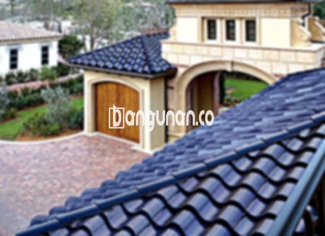

**Jual Genteng Kermaik & Beton di Jati Pulo Jakarta** – Bagi Mitra Bangunan yang mencari material atap berkualitas tinggi di Jati Pulo Jakarta, genteng merupakan elemen penting yang wajib dimiliki setiap pemilik hunian. Genteng tidak hanya berfungsi sebagai pelindung rumah dari berbagai elemen cuaca seperti hujan dan panas, tetapi juga berperan penting dalam meningkatkan keamanan dan kenyamanan tempat tinggal Anda. Investasi pada genteng berkualitas akan memastikan rumah Anda terlindungi dengan baik dan tahan lama.

Memilih genteng yang tepat adalah keputusan penting yang perlu dipertimbangkan dengan cermat. Ada banyak sekali jenis genteng yang tersedia di pasaran, masing-masing dengan kelebihan dan kekurangan tersendiri. Memahami perbedaan antara jenis-jenis genteng ini akan membantu Anda dalam membuat keputusan yang tepat sesuai dengan kebutuhan dan preferensi pribadi. Pertimbangkan aspek seperti daya tahan, estetika, dan biaya saat memilih genteng untuk rumah Anda.



## Informasi Harga Genteng dari Toko Jual Genteng Kermaik & Beton di Jati Pulo Jakarta

Berbagai opsi genteng tersedia untuk memenuhi beragam proyek konstruksi di area Jati Pulo Jakarta. Informasi harga yang jelas akan membantu Anda merencanakan anggaran secara efektif. Berikut adalah gambaran umum harga yang bisa Anda jadikan referensi awal.

### \- Harga Genteng Metal di Toko Genteng Kermaik & Beton di Jati Pulo Jakarta

Genteng metal menjadi pilihan yang semakin populer karena bobotnya yang ringan, kekuatan yang mumpuni, dan tampilannya yang modern. Pilihan ini ideal untuk proyek rumah minimalis, menciptakan kesan bersih dan kontemporer pada desain eksterior. Untuk detail harga terbaru, silakan merujuk pada tabel harga yang tersedia atau hubungi tim layanan pelanggan kami.

### \- Harga Genteng Aspal di Toko Genteng Kermaik & Beton di Jati Pulo Jakarta

Genteng aspal menawarkan keunggulan dalam fleksibilitas dan ketahanan terhadap api, menjadikannya pilihan yang aman dan andal. Terbuat dari kombinasi serat kayu dan aspal, material ini memberikan perlindungan optimal bagi rumah Anda dari berbagai kondisi cuaca. Informasi lebih lanjut mengenai harga dapat Anda peroleh melalui tabel harga atau dengan menghubungi tim dukungan kami.

### \- Harga Genteng Keramik & Beton di Jati Pulo Jakarta

Genteng keramik dan beton dikenal karena daya tahannya yang luar biasa dan ketersediaan berbagai pilihan warna yang menarik. Dengan desain yang unik dan beragam, genteng ini dapat meningkatkan estetika rumah Anda secara signifikan. Detail harga untuk kedua jenis genteng ini dapat Anda temukan pada tabel harga atau dengan menghubungi tim kami untuk konsultasi.

### \- Harga Genteng Kaca di Toko Genteng Kermaik & Beton di Jati Pulo Jakarta

Genteng kaca sering digunakan sebagai elemen dekoratif untuk menciptakan efek pencahayaan alami di dalam ruangan. Penggunaannya biasanya sebagai aksen pada area tertentu, bukan sebagai penutup atap utama, karena dapat menyerap panas. Untuk detail harga yang akurat, silakan lihat tabel harga yang kami sediakan atau hubungi tim kami.

### \- Harga Genteng Seng di Toko Genteng Kermaik & Beton di Jati Pulo Jakarta

Genteng seng merupakan opsi yang ekonomis dan sering digunakan pada bangunan-bangunan tradisional. Ukurannya yang panjang mengurangi jumlah sambungan dan mempermudah proses pemasangan. Untuk memastikan ketahanan, gunakan paku berkualitas tinggi saat pemasangan. Informasi harga lebih lanjut tersedia pada tabel harga atau melalui kontak kami.

### \- Harga Genteng Beton di Toko Genteng Kermaik & Beton di Jati Pulo Jakarta

Genteng beton merupakan pilihan yang kokoh dan tahan lama, dibuat dari campuran semen, pasir, dan air berkualitas tinggi. Ketahanannya menjadikannya investasi jangka panjang yang menguntungkan bagi rumah Anda di Jati Pulo Jakarta. Informasi harga lengkap tentang genteng beton dapat Anda temukan pada tabel harga yang tersedia atau dengan menghubungi tim layanan pelanggan kami.



## Berbagai Pilihan Jenis Genteng dari Toko Jual Genteng Kermaik & Beton di Jati Pulo Jakarta

Kami menyediakan beragam pilihan material genteng untuk memenuhi kebutuhan konstruksi dan preferensi desain bangunan Anda di Jati Pulo Jakarta. Berikut adalah beberapa jenis genteng yang tersedia:

### Genteng Keramik dari Toko Jual Genteng Kermaik & Beton di Jati Pulo Jakarta

Bagi Anda yang mencari material atap yang elegan dan tahan lama, genteng keramik menjadi pilihan yang sangat tepat. Genteng ini menawarkan keindahan alami dan dapat meningkatkan nilai estetika rumah Anda. Dengan perawatan yang tepat, genteng keramik dapat bertahan selama bertahun-tahun.

### Genteng Seng dan Genteng Kermaik & Beton di Jati Pulo Jakarta

Genteng seng adalah solusi yang ekonomis dan praktis untuk proyek-proyek konstruksi dengan anggaran terbatas. Ukurannya yang panjang memudahkan proses pemasangan dan mengurangi pemborosan material. Pastikan untuk menggunakan paku yang kuat dan tahan karat untuk meningkatkan ketahanan genteng seng.

### Genteng Asbes dan Genteng Kermaik & Beton di Jati Pulo Jakarta

Meskipun dulu sering digunakan, genteng asbes kurang direkomendasikan karena potensi bahaya kesehatan dan masalah lingkungan. Pertimbangkan alternatif yang lebih aman dan ramah lingkungan untuk investasi jangka panjang yang lebih baik bagi keluarga Anda.

### Genteng Kanopi Baja Ringan dan Genteng Kermaik & Beton di Jati Pulo Jakarta

Genteng kanopi baja ringan menawarkan kombinasi unik antara kekuatan, ringan, dan fleksibilitas. Material ini tahan terhadap berbagai kondisi cuaca dan memberikan tampilan modern pada rumah Anda. Ideal untuk proyek renovasi atau pembangunan baru.

### Genteng Sirap Kayu Ulin dan Genteng Kermaik & Beton di Jati Pulo Jakarta

Genteng sirap kayu ulin memberikan tampilan alami dan mewah pada rumah Anda. Terbuat dari kayu ulin berkualitas tinggi yang tahan terhadap cuaca ekstrem, material ini memberikan kesan hangat dan nyaman. Anda dapat menemukan berbagai pilihan desain dan ukuran untuk disesuaikan dengan gaya arsitektur rumah Anda.

Mitra Bangunan yang sedang mencari solusi atap terbaik di Jati Pulo Jakarta, jangan ragu untuk menghubungi kami. Kami siap memberikan konsultasi gratis dan membantu Anda memilih genteng yang tepat sesuai dengan anggaran dan kebutuhan Anda. Hubungi melalui tombol WhatsApp atau Telepon di halaman ini untuk mendapatkan penawaran terbaik.

**Ref by:**  [Genteng Kermaik & Beton  Jati Pulo Jakarta](https://id.wikipedia.org/wiki/Genteng)