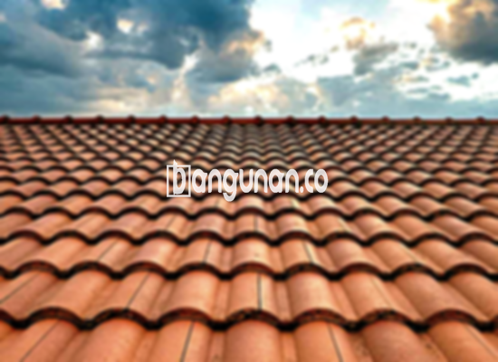

**Jual Genteng Kermaik & Beton di Jatijajar Depok** – Genteng merupakan material hunian yang sangat penting yang sebaiknya dimiliki setiap pemilik rumah. Dengan genteng yang tepat, rumah Anda terlindungi dari berbagai kondisi cuaca seperti hujan deras dan sengatan matahari yang terik. Selain itu, genteng juga berkontribusi pada keamanan dan kenyamanan tempat tinggal Anda. Bagi Mitra Bangunan di Jatijajar Depok yang sedang mencari solusi atap terbaik, kami hadir dengan beragam pilihan genteng berkualitas tinggi.

Memilih genteng yang ideal untuk rumah memerlukan pertimbangan matang. Terdapat beragam jenis genteng di pasaran, masing-masing menawarkan keunggulan dan kekurangan yang berbeda. Preferensi pribadi juga menjadi faktor penting dalam pemilihan ini. Sebagaimana Anda ketahui, atap adalah bagian rumah yang bertahan lama, sehingga memilih genteng berkualitas adalah investasi yang bijaksana.



## Informasi Harga Genteng dari Toko Jual Genteng Kermaik & Beton di Jatijajar Depok

Kami menyediakan berbagai macam pilihan genteng yang bisa Anda sesuaikan dengan kebutuhan dan anggaran proyek Anda. Berikut adalah gambaran harga beberapa jenis genteng yang tersedia di Jatijajar Depok. Harga dapat bervariasi, jadi jangan ragu untuk menghubungi kami untuk mendapatkan penawaran terkini.

### \- Harga Genteng Metal di Toko Genteng Kermaik & Beton di Jatijajar Depok

Genteng metal adalah salah satu pilihan yang sangat populer karena tampilannya yang modern dan ringan. Material ini sangat cocok untuk rumah bergaya minimalis, memberikan kesan elegan dan kontemporer. Untuk mendapatkan informasi detail harga genteng metal, silakan merujuk ke tabel harga di bawah ini, atau langsung menghubungi tim kami yang siap membantu.

### \- Harga Genteng Aspal di Toko Genteng Kermaik & Beton di Jatijajar Depok

Genteng aspal menawarkan kombinasi keindahan dan ketahanan yang menarik. Terbuat dari serat kayu dan aspal berkualitas tinggi, material ini efektif melindungi rumah dari cuaca buruk dan bahkan memiliki sifat tahan api. Untuk informasi harga genteng aspal terkini, Anda dapat melihat tabel harga yang tersedia, atau menghubungi kami.

### \- Harga Genteng Keramik & Beton di Jatijajar Depok

Genteng keramik merupakan pilihan klasik yang masih banyak diminati hingga saat ini. Keunggulan utama genteng keramik terletak pada variasi warna dan desainnya yang unik, yang memungkinkan Anda menciptakan atap dengan tampilan yang personal dan menarik. Untuk mengetahui harga genteng keramik yang tersedia, silakan periksa tabel harga di bawah.

### \- Harga Genteng Kaca di Toko Genteng Kermaik & Beton di Jatijajar Depok

Genteng kaca seringkali digunakan sebagai aksen dekoratif untuk memberikan pencahayaan alami pada ruangan. Namun, perlu diperhatikan bahwa penggunaan genteng kaca secara berlebihan dapat menyebabkan suhu ruangan menjadi lebih panas. Detail harga genteng kaca dapat Anda temukan pada tabel harga.

### \- Harga Genteng Seng di Toko Genteng Kermaik & Beton di Jatijajar Depok

Genteng seng merupakan pilihan ekonomis yang sering ditemukan pada bangunan-bangunan lama. Ukurannya yang panjang membuat pemasangan lebih efisien dan hemat biaya. Jika Anda tertarik dengan genteng seng, silakan menghubungi kami untuk mendapatkan informasi harga yang akurat.

### \- Harga Genteng Beton di Toko Genteng Kermaik & Beton di Jatijajar Depok

Genteng beton merupakan pilihan yang kuat dan tahan lama karena terbuat dari bahan dasar beton berkualitas tinggi, yaitu campuran semen, pasir, dan air. Banyak orang memilih genteng beton karena kekuatannya dan keawetannya. Silakan lihat tabel harga untuk detail lebih lanjut tentang harga genteng beton.



## Berbagai Jenis Genteng dari Toko Jual Genteng Kermaik & Beton di Jatijajar Depok

Tersedia berbagai jenis genteng yang bisa Anda pilih untuk membangun atau merenovasi atap rumah Anda. Berikut adalah beberapa pilihan yang bisa Anda pertimbangkan:

### Genteng Keramik dari Toko Jual Genteng Kermaik & Beton di Jatijajar Depok

Jika Anda sedang mencari genteng untuk rumah Anda, genteng keramik bisa menjadi pilihan yang sangat tepat. Jenis genteng ini memiliki daya tarik tersendiri karena kemampuannya meningkatkan estetika rumah. Dengan genteng keramik, rumah Anda akan lebih terlindungi dari panas matahari dan cuaca ekstrem lainnya.

### Genteng Seng dan Genteng Kermaik & Beton di Jatijajar Depok

Genteng seng adalah salah satu jenis genteng yang sering digunakan pada bangunan-bangunan tradisional. Ukurannya yang panjang menjadikannya pilihan yang hemat biaya. Untuk memastikan pemasangan yang kuat dan tahan lama, kami merekomendasikan penggunaan paku tambahan.

### Genteng Asbes dan Genteng Kermaik & Beton di Jatijajar Depok

Meskipun dahulu banyak digunakan, genteng asbes kini kurang direkomendasikan karena sifatnya yang rentan terhadap kerusakan. Penggantian genteng asbes yang rusak menjadi hal yang lumrah.

### Genteng Kanopi Baja Ringan dan Genteng Kermaik & Beton di Jatijajar Depok

Genteng kanopi baja ringan adalah pilihan modern yang menawarkan kombinasi antara kekuatan, ringan, dan desain yang menarik. Material ini cocok untuk berbagai jenis atap dan memberikan tampilan yang unik.

### Genteng Sirap Kayu Ulin dan Genteng Kermaik & Beton di Jatijajar Depok

Genteng sirap kayu ulin terbuat dari kayu ulin berkualitas tinggi, menawarkan keindahan alami dan harga yang relatif terjangkau. Penggunaan genteng ini dapat menciptakan suasana nyaman dan asri di rumah Anda.

Anda dapat menemukan berbagai jenis Genteng Kermaik & Beton di Jatijajar Depok yang sesuai dengan kebutuhan dan anggaran Anda. Pastikan Anda menentukan jumlah, material, dan jenis genteng yang dibutuhkan sebelum menghubungi kami. Dapatkan penawaran harga terbaik sekarang juga, Mitra Bangunan! Kami siap membantu Anda menciptakan atap rumah impian Anda.

**Ref by:**  [Genteng Kermaik & Beton  Jatijajar Depok](https://id.wikipedia.org/wiki/Genteng)