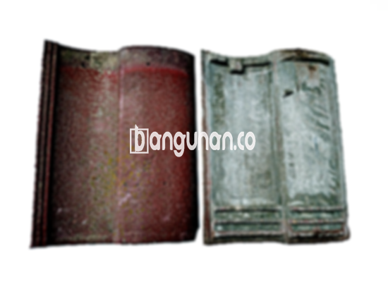

**Jual Genteng Kermaik & Beton di Jatimulya Depok** – Hunian yang nyaman dan terlindungi adalah impian setiap keluarga. Genteng berperan penting dalam mewujudkan impian tersebut, memberikan perlindungan optimal dari berbagai kondisi cuaca. Sebagai Mitra Bangunan yang bijak, Anda tentu menginginkan material atap yang berkualitas dan tahan lama. Kami hadir sebagai solusi terpercaya untuk kebutuhan genteng Anda di Jatimulya Depok.

Memilih genteng yang tepat adalah investasi jangka panjang untuk kenyamanan dan keamanan rumah Anda. Ada beragam jenis genteng yang tersedia di pasaran, masing-masing dengan keunggulan dan kekurangannya sendiri. Pilihan bergantung pada preferensi estetika, anggaran, dan kebutuhan fungsional Anda. Penting untuk mempertimbangkan kualitas material agar atap rumah Anda awet dan melindungi keluarga Anda dari berbagai elemen.



## Informasi Harga Genteng dari Penyedia Jual Genteng Kermaik & Beton di Jatimulya Depok

Beragamnya jenis genteng tentu disertai dengan variasi harga. Berikut adalah referensi harga yang dapat Anda pertimbangkan saat memilih genteng untuk proyek Anda di Jatimulya Depok. Kami menyediakan informasi harga terkini dan transparan untuk membantu Anda membuat keputusan yang tepat.

### \- Harga Genteng Metal di Toko Genteng Kermaik & Beton di Jatimulya Depok

Genteng metal merupakan pilihan populer karena ringan, kuat, dan tahan lama. Sering digunakan pada desain rumah minimalis, genteng metal memberikan tampilan modern dan elegan. Kekuatan dan ketahanannya menjadikannya solusi ideal untuk melindungi hunian Anda.

### \- Harga Genteng Aspal di Toko Genteng Kermaik & Beton di Jatimulya Depok

Genteng aspal menawarkan keindahan alami dengan tekstur dan warna yang menarik. Terbuat dari serat kayu dan aspal berkualitas tinggi, genteng ini tahan terhadap api dan memberikan insulasi termal yang baik. Permukaannya yang fleksibel juga membuatnya tahan terhadap benturan.

### \- Harga Genteng Keramik & Beton di Jatimulya Depok

Genteng keramik dan beton adalah pilihan klasik yang sudah teruji kekuatannya. Dengan berbagai pilihan warna dan desain, Anda dapat menciptakan tampilan atap yang unik dan sesuai dengan gaya arsitektur rumah Anda. Kedua jenis genteng ini juga dikenal tahan lama dan minim perawatan.

### \- Harga Genteng Kaca di Toko Genteng Kermaik & Beton di Jatimulya Depok

Genteng kaca sering digunakan sebagai aksen untuk memberikan pencahayaan alami pada ruangan di bawahnya. Meskipun tidak digunakan secara keseluruhan sebagai atap, genteng kaca dapat menambahkan sentuhan estetika yang menarik pada desain rumah Anda.

### \- Harga Genteng Seng di Toko Genteng Kermaik & Beton di Jatimulya Depok

Genteng seng merupakan pilihan ekonomis dan ringan. Sering digunakan pada bangunan tradisional, genteng seng mudah dipasang dan tahan terhadap korosi. Namun, perlu diingat bahwa genteng seng mungkin memerlukan perawatan ekstra untuk mencegah kebocoran.

### \- Harga Genteng Beton di Toko Genteng Kermaik & Beton di Jatimulya Depok

Genteng beton merupakan pilihan yang kokoh dan tahan lama. Terbuat dari campuran semen, pasir, dan air berkualitas tinggi, genteng ini tahan terhadap cuaca ekstrem dan memberikan perlindungan optimal untuk rumah Anda. Ketahanannya terhadap api juga menjadi keunggulan tersendiri.



## Ragam Jenis Genteng yang Tersedia di Toko Jual Genteng Kermaik & Beton di Jatimulya Depok

Kami menyediakan berbagai jenis genteng untuk memenuhi kebutuhan dan preferensi Anda. Berikut adalah beberapa pilihan yang tersedia:

### Genteng Keramik dari Toko Jual Genteng Kermaik & Beton di Jatimulya Depok

Genteng keramik menawarkan keindahan klasik dengan berbagai pilihan warna dan desain. Material ini tahan lama dan memberikan insulasi termal yang baik, menjaga rumah Anda tetap nyaman sepanjang tahun.

### Genteng Seng dan Genteng Kermaik & Beton di Jatimulya Depok

Genteng seng adalah pilihan ekonomis yang ringan dan mudah dipasang. Cocok untuk bangunan tradisional, genteng seng memberikan tampilan yang khas dan tahan lama.

### Genteng Asbes dan Genteng Kermaik & Beton di Jatimulya Depok

Meskipun dulunya populer, penggunaan genteng asbes kini semakin berkurang karena pertimbangan kesehatan dan lingkungan. Saat ini ada alternatif yang lebih aman dan ramah lingkungan yang dapat Anda pertimbangkan.

### Genteng Kanopi Baja Ringan dan Genteng Kermaik & Beton di Jatimulya Depok

Genteng kanopi baja ringan menawarkan kombinasi kekuatan, ringan, dan estetika modern. Material ini tahan terhadap karat dan memberikan perlindungan optimal terhadap cuaca ekstrem.

### Genteng Sirap Kayu Ulin dan Genteng Kermaik & Beton di Jatimulya Depok

Genteng sirap kayu ulin memberikan tampilan alami dan tradisional. Terbuat dari kayu ulin yang berkualitas tinggi, genteng ini tahan lama dan memberikan nilai estetika yang unik.

Anda dapat menemukan berbagai pilihan Genteng Kermaik & Beton di Jatimulya Depok yang sesuai dengan kebutuhan dan budget Anda. Kami akan membantu Anda memilih material yang tepat dan memberikan penawaran harga terbaik. Jangan ragu untuk menghubungi kami untuk konsultasi gratis dan penawaran khusus.

**Ref by:**  [Genteng Kermaik & Beton  Jatimulya Depok](https://id.wikipedia.org/wiki/Genteng)

Sebagai Mitra Bangunan yang cerdas, jangan tunda lagi untuk memperbarui atap rumah Anda dengan genteng berkualitas. Hubungi kami sekarang juga melalui tombol WhatsApp atau Telepon di halaman ini untuk mendapatkan informasi lebih lanjut dan penawaran harga terbaik di Jatimulya Depok. Kami siap membantu Anda mewujudkan hunian impian yang nyaman dan terlindungi.