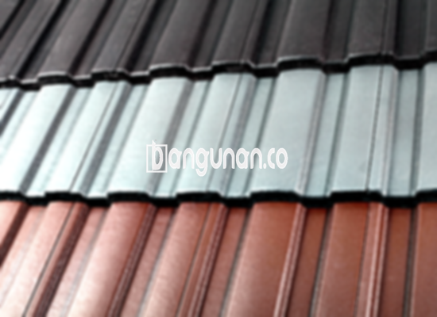

**Jual Genteng Kermaik & Beton di Jatisampurna Bekasi** – Genteng merupakan salah satu elemen esensial dalam konstruksi sebuah hunian yang sebaiknya menjadi perhatian utama setiap pemilik rumah. Perannya tidak hanya sekadar melindungi dari hujan dan sengatan matahari, melainkan juga turut menentukan kenyamanan dan keamanan tempat tinggal Anda. Sebuah rumah tanpa perlindungan genteng yang memadai tentu akan terasa tidak nyaman dan rentan terhadap kerusakan. Oleh karena itu, Mitra Bangunan di Jatisampurna Bekasi hadir untuk menyediakan solusi atap rumah yang berkualitas dan beragam pilihan genteng yang sesuai dengan kebutuhan Anda.

Mempertimbangkan jenis genteng yang tepat adalah sebuah investasi penting bagi rumah Anda. Banyak sekali pilihan genteng yang tersedia di pasaran saat ini, masing-masing menawarkan karakteristik serta keunggulan berbeda. Penting bagi Anda untuk menyesuaikan gaya arsitektur rumah, anggaran yang tersedia, serta kondisi iklim setempat saat menentukan jenis genteng yang paling ideal. Dengan memilih genteng berkualitas, Anda akan mendapatkan perlindungan optimal sekaligus meningkatkan nilai estetika rumah Anda.



## Informasi Harga Genteng dari Toko Jual Genteng Kermaik & Beton di Jatisampurna Bekasi

Bagi Anda yang berencana membangun atau merenovasi atap rumah di wilayah Jatisampurna Bekasi, memiliki informasi perkiraan harga genteng tentu akan sangat membantu dalam perencanaan anggaran. Kami menyediakan berbagai pilihan genteng dengan harga yang kompetitif dan transparan. Berikut ini adalah panduan harga beberapa jenis genteng yang paling banyak dicari:

### \- Harga Genteng Metal di Toko Genteng Kermaik & Beton di Jatisampurna Bekasi

Genteng metal menjadi salah satu pilihan terpopuler karena bobotnya yang ringan, kekuatan material, dan ketahanannya yang baik terhadap berbagai kondisi cuaca. Jenis genteng ini sangat cocok untuk diterapkan pada rumah bergaya minimalis maupun modern, karena mampu memberikan tampilan yang bersih dan elegan. Untuk detail lebih lengkap mengenai harga genteng metal, silakan merujuk pada tabel harga di bawah ini atau hubungi tim penjualan kami.

### \- Harga Genteng Aspal di Toko Genteng Kermaik & Beton di Jatisampurna Bekasi

Genteng aspal menawarkan daya tarik visual yang unik dan menyerupai material alami. Terbuat dari kombinasi serat kayu dan aspal berkualitas tinggi, jenis genteng ini memiliki ketahanan yang baik terhadap perubahan cuaca ekstrem. Selain itu, genteng aspal dikenal memiliki sifat yang tidak mudah terbakar, sehingga memberikan perlindungan tambahan bagi rumah Anda. Kami menyediakan berbagai pilihan warna dan desain genteng aspal untuk memenuhi selera Anda.

### \- Harga Genteng Kermaik & Beton di Jatisampurna Bekasi

Genteng keramik dan beton merupakan pilihan klasik yang masih banyak diminati hingga saat ini. Kedua jenis genteng ini dikenal karena memiliki kekuatan yang tinggi, tahan lama, serta tersedia dalam berbagai pilihan warna dan bentuk. Genteng keramik dan beton dapat diaplikasikan pada berbagai gaya arsitektur rumah, mulai dari rumah tradisional hingga rumah modern.

### \- Harga Genteng Kaca di Toko Genteng Kermaik & Beton di Jatisampurna Bekasi

Genteng kaca umumnya dimanfaatkan sebagai elemen dekoratif untuk memberikan pencahayaan alami pada ruangan. Penggunaan genteng kaca biasanya tidak menutupi seluruh area atap, melainkan berfungsi sebagai aksen estetika yang menarik. Penerapan genteng kaca dapat menciptakan suasana yang lebih cerah dan terbuka di dalam rumah Anda.

### \- Harga Genteng Seng di Toko Genteng Kermaik & Beton di Jatisampurna Bekasi

Genteng seng adalah salah satu opsi yang ekonomis, seringkali digunakan pada bangunan-bangunan yang mengutamakan efisiensi biaya. Walaupun ringan dan terjangkau, genteng seng memerlukan perawatan berkala untuk mencegah korosi. Kami menyediakan genteng seng dalam berbagai ukuran dan ketebalan yang sesuai dengan kebutuhan proyek Anda.

### \- Harga Genteng Beton di Toko Genteng Kermaik & Beton di Jatisampurna Bekasi

Genteng beton adalah pilihan yang sangat direkomendasikan karena konstruksinya yang kokoh, tahan lama, dan mampu menahan berbagai kondisi cuaca ekstrim. Terbuat dari campuran semen, pasir, dan air berkualitas tinggi, genteng beton memberikan perlindungan optimal bagi hunian Anda. Kami menyediakan berbagai ukuran dan bentuk genteng beton untuk memenuhi kebutuhan proyek Anda di Jatisampurna Bekasi.



## Beragam Jenis Genteng yang Tersedia di Toko Jual Genteng Kermaik & Beton di Jatisampurna Bekasi

Kami menyediakan berbagai macam pilihan genteng untuk memenuhi kebutuhan dan preferensi Anda dalam membangun atau merenovasi atap rumah. Berikut adalah beberapa jenis genteng yang tersedia di toko kami:

### Genteng Keramik dari Toko Jual Genteng Kermaik & Beton di Jatisampurna Bekasi

Bagi Anda yang sedang mencari genteng dengan tampilan klasik dan elegan, genteng keramik adalah pilihan yang sangat tepat. Jenis genteng ini memiliki ketahanan yang baik terhadap cuaca dan mampu memberikan isolasi termal yang efektif bagi rumah Anda. Dengan beragam pilihan warna dan desain, Anda pasti akan menemukan genteng keramik yang sesuai dengan gaya arsitektur rumah Anda di Jatisampurna Bekasi.

### Genteng Seng dan Genteng Kermaik & Beton di Jatisampurna Bekasi

Genteng seng adalah pilihan ekonomis yang cocok untuk proyek pembangunan dengan anggaran terbatas. Meski ringan dan terjangkau, perlu diingat bahwa genteng seng memerlukan perawatan yang lebih intensif untuk mencegah terjadinya korosi. Kami menyediakan berbagai ukuran dan ketebalan genteng seng untuk mengakomodasi kebutuhan spesifik proyek Anda.

### Genteng Asbes dan Genteng Kermaik & Beton di Jatisampurna Bekasi

Genteng asbes telah lama dikenal sebagai material atap yang umum digunakan. Namun, perlu diperhatikan bahwa genteng asbes mengandung unsur-unsur berbahaya bagi kesehatan. Oleh karena itu, kami merekomendasikan Anda untuk mempertimbangkan pilihan jenis genteng lain yang lebih aman dan ramah lingkungan untuk hunian Anda.

### Genteng Kanopi Baja Ringan dan Genteng Kermaik & Beton di Jatisampurna Bekasi

Genteng kanopi baja ringan adalah solusi modern yang semakin populer. Jenis genteng ini dikenal ringan, kuat, dan tahan lama. Dengan desain yang elegan dan modern, genteng kanopi baja ringan dapat meningkatkan tampilan visual rumah Anda secara signifikan.

### Genteng Sirap Kayu Ulin dan Genteng Kermaik & Beton di Jatisampurna Bekasi

Genteng sirap kayu ulin menawarkan keindahan alami dan keunikan tersendiri. Terbuat dari kayu ulin berkualitas tinggi, jenis genteng ini tahan terhadap cuaca dan serangan hama. Genteng sirap kayu ulin dapat menciptakan suasana yang hangat dan nyaman di dalam rumah Anda.

Anda dapat menemukan jenis Genteng Kermaik & Beton di Jatisampurna Bekasi yang paling sesuai dengan kebutuhan dan anggaran Anda. Jangan ragu untuk menghubungi kami dan berkonsultasi dengan tim ahli kami. Kami siap membantu Anda dalam memilih genteng yang tepat untuk hunian Anda. Mitra Bangunan siap melayani dan memberikan penawaran harga terbaik untuk Anda.

**Ref by:**  [Genteng Kermaik & Beton  Jatisampurna Bekasi](https://id.wikipedia.org/wiki/Genteng)