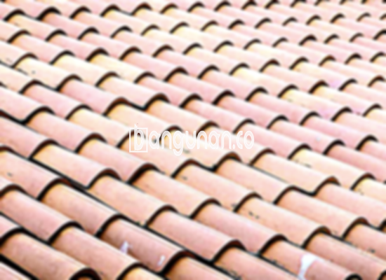

**Jual Genteng Kermaik & Beton di Jatisari Karawang** – Genteng merupakan material konstruksi penting yang sebaiknya dimiliki setiap pemilik rumah. Sebagai Mitra Bangunan yang cerdas, Anda tentu mengutamakan perlindungan hunian dari berbagai kondisi cuaca seperti hujan deras dan terik matahari. Investasi pada genteng berkualitas adalah langkah bijak untuk memastikan keamanan dan kenyamanan tempat tinggal Anda. Hunian tanpa genteng yang memadai akan terasa kurang nyaman dan rentan terhadap kerusakan.

Memastikan kualitas atap rumah Anda dengan memilih genteng yang tepat adalah hal yang krusial. Tersedia beragam jenis genteng dengan karakteristik unik dan harga berbeda-beda, sehingga Anda dapat menyesuaikan pilihan dengan anggaran dan gaya arsitektur rumah Anda. Banyak pemilik rumah di Jatisari Karawang yang mengedepankan mutu karena mereka memahami bahwa hunian adalah aset jangka panjang.



## Informasi Harga Genteng dari Toko Jual Genteng Kermaik & Beton di Jatisari Karawang

Kami menyediakan berbagai opsi genteng untuk memenuhi kebutuhan konstruksi Anda. Setiap jenis menawarkan keunggulan spesifik, dan harga bervariasi sesuai kualitas dan material. Berikut adalah panduan harga yang dapat Anda pertimbangkan saat memilih genteng untuk proyek Anda.

### - Harga Genteng Metal di Toko Genteng Kermaik & Beton di Jatisari Karawang

Genteng metal sering kali menjadi pilihan utama bagi mereka yang mencari tampilan modern dan minimalis. Desainnya yang ramping dan elegan memberikan sentuhan kontemporer pada rumah Anda. Saat ini, harga genteng metal berkisar sekitar Rp. 26.000 per lembar.

### - Harga Genteng Aspal di Toko Genteng Kermaik & Beton di Jatisari Karawang

Genteng aspal, yang terbuat dari serat kayu dan aspal, menawarkan keseimbangan antara daya tahan dan estetika. Material ini dikenal memiliki ketahanan terhadap api, sebuah keunggulan penting untuk keamanan hunian Anda. Harga genteng aspal saat ini adalah Rp.125.000 per meter.

### - Harga Genteng Kermaik & Beton di Jatisari Karawang

Genteng keramik merupakan pilihan populer yang telah digunakan selama bertahun-tahun karena keindahan dan ketahanannya. Variasi warna dan desainnya yang kaya memungkinkan Anda menciptakan tampilan atap yang unik dan personal. Harga genteng keramik terbaru adalah Rp. 9.800 per biji.

### - Harga Genteng Kaca di Toko Genteng Kermaik & Beton di Jatisari Karawang

Genteng kaca sering digunakan sebagai elemen dekoratif untuk menciptakan pencahayaan alami di dalam ruangan. Namun, perlu diperhatikan bahwa penggunaan genteng kaca secara berlebihan dapat meningkatkan suhu di dalam rumah. Harga genteng kaca saat ini adalah Rp. 8.800 per pcs.

### - Harga Genteng Seng di Toko Genteng Kermaik & Beton di Jatisari Karawang

Genteng seng adalah pilihan ekonomis yang sering ditemukan pada bangunan-bangunan tradisional. Ukurannya yang panjang membuat pemasangan lebih efisien dan hemat biaya. Pastikan menggunakan paku yang kuat untuk memastikan genteng terpasang dengan aman. Harga genteng seng terbaru adalah Rp. 39.000 per buah.

### - Harga Genteng Beton di Toko Genteng Kermaik & Beton di Jatisari Karawang

Genteng beton terbuat dari campuran semen, pasir, dan air, sehingga sangat kuat dan tahan lama. Material ini merupakan pilihan yang andal untuk melindungi rumah Anda dari berbagai kondisi cuaca. Harga genteng beton saat ini adalah Rp. 5.800 per buah.



## Beberapa Jenis Genteng dari Toko Jual Genteng Kermaik & Beton di Jatisari Karawang

Berikut adalah beberapa opsi genteng yang dapat Anda pilih untuk membangun atau merenovasi atap rumah Anda di Jatisari Karawang:

### Genteng Keramik dari Toko Jual Genteng Kermaik & Beton di Jatisari Karawang

Genteng keramik adalah pilihan tepat bagi Anda yang menginginkan atap yang indah dan tahan lama. Variasi warna dan teksturnya yang unik dapat memberikan karakter pada rumah Anda. Selain itu, genteng keramik dapat membantu menjaga suhu ruangan tetap sejuk.

### Genteng Seng dan Genteng Kermaik & Beton di Jatisari Karawang

Genteng seng adalah solusi ekonomis yang populer, terutama untuk bangunan dengan anggaran terbatas. Ukurannya yang panjang mempermudah pemasangan, sehingga menghemat waktu dan biaya tenaga kerja. Untuk memastikan pemasangan yang kuat, gunakan paku berkualitas tinggi.

### Genteng Asbes dan Genteng Kermaik & Beton di Jatisari Karawang

Genteng asbes dulunya banyak digunakan, tetapi saat ini kurang direkomendasikan karena materialnya mudah rusak dan rapuh. Kerusakan pada genteng asbes dapat menyebabkan kebocoran dan memerlukan penggantian secara berkala.

### Genteng Kanopi Baja Ringan dan Genteng Kermaik & Beton di Jatisari Karawang

Genteng kanopi baja ringan menawarkan kombinasi kekuatan, ringan, dan desain yang modern. Material ini tahan terhadap karat dan mudah dipasang, sehingga menjadi pilihan populer untuk berbagai jenis bangunan.

### Genteng Sirap Kayu Ulin dan Genteng Kermaik & Beton di Jatisari Karawang

Genteng sirap kayu ulin memberikan tampilan alami dan tradisional pada rumah Anda. Kayu ulin memiliki daya tahan yang tinggi terhadap cuaca ekstrem, sehingga ideal untuk iklim tropis seperti di Indonesia.

Sebagai Mitra Bangunan yang terpercaya di Jatisari Karawang, kami siap membantu Anda memilih genteng yang paling sesuai dengan kebutuhan dan anggaran Anda. Jangan ragu untuk menghubungi kami melalui tombol WhatsApp atau Telepon di halaman ini untuk mendapatkan penawaran harga terbaik dan konsultasi gratis. Kami berkomitmen untuk memberikan pelayanan terbaik demi kepuasan Anda.

**Ref by:**  [Genteng Kermaik & Beton  Jatisari Karawang](https://id.wikipedia.org/wiki/Genteng)